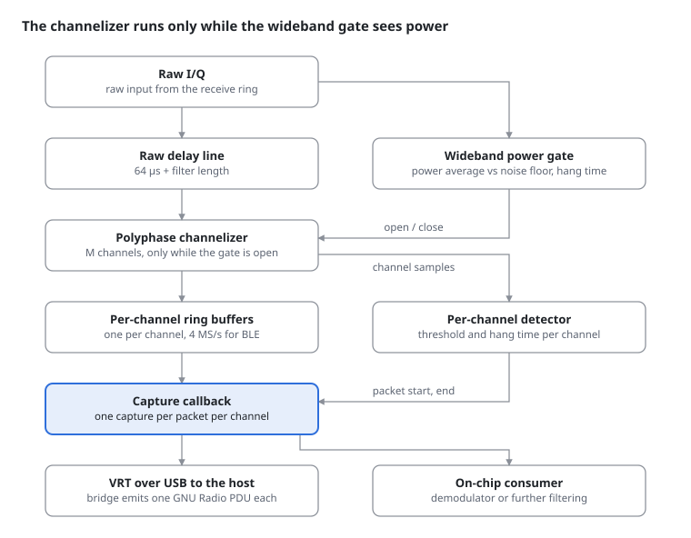

# Channelized burst capture

Design note, 2026-10-15; implemented on the ESP32-S3 on 2026-10-16 as `esp_sdr_chancap.h`
(`CONFIG_ESP_SDR_CHANCAP`) and `apps/chancap`: see [Implementation](#implementation) at the end.

## Goal and scope

A reusable receive tool that watches a grid of equally spaced channels and hands over one I/Q
capture per packet per channel, with a timestamp and metadata. The consumer decides what happens
next: send it to the host as a GNU Radio PDU, or demodulate it on the chip.

- **In scope:** any uniform channel grid inside the captured bandwidth, given by first channel
  frequency, spacing and count. Examples are BLE (2 MHz spacing) and IEEE 802.15.4 (5 MHz
  spacing) in promiscuous mode.
- **Out of scope:** demodulation itself, mixed grids in one instance, and transmit.
- **Not a goal:** a continuous spectrum view. Frame-based FFTs already cover that better.

## Pipeline

Two power detectors gate the work. A cheap wideband detector decides when the channelizer runs,
and a per-channel detector decides which samples become a capture.



1. **Wideband gate.** A running average of the raw signal power is compared against a tracked
   noise floor. The gate opens on a rise and closes after the hang time.
2. **Delay line.** The channelizer reads the raw stream a fixed 64 µs (plus its filter length)
   behind the gate. When the gate opens, the channelizer starts on samples from before the burst,
   so nothing has to be caught up and the preamble is kept.
3. **Channelizer.** A polyphase filter bank splits the band into M channels at the per-channel
   rate.
4. **Per-channel detection.** Each channel has its own noise floor, threshold and hang time. A
   packet's capture runs from a bit before its trigger to the end of its hang time, taken from
   that channel's ring buffer.
5. **Callback.** One capture per packet goes to the consumer, which sends it to the host or
   processes it on the chip.

Gating lowers the average load, not the peak: while the gate is open, the channelizer must keep
up with the full input rate. At 2.4 GHz, Wi-Fi will hold the gate open much of the time.

Either gate can be switched off at runtime, which turns the pipeline into a continuous
channelizer, a continuous per-packet sniffer or anything between; see
[Runtime gating](#runtime-gating) below.

## Configuration and C API

One config struct describes the channel grid and the detector. Each finished packet reaches a
callback as one capture, which the consumer releases when done. The names follow the existing
`esp_sdr_ring` style (callbacks take `void *user` first, `_stop()` returns nothing). This is
the API as built (`include/esp_sdr/esp_sdr_chancap.h`); the per-channel rate is given directly
instead of an oversampling factor, since the decimator bank's rate is not a multiple of the
spacing.

```c
struct esp_sdr_chancap_cfg {
    uint32_t first_freq_hz;    /* centre of channel 0 */
    uint32_t spacing_hz;       /* 2 MHz BLE, 5 MHz 802.15.4 */
    uint16_t n_channels;
    uint32_t channel_rate_hz;  /* the spacing or twice it (filter bank), 16 MHz / n (decimators) */
    bool     wb_gate;          /* wideband gate on at start; see Runtime gating */
    bool     ch_gate;          /* per-channel gate on at start */
    int16_t  wb_threshold_db;  /* wideband gate, above the tracked noise floor */
    int16_t  ch_threshold_db;  /* per channel, above that channel's noise floor */
    uint32_t lookback_us;      /* delay line in front of the channelizer, e.g. 64 */
    uint32_t hang_us;          /* hold after power drops, e.g. 250 */
    uint32_t max_capture_us;   /* cap per capture; chunk length when ch_gate is off */
    esp_sdr_chancap_cb_t cb;
    void *user;
};

struct esp_sdr_chancap {
    uint16_t channel;          /* freq = first_freq_hz + channel * spacing_hz */
    uint64_t index;            /* raw input sample index of the first sample */
    uint32_t sample_rate;      /* per-channel rate */
    const int16_t *iq;         /* interleaved I/Q */
    size_t   n;                /* complex samples */
    int16_t  peak_db, noise_db;
    bool     truncated;        /* hit max_capture_us while the detector still saw power */
    bool     chunk;            /* fixed-length piece of a continuous stream (ch_gate off) */
};

typedef void (*esp_sdr_chancap_cb_t)(void *user, const struct esp_sdr_chancap *cap);

int  esp_sdr_chancap_start(const struct esp_sdr_chancap_cfg *cfg);
int  esp_sdr_chancap_set_gates(bool wideband, bool per_channel);
int  esp_sdr_chancap_set_thresholds(int16_t wb_db, int16_t ch_db);
void esp_sdr_chancap_release(const struct esp_sdr_chancap *cap);
void esp_sdr_chancap_stop(void);
bool esp_sdr_chancap_active(void);
void esp_sdr_chancap_get_stats(struct esp_sdr_chancap_stats *stats);
void esp_sdr_chancap_get_plan(struct esp_sdr_chancap_plan *plan);   /* LO, engine, taps */
int  esp_sdr_chancap_bench(const struct esp_sdr_chancap_cfg *cfg, uint32_t pairs,
                           struct esp_sdr_chancap_bench_result *res);
```

- **Buffer ownership:** the callback gets a capture it must give back with
  `esp_sdr_chancap_release()`. A USB sender can then transmit it without copying. Captures come
  from a fixed memory slab; when the slab is empty, new packets are dropped and counted.
  `apps/stream` already hands bursts between threads through a `K_MEM_SLAB` and a message queue.
- **Callback context:** a work queue thread, never the DMA or ring loop. The ring's own sink runs
  with interrupts masked and must not block, so the capture path copies out of it and does
  everything else on the thread. The 802.15.4 driver (`lib/ieee802154/ieee154_esp_sdr.c`) works
  this way: its sink copies into an internal-RAM ring, a thread drains it. The sink must write to
  internal RAM; PSRAM stores cost it about 20 cycles per sample.
- **Timestamps:** `index` counts raw input samples. The ring sink's own `index` counts decimated
  output samples; output sample k is input pair k × decimation (`esp_sdr_ring_now()`). Captures
  from different channels can then be ordered and paired, for example a packet with its
  acknowledgement.
- **Validation at start:** the sample rate must be an integer multiple of the spacing, and every
  channel must lie inside the usable band. `esp_sdr_chancap_start()` picks the tuning frequency
  itself and returns `-EINVAL` for an impossible grid.
- **Thresholds:** relative to a slowly tracked noise floor per channel, not absolute. Gain and
  interference change, and a fixed level would drift into always-on or never-on.

### Runtime gating

Both gates switch on and off independently while running, through
`esp_sdr_chancap_set_gates()`. The four combinations give four useful modes:

| Wideband gate | Per-channel gate | What the consumer gets | Use |
|---|---|---|---|
| on | on | one capture per packet per channel; channelizer idle while the band is quiet | promiscuous sniffing at the lowest average load |
| off | on | one capture per packet per channel; channelizer always running | a band so busy the wideband gate would never close anyway |
| on | off | every channel in full for each span the band is busy, all with the same start and end | recording bursts for offline analysis, including signals below the per-channel threshold |
| off | off | every channel as a continuous stream, cut into back-to-back chunks of `max_capture_us` with contiguous indices | feeding continuous demodulators or recorders on the host |

Switching rules:

- **Takes effect at the next block boundary** of the ring, so a switch never splits a sample
  block.
- **Open captures are closed and delivered** when a switch would change how they end. No samples
  are lost or duplicated across a switch; `index` stays contiguous.
- **State keeps running while a gate is off.** The delay line keeps filling and every noise floor
  keeps tracking, so turning a gate on works at once, without a warm-up gap.
- **Thresholds** change at runtime through `esp_sdr_chancap_set_thresholds()`, on the same block
  boundary.

## Output format: VITA 49.2 on the wire, GNU Radio PDU on the host

On the S3, the chip keeps sending VITA 49.2, the transport `apps/stream` already uses (UDP over
IPv6 on a USB CDC-NCM link). The C5 and C6 stream the osmosdr protocol over USB-Serial-JTAG
instead (`apps/osmosdr_serial`); VRT there would be new. A small host bridge turns each capture
into one GNU Radio PDU. VRT is a wire format; a PDU is GNU Radio's in-memory message (a metadata
dictionary paired with a sample vector). The two map onto each other one to one.

**On the wire (chip side), reusing `vrt_rx.c`:**

- One VRT stream per channel: stream ID = a base ID + the channel index. Today `apps/stream` has
  one stream with a build-time ID (`CONFIG_APP_RX_STREAM_ID`), routes commands for any other ID
  to the transmitter, and keeps its packet counter and context state in single variables: the
  per-channel streams need a new ID range and per-stream state.
- A context packet per stream on start and on change: RF reference frequency = that channel's
  centre, sample rate and bandwidth = the per-channel rate, payload format = 8, 12 or 16 bit. The
  existing code already fills all of these, the RF reference at whole-MHz resolution (channel
  centres need Hz).
- One capture = one or more signal data packets on its channel's stream. TSI and TSF carry the
  time of the first sample, derived from the raw sample index. Today `vrt_rx.c` stamps the
  capture's arming time instead (TSI "other", seconds since boot; TSF real time in picoseconds).
- 16-bit items by default: after channelization the per-channel rate is low enough that the
  bandwidth saving of 8 bit is not needed.

**On the host (bridge to GNU Radio):** each capture becomes one PDU, sent through GNU Radio's ZMQ
message blocks or a source block.

| PDU metadata key | Type | From |
|---|---|---|
| `rx_time` | tuple (uint64 s, double frac s) | VRT TSI and TSF, the UHD tag convention |
| `rx_freq` | double, Hz | context packet RF reference frequency |
| `rx_rate` | double, Hz | context packet sample rate |
| `channel` | uint64 | stream ID minus the base ID |
| `start_index` | uint64 | raw input sample index, for exact pairing across channels |
| `power_db`, `noise_db` | double | capture metadata |
| `truncated` | bool | capture hit `max_capture_us` |
| `chunk` | bool | fixed-length piece of a continuous stream, per-channel gate off |

The sample vector is a `c32vector` (complex float), scaled from the int16 items, so stock GNU
Radio PDU blocks work unchanged. Reusing the `rx_` keys from the UHD convention lets existing
burst flowgraphs read the time and frequency without changes.

## Sizing and timing

The timing values come from the protocol specs. The buffer sizes are arithmetic at 16-bit I/Q
(4 bytes per complex sample) and become final once the detector window and filter are chosen.

| Item | Value | Basis |
|---|---|---|
| BLE 1M preamble + access address | 40 µs | BLE spec |
| 802.15.4 sync header (preamble + SFD) | 160 µs | 802.15.4 O-QPSK PHY |
| BLE inter-frame space | 150 µs | BLE spec |
| 802.15.4 ACK turnaround | 192 µs | 802.15.4 spec |
| Lookback (delay line) | 64 µs + filter length | detector delay estimate + margin |
| Hang time | 250 µs | covers a reply after the gap |
| Raw delay line at 40 MS/s | 2560 samples, about 10 KB | 64 µs × 40 MS/s |
| Per-channel rate, BLE grid | 4 MS/s | 2 MHz spacing × oversample 2 |
| Channels in 40 MHz | about 20 BLE, 8 of 16 802.15.4 | 2 MHz and 5 MHz spacing |
| One BLE capture, longest 1M packet (about 2.1 ms) + hang | about 9400 samples, about 37 KB | 2.37 ms × 4 MS/s |

No chip has a gapless 16-bit 40 MS/s input. The delay line on the inputs that exist: the C5's
40 MS/s diagnostic-bus stream carries one byte per sample (4-bit I and Q), so 2560 bytes; the
S3 ring runs at 16 MS/s, so 1024 pairs.

The last row sizes the capture slab: a few dozen BLE captures in flight need about 1 MB, which
points at PSRAM for the slab.

## Open questions and next steps

The biggest open question is where the channelizer runs. The repo suggests the chip cannot do it
at 40 MS/s today.

- **Compute budget.** The inputs per chip, from [the C5 section](hardware-quirks.md#esp32-c5)
  and [CPU and toolchain](hardware-quirks.md#cpu-and-toolchain) of the hardware quirks and
  `include/esp_sdr/esp_sdr_ring.h`:
  - **S3:** the ring runs at 16 MS/s. Its two-stage FIR fits the 15-cycle-per-pair budget at
    decimation 64 and up (about 12.7 cycles) but not at decimation 4. A boxcar of 4 costs about
    14 cycles per pair, over budget once a sink runs; taking every 4th pair costs about 1.
  - **C5:** the diagnostic-bus ring streams 40 MS/s of 4-bit I/Q gaplessly with a budget of 6.0
    cycles per byte; box16 and a CIC3 already take 4.1 to 4.4 (5.7 with the USB service).
  - **C6:** no gapless raw stream; the CPU-paced receive reads the IQ estimator at a few MS/s at
    most.

  A polyphase channelizer costs more per input sample than any of these, so it will not run on
  the chip at 40 MS/s; on the C5 it would have to follow a decimating stage.
- **USB rules out a host-side channelizer.** USB carries about 1 MB/s on the S3 and about
  500 kB/s on the C5 and C6 (apps/stream and apps/osmosdr_serial READMEs). Raw 40 MS/s at 8 bit
  is 80 MB/s, 80 to 160 times more; 80 MS/s doubles that. Gated raw bursts to the host therefore
  only work below about 1 % duty cycle: occasional snapshots, not continuous sniffing. Continuous
  multi-channel capture needs the channelizer on the chip, at a rate and channel count the chip
  can carry. The API above stays the target for an on-chip version at lower rates or with fewer
  channels. Even the gate costs a few cycles per sample, so it needs measuring too.
- **Hardware help.** Check whether the PHY's own energy detection or AGC state can serve as the
  wideband gate without touching samples. The decomp notes are the place to look.
- **Capture boundaries in VRT.** Mark where one capture ends: a trailer bit, a capture sequence
  number in a context field, or the host inferring it from timestamp gaps. `vrt_rx.c` already
  sets the trailer's sample-loss bit on each burst's first packet, and `bursts()` in
  `apps/stream/tools/esp_sdr_lab.py` merges packets into bursts by timestamp.
- **Mixed grids.** BLE and 802.15.4 together need two instances or a finer common grid (1 MHz).
  Decide once the single-grid version works.

Existing pieces to start from: no channelizer or energy gate exists in the repo yet. The closest
are the CSMA noise-floor calibration in `apps/link/src/mac.c` (one-shot, dB above a median
floor) and the 802.15.4 driver's sink-to-thread hand-over.

Next steps as of the note (2026-10-15): benchmark a gate and an M = 32 channelizer on the C5 and
the S3, prototype the host side in GNU Radio, then decide the split. What was done instead is
below: the S3 carries an 8-channel bank at 16 MS/s, so the split question answered itself for
that chip; the C5 stays open.

## Implementation

Built 2026-10-16 for the ESP32-S3 (`lib/esp_sdr/src/esp_sdr_chancap.c`, the portable signal
processing in `esp_sdr_chancap_dsp.h`, the vector kernels in `esp_sdr_chancap_pie.S`).

- **Input.** The ring gained a mode without decimation (`ESP_SDR_RING_DECIM_RAW`,
  `CONFIG_ESP_SDR_RING_RAW`): the sink gets the unpacked 16 MS/s stream in chunks of up to 512
  pairs with 64 pairs of history in front, costing the unpack's 3 cycles per pair on the ring
  CPU plus about 1 for the history. With `spare_bank_app` the ring rotates through banks 0 and 1
  and leaves bank 2 (64 KiB of internal RAM) to the app. An image that runs the ring only raw
  leaves the decimating FIR out (`CONFIG_ESP_SDR_RING_FIR=n`, about 1 KiB of IRAM).
- **Hand-over, the 8-channel bank.** The work of the filter bank is split over the CPUs. The
  sink on the ring's CPU computes the branch sums of every frame of 8 input pairs straight from
  the ring's chunk (8 taps per lane, 40-bit accumulators) and writes them to a ring of 1024
  frames in bank 2 (32 KiB, 512 µs). The channelizer on the other CPU runs the DFT and the
  per-frame rotation over 8 frames at a time (`esp_sdr_chancap_post_n()`: the odd-stacking
  twiddle merged into stage 1 as one Q14 complex multiply, stages 2 and 3 on I and Q together
  through `EE.VUNZIP.32` / `EE.VUNZIP.16`, the -j of stage 2 by 0/1 masks), takes the wideband
  gate's power from the sums (`EE.VMULAS.S16.ACCX`, one horizontal sum per sub-block), and
  writes the frames to a frame ring of 512 in bank 2 that is the lookback of all channels at
  once. Captures read their lanes through one 8 x 8 transpose per run, only while one is open.
  The per-channel detectors judge blocks of 32 output samples with one vector power call.
- **Hand-over, the other grids.** The sink copies every chunk into a raw ring of 8192 pairs in
  bank 2 (planar int16, the first 320 pairs mirrored past the end so that a filter window never
  wraps) with the vector unit, sums the power of every 64-pair sub-block, and publishes the
  write position. The channelizer thread runs two passes: the wideband gate on the sub-block
  powers, a lookback ahead of the channelizer, which runs on a sub-block when the gate is or
  becomes open within that lookback. So the delay line of the design is the hand-over ring
  itself, and the gate's decision reaches the channelizer before the samples do.
- **Engines.** A spacing that divides 16 MHz runs the polyphase filter bank: M = 16 MHz /
  spacing channels, 8 taps per branch (Kaiser, 50 dB, cutoff 0.4 spacings), decimation M or
  M / 2, odd stacking so that the LO sits on a channel edge. The C reference computes the same
  integer arithmetic as the kernels (saturating 16-bit adds, truncating Q14 products), and the
  bench checks both bit for bit on noise. Other spacings run a decimator per channel: a Q14
  mixer, a 32-tap low pass, decimation 16 MHz / rate (4 MS/s for 802.15.4, three channels in
  16 MHz).
- **Detectors.** Both gates are the same detector: a noise floor that follows power below four
  times itself at 1/64 per block and creeps up otherwise, a threshold in dB above it with 3 dB
  of hysteresis, and a hang count. The wideband one judges 4 µs sub-blocks, the per-channel ones
  blocks of 32 output samples. A capture opens from the lookback (the frame ring, or the
  per-channel rings of the other grids, up to 7168 pairs for all channels) and appends until the
  hang time ends or `max_capture_us` is reached.
- **Captures.** A PSRAM slab (`CONFIG_ESP_SDR_CHANCAP_SLAB_KB`, 512 KiB) is cut into buffers of
  `max_capture_us` samples at start; the channelizer thread fills them, a queue hands them to the
  callback thread, `esp_sdr_chancap_release()` returns them. `index` is the ring pair index of
  the channel filter's window centre, so captures on different channels line up.
- **Threads.** The ring on CPU 1 (cooperative), the channelizer and the callback thread on CPU 0
  (preemptive, `CONFIG_ESP_SDR_CHANCAP_DSP_PRIORITY` and one below), stacks in the internal RAM
  above the capture bank. The channelizer runs at the highest preemptive priority and sleeps a
  tick whenever it has caught up, so the shell and the USB stack get CPU 0 in between; the
  chancap images run 20000 ticks a second, since a tick's sleep lasts up to two ticks and that
  wait comes out of the hand-over ring's slack (a wake-up from the sink would be better, but a
  `k_sem_give()` from the ring loop cost the ring thousands of abandoned units a second, and the
  two software interrupts the ring's CPU could raise belong to the flash stall);
  it holds the Wi-Fi MAC interrupt off on its CPU for the run, as the ring does on its own (the
  handler took 400 µs per decoded packet). Nothing cooperative may run on CPU 0 during a run:
  the USB device stack's thread, the DWC2 driver's thread and the CDC-ACM class's work queue all
  are by default and held the CPU for 160 to 800 µs per transfer burst (measured by sampling
  CPU 0's current thread from the ring's CPU), so the chancap images run them preemptible
  (`CONFIG_USBD_THREAD_PREEMPTIBLE`, `CONFIG_UDC_DWC2_THREAD_PREEMPTIBLE`, two local Zephyr
  options, and `CONFIG_SYSTEM_WORKQUEUE_PRIORITY=11`). When the channelizer falls more than 6656
  pairs (416 µs) behind, it restarts from the newest data and counts an overrun; a ring gap
  starts a new epoch the same way. `memcpy()` and `memmove()` are the ROM's on the S3 and copy
  bytewise: the hot paths use the vector unit or inline word copies.
- **Transport.** `apps/chancap`: VITA 49.2 as in this note (one stream per channel, a context
  packet before every capture carrying the noise floor as the reference level and the peak above
  it as gain stage 1, trailer bits for first, last, truncated and chunk) in 4 KiB blocks on a
  vendor bulk IN endpoint, since no app with the CDC-NCM stack has room for the ring: `stream`'s
  image ends 1.5 KiB below bank 1, and the ring needs it below bank 0. The host bridge
  (`apps/chancap/tools/chancap_bridge.py`) reads the blocks with pyusb, reassembles the captures
  and emits GNU Radio PDUs (ZMQ), `.npz` files or a line per capture.
- **Tests.** `tests/unit/chancap_dsp` (native_sim: the bank against a direct floating point
  model, tones per channel, rejection, the decimator, the detector) and
  `tests/integration/esp_sdr_chancap_api` (the S3: contract, LO plan, bench with the kernel
  check, live runs).

Measured on the S3 (the test's bench, cycles per input pair, 15 available per CPU at 16 MS/s):

| Path | Ring CPU | Channelizer CPU |
|---|---|---|
| 8 x 2 MHz at 2 MS/s (BLE, both CPUs) | 11.5 (unpack 3.0, branch sums 7.1, history 1.1) | 11.6 (kernels 5.7, channels 3.5, gate) |
| 3 x 5 MHz at 4 MS/s (802.15.4, decimators) | 6.5 (copy, power) | 56 (13.7 per channel: mixer and 32-tap FIR on the vector unit) |

The BLE grid runs in real time on average; on the air with the gates on, a few percent of the
bursts still end in an overrun (the channelizer falls up to 620 µs behind the sink, against
416 µs of hand-over ring, from a single long event on CPU 0 that is still being hunted), and
with both gates off and all eight channels streaming into PSRAM it needs about 25 to 33 cycles
per pair, so continuous mode is a debugging mode. The decimator bank for three 802.15.4
channels at 4 MS/s costs 3.8 times its budget: it needs part of its work on the ring's CPU, or
fewer taps.

Open after the implementation: the remaining overrun source and the decimator bank's budget
(above), capture rates on the air, the C5 (its diagnostic-bus ring at 40 MS/s and 4 bits would
need the bank behind a decimating stage), mixed grids, and the PHY's own energy detection as a
cheaper wideband gate.
