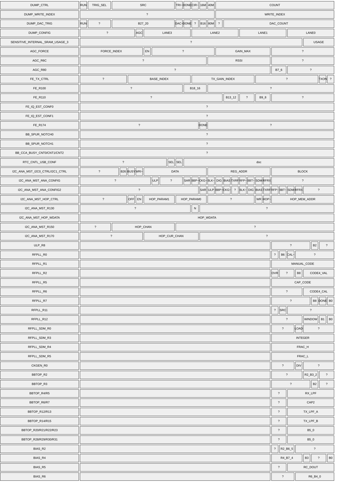

# ESP32-S3 registers

<!-- nav-start -->
Previous: [Transmit from GNU Radio World to an S31](grworld-tx.md) · Up: [Reference](index.md) · Next: [ESP32-C6 registers](registers-esp32c6.md)
<!-- nav-end -->

This page records what this project knows about the ESP32-S3 registers that `lib/esp_sdr` relies
on, or that a later feature could use, and that Espressif does not document, or documents without
the behaviour that matters. For each register it gives where it is, its fields, what it does, the
values seen, and how sure we are.

- The ESP32-C6 has its own page, [ESP32-C6 registers](registers-esp32c6.md).
- What the registers do in the radio's chain is taught in [Transceiver](../radio/transceiver.md)
  (the blocks, the analog I2C access and the vendor PHY functions), [Tuning](../radio/tuning.md)
  (the measured PLL behaviour) and [Samples in and out](../samples/index.md) (the sample word
  formats and the SRAM bank ownership).
- How the library copes with the chips' quirks is in those guides and in
  [Chip notes](chips.md).

## Register map

One row per register, in the order of the [Register summary](#register-summary): its name, then
its bits from 31 on the left to 0 on the right. The analog I2C blocks' 8-bit registers sit
right-aligned. `?` marks unknown bits, `doc` bits Espressif documents, and a field name cut to fit
ends in `~`; each register's table under [Registers](#registers) has the bits and full names.

<!-- svd:overview -->

<!-- svd:end -->

## How to read this page

### Conventions

- The register part follows Espressif's technical reference manual: a register summary, then each
  register with a bit-field table and its fields' descriptions.
- The table's Init row, where present, is the value after the PHY's initialization (written by
  the vendor's init code or read on the bench after it), not the reset value.
- "(unknown)" marks bits nobody has tied to a function yet, "(documented)" bits that Espressif's
  SVD documents in a register this page only adds to.
- Names are spelled as in Espressif's headers (`REGISTER_REG`, `FIELD`): Espressif's own for the
  registers its SVD has (RTC_CNTL_USB_CONF_REG, SENSITIVE_INTERNAL_SRAM_USAGE_3_REG), this
  project's elsewhere, also for the registers under "Baseband" that this page adds to Espressif's
  BB peripheral.
- Access: R/W read and write, RO read only (set by the hardware), WO written only (reads
  unknown). It is inferred from the vendor code and this project's use.
- Analog I2C registers are 8 bits wide and addressed `block:reg` with a decimal register number:
  `0x62:12[3:2]` is bits 3:2 of register 12 in analog block 0x62. Upstream esp-sdr uses the same
  form.
- The analog blocks are not memory-mapped: see
  [Transceiver](../radio/transceiver.md#analog-i2c-access) for how the library reaches them and
  which block is which.

### Generator

The register part is generated from [esp32s3.svd](../registers/esp32s3.svd), a CMSIS-SVD file of
this project's additions to Espressif's SVD ([espressif/svd](https://github.com/espressif/svd) at
be20aa1), by `doc/registers/svd2md.py`. Edit the SVD, then run the script.

### Evidence sources

- Evidence paths are relative to this repository (`lib/`, `doc/`, ...) or, for files outside it,
  to the west workspace: `modules/lib/esp-sdr/` is upstream esp-sdr (commit 1fe5535),
  `modules/hal/espressif/` the HAL.
- `git show <commit>:<path>` cites a file at an older upstream commit: run it in
  `modules/lib/esp-sdr/`.
- "Bench" with a date is a measurement with scratch tools that are not in the repository.

| Bench dates | Boards |
|---|---|
| 2026-10-05 and 06 | two XIAO ESP32S3 |
| 2026-10-07 to 09 | one XIAO ESP32S3 next to one XIAO ESP32C6 |
| 2026-10-11 | the same pair: the C6 transmitting into the S3 over coax, the S3's receive gain fixed at index 0 |

#### Decompiled objects

- Entries marked decompile cite the blob object they were read from, as in "S3 `phy_i2c.o`", and
  the function where the text names one.
- The `phy_*.o` objects except `phy_test.o` are members of
  `modules/hal/espressif/zephyr/blobs/lib/esp32s3/libphy.a`.
- `bb_common.o`, `crypto_common.o`, `esp_phy_api.o`, `mac_common.o`, `phy_test.o`, `rf_test.o` and
  `wifi.o` are members of `zephyr/blobs/lib/esp32s3/librftest.a` (esp-phy-lib e37ecdc9).
- Decompiled C drops the arguments of indirect calls, so argument values come from the
  disassembly.
- ROM addresses refer to `esp32s3_rev0_rom.elf` of esp-rom-elfs 20230320.

### Confidence levels

| Confidence | Meaning |
|---|---|
| measured | Seen on the bench boards or on air between them. |
| working | The library depends on it and works; the meaning is not proven beyond that. |
| upstream | Stated by upstream esp-sdr (code, comments, docs); not re-checked here. |
| decompile | Read from vendor code (decompile or disassembly); not confirmed on hardware. |
| speculative | A guess. Treat the field as unknown. |

### Reading the decompile

The PHY calls ROM helpers through the function table `g_phyFuns` (ROM image at `.data_phyrom`,
0x3fcef3d8). The slots that this page and [Transceiver](../radio/transceiver.md) cite:

| Slot | Function |
|---|---|
| 0x28 | `get_data_sat(value, max, min)` |
| 0x5c | `mhz2ieee` |
| 0x6c | `bb_bss_cbw40` |
| 0xbc | `force_txon` |
| 0x154 | `get_i2c_read_mask` |
| 0x158 | `get_i2c_mst0_mask` |
| 0x15c | `get_i2c_hostid` (libphy's) |
| 0x160, 0x164 | `enter/exit_critical_phy` (empty) |
| 0x168 | `chip_i2c_readReg_org` |
| 0x16c, 0x18c | `chip_i2c_readReg/writeReg` (libphy's) |
| 0x188 | `i2c_readReg(block, host, reg)` |
| 0x190 | `i2c_writeReg(block, host, reg, data)` |
| 0x194 | `i2c_readReg_Mask(block, host, reg, msb, lsb)` |
| 0x198 | `i2c_writeReg_Mask(block, host, reg, msb, lsb, data)` |
| 0x1d4 | `chan_to_freq` |
| 0x200, 0x204 | `phy_en/dis_hw_set_freq` (libphy's) |
| 0x20c | `write_pll_cap` (libphy's) |
| 0x210 | `set_tx_gain_mem` |

Evidence: *decompile* S3 ROM image, S3 `phy_init.o`.

## Register summary

<!-- svd:summary -->

| Name | Description | Address | Access |
|---|---|---|---|
| **Dump and DAC engine** | | | |
| [DUMP_CTRL_REG](#register-dump_ctrl_reg-0x60033d5c) | Receive side: run, trigger and count of a capture | 0x60033d5c | varies |
| [DUMP_WRITE_INDEX_REG](#register-dump_write_index_reg-0x60033d60) | Words written by a capture; the live write index in circular mode | 0x60033d60 | RO |
| [DUMP_DAC_TRIG_REG](#register-dump_dac_trig_reg-0x60033d64) | Transmit side: run, trigger and count of a playback | 0x60033d64 | varies |
| [DUMP_CONFIG_REG](#register-dump_config_reg-0x60033d90) | Lane selectors: the sources packed into a dump word | 0x60033d90 | R/W |
| **SRAM bank ownership** | | | |
| [SENSITIVE_INTERNAL_SRAM_USAGE_3_REG](#register-sensitive_internal_sram_usage_3_reg-0x600c101c) | Hands SRAM banks to the dump engine | 0x600c101c | R/W |
| **AGC force** | | | |
| [AGC_FORCE_REG](#register-agc_force_reg-0x6001c02c) | Forced receive gain index, force bit and largest calibrated index | 0x6001c02c | R/W |
| [AGC_R6C_REG](#register-agc_r6c_reg-0x6001c06c) | AGC RSSI; lead, not tried | 0x6001c06c | RO |
| [AGC_R80_REG](#register-agc_r80_reg-0x6001c080) | Unknown; bits 7:6 cleared by `bt_rx_force(0)` | 0x6001c080 | R/W |
| **Front end** | | | |
| [FE_TX_CTRL_REG](#register-fe_tx_ctrl_reg-0x60006000) | Force TX on and the TX gain memory index | 0x60006000 | R/W |
| [FE_R100_REG](#register-fe_r100_reg-0x60006100) | Unknown; bits 18:16 listed by upstream's filter probe | 0x60006100 | RO |
| [FE_R110_REG](#register-fe_r110_reg-0x60006110) | Unknown; written by `force_txon_mode()` and `bt_rx_force(0)` | 0x60006110 | R/W |
| [FE_IQ_EST_CONF0_REG](#register-fe_iq_est_conf0_reg-0x60006140) | IQ estimator configuration; lead, not tried | 0x60006140 | R/W |
| [FE_IQ_EST_CONF1_REG](#register-fe_iq_est_conf1_reg-0x60006144) | IQ estimator configuration; lead, not tried | 0x60006144 | R/W |
| [FE_R174_REG](#register-fe_r174_reg-0x60006174) | IQ estimator done flag; lead, not tried | 0x60006174 | RO |
| **Baseband** | | | |
| [BB_SPUR_NOTCH0_REG](#register-bb_spur_notch0_reg-0x6001d014) | Spur notch; lead, not tried | 0x6001d014 | R/W |
| [BB_SPUR_NOTCH1_REG](#register-bb_spur_notch1_reg-0x6001d018) | Spur notch; lead, not tried | 0x6001d018 | R/W |
| [BB_CCA_BUSY_CNT0_REG, BB_CCA_BUSY_CNT1_REG, BB_CCA_BUSY_CNT2_REG](#register-bb_cca_busy_cnt0_reg-bb_cca_busy_cnt1_reg-bb_cca_busy_cnt2_reg-0x6001d058-0x6001d05c-0x6001d060) | CCA busy counters; lead, not tried | 0x6001d058, 0x6001d05c, 0x6001d060 | RO |
| **USB PHY select** | | | |
| [RTC_CNTL_USB_CONF_REG](#register-rtc_cntl_usb_conf_reg-0x60008120) | USB PHY select; documented, descriptions empty | 0x60008120 | R/W |
| **Analog I2C master** | | | |
| [I2C_ANA_MST_I2C0_CTRL_REG, I2C_ANA_MST_I2C1_CTRL_REG](#register-i2c_ana_mst_i2c0_ctrl_reg-i2c_ana_mst_i2c1_ctrl_reg-0x6000e000-0x6000e004) | Command word, master 0 (I2C0) and master 1 (I2C1) | 0x6000e000, 0x6000e004 | varies |
| [I2C_ANA_MST_ANA_CONFIG_REG](#register-i2c_ana_mst_ana_config_reg-0x6000e044) | Readback enable, one bit per block | 0x6000e044 | R/W |
| [I2C_ANA_MST_ANA_CONFIG2_REG](#register-i2c_ana_mst_ana_config2_reg-0x6000e048) | Master select, one bit per block | 0x6000e048 | R/W |
| [I2C_ANA_MST_HOP_CTRL_REG](#register-i2c_ana_mst_hop_ctrl_reg-0x6000e0c4) | Frequency hop engine control (speculative) | 0x6000e0c4 | varies |
| [I2C_ANA_MST_R130_REG](#register-i2c_ana_mst_r130_reg-0x6000e130) | Frequency hop engine module reset (speculative) | 0x6000e130 | R/W |
| [I2C_ANA_MST_HOP_WDATA_REG](#register-i2c_ana_mst_hop_wdata_reg-0x6000e148) | Frequency hop engine table write data (speculative) | 0x6000e148 | R/W |
| [I2C_ANA_MST_R150_REG](#register-i2c_ana_mst_r150_reg-0x6000e150) | Frequency hop engine channel index (speculative) | 0x6000e150 | R/W |
| [I2C_ANA_MST_R170_REG](#register-i2c_ana_mst_r170_reg-0x6000e170) | Frequency hop engine current channel (speculative) | 0x6000e170 | RO |
| **Analog I2C block 0x61 (ULP)** | | | |
| [ULP_R8](#register-ulp_r8-0x618) | Bit 2 set during the RC time-constant measurement | 0x61:8 | R/W |
| **Analog I2C block 0x62 (RF PLL)** | | | |
| [RFPLL_R0](#register-rfpll_r0-0x620) | VCO calibration start | 0x62:0 | varies |
| [RFPLL_R1](#register-rfpll_r1-0x621) | Manual capacitor code, bits 7:0 | 0x62:1 | R/W |
| [RFPLL_R2](#register-rfpll_r2-0x622) | 4-bit code override and manual capacitor code bit 8 | 0x62:2 | R/W |
| [RFPLL_R5](#register-rfpll_r5-0x625) | Capacitor code readback, bits 7:0 | 0x62:5 | RO |
| [RFPLL_R6](#register-rfpll_r6-0x626) | Calibrated 4-bit code | 0x62:6 | RO |
| [RFPLL_R7](#register-rfpll_r7-0x627) | Capacitor code bit 8 and calibration done | 0x62:7 | RO |
| [RFPLL_R11](#register-rfpll_r11-0x6211) | Capacitor code source | 0x62:11 | R/W |
| [RFPLL_R12](#register-rfpll_r12-0x6212) | VCO window comparator and two unknown status bits | 0x62:12 | RO |
| **Analog I2C block 0x63 (RF PLL fractional-N divider)** | | | |
| [RFPLL_SDM_R0](#register-rfpll_sdm_r0-0x630) | Divider word load (presumed) | 0x63:0 | R/W |
| [RFPLL_SDM_R3](#register-rfpll_sdm_r3-0x633) | Integer part above 32 | 0x63:3 | R/W |
| [RFPLL_SDM_R4](#register-rfpll_sdm_r4-0x634) | Fraction, high byte | 0x63:4 | R/W |
| [RFPLL_SDM_R5](#register-rfpll_sdm_r5-0x635) | Fraction, low byte | 0x63:5 | R/W |
| **Analog I2C block 0x65 (clock generator, LO 5/6 divider)** | | | |
| [CKGEN_R0](#register-ckgen_r0-0x650) | LO 5/6 divider select | 0x65:0 | R/W |
| **Analog I2C block 0x66 (BBPLL)** | | | |
| **Analog I2C block 0x67 (BBTOP, analog baseband)** | | | |
| [BBTOP_R2](#register-bbtop_r2-0x672) | Unknown 2-bit field, 1 at init | 0x67:2 | R/W |
| [BBTOP_R3](#register-bbtop_r3-0x673) | Unknown bit, changed by the receive calibration | 0x67:3 | R/W |
| [BBTOP_R4, BBTOP_R5](#register-bbtop_r4-bbtop_r5-0x674-0x675) | Receive low-pass capacitor code, I (BBTOP_R4) and Q (BBTOP_R5) | 0x67:4, 0x67:5 | R/W |
| [BBTOP_R6, BBTOP_R7](#register-bbtop_r6-bbtop_r7-0x676-0x677) | Second capacitor pair, unknown | 0x67:6, 0x67:7 | R/W |
| [BBTOP_R12, BBTOP_R13](#register-bbtop_r12-bbtop_r13-0x6712-0x6713) | Transmit low-pass pair A (0x0c, 0x0d) | 0x67:12, 0x67:13 | R/W |
| [BBTOP_R14, BBTOP_R15](#register-bbtop_r14-bbtop_r15-0x6714-0x6715) | Transmit low-pass pair B (0x0e, 0x0f) | 0x67:14, 0x67:15 | R/W |
| [BBTOP_R20, BBTOP_R21, BBTOP_R22, BBTOP_R23](#register-bbtop_r20-bbtop_r21-bbtop_r22-bbtop_r23-0x6720-0x6721-0x6722-0x6723) | Unknown pairs (0x14 to 0x17), written from PHY parameters at init | 0x67:20, 0x67:21, 0x67:22, 0x67:23 | R/W |
| [BBTOP_R28, BBTOP_R29, BBTOP_R30, BBTOP_R31](#register-bbtop_r28-bbtop_r29-bbtop_r30-bbtop_r31-0x6728-0x6729-0x6730-0x6731) | Unknown pairs (0x1c to 0x1f), written from PHY parameters at init | 0x67:28, 0x67:29, 0x67:30, 0x67:31 | R/W |
| **Analog I2C block 0x6a (bias): RC calibration** | | | |
| [BIAS_R2](#register-bias_r2-0x6a2) | RC measurement setting in bits 6:5 | 0x6a:2 | R/W |
| [BIAS_R4](#register-bias_r4-0x6a4) | RC measurement mode and control bits | 0x6a:4 | varies |
| [BIAS_R5](#register-bias_r5-0x6a5) | RC measurement result | 0x6a:5 | RO |
| [BIAS_R6](#register-bias_r6-0x6a6) | RC measurement setting in bits 4:0 | 0x6a:6 | R/W |

<!-- svd:end -->

## Registers

<!-- svd:registers -->

### Dump and DAC engine

The Wi-Fi MAC's debug dump engine moves raw baseband words between the radio
and one 64 KiB SRAM bank (see "SRAM bank ownership"). Its page, 0x60033000,
has no name in the HAL. Layout from upstream esp-sdr; the DAC side from
librftest's `dactrig()`.

**Wi-Fi MAC interrupt.** CPU interrupt line 0 (`ETS_WMAC_INUM`,
`modules/hal/espressif/components/soc/esp32s3/include/soc/soc.h:212`);
`esp_sdr_ring_run()` disables it on its CPU
([Gapless receive](../samples/rings.md#interrupts-inside-the-ring);
`lib/esp_sdr/src/esp_sdr_ring.c:508-538`).

#### Register DUMP_CTRL_REG (0x60033d5c)

Receive side: run, trigger and count of a capture

| Bits | 31 | 30:28 | 27:20 | 19 | 18 | 17 | 16 | 15 | 14:0 |
|---|---|---|---|---|---|---|---|---|---|
| Field | DUMP_RUN | DUMP_TRIG_SEL | DUMP_SRC | DUMP_TRIGGER | DUMP_DONE | DUMP_CIRCULAR | DUMP_RATE_16M | DUMP_RATE_40M | DUMP_COUNT |

**DUMP_RUN** Enables the engine. (R/W)

**DUMP_TRIG_SEL** The vendor `adctrig()`'s second argument: 0 = software trigger (DUMP_TRIGGER); 5 and 6 make it send frames while it waits. Seen 0. The trigger select could take work off the CPU; lead, not tried. (R/W)

**DUMP_SRC** The vendor's third argument; upstream calls it the source. Seen 0. (R/W)

**DUMP_TRIGGER** Write 1, then 0, to start a one-shot capture. (WO)

**DUMP_DONE** Reads 1 once DUMP_COUNT words are written; the library gives up after 20 ms. (RO)

**DUMP_CIRCULAR** With DUMP_RUN and no trigger, the engine writes continuously round a 16384-pair ring (0x00024000 = this bit plus count 16384). In `adctrig()` the same bit skips the final count check. (R/W)

**DUMP_RATE_16M** Separate 16 MS/s path: 4096 samples in 256 us. `adctrig()` sets it unless bit 0 of its fourth argument is set. (R/W)

**DUMP_RATE_40M** 80 MS/s halved, through the radio's decimation filter (each symbol spread over about +-8 samples, same MER as 80 MS/s): 4096 samples in 102 us. (R/W)

**DUMP_COUNT** Words to capture, 256 to 16380. The library uses bits 13:0 (at most 16380, `ESP_SDR_SAMPLES_MAX`); `adctrig()` writes count + 1 and checks a 15-bit written count, and the ring writes 16384 (bit 14), so the field is probably 15 bits wide. (R/W)

With neither DUMP_RATE_16M nor DUMP_RATE_40M the engine captures at 80 MS/s (4096
samples in 51 to 60 us). One-shot sequence: DUMP_CTRL_REG = 0, DUMP_CONFIG_REG, bank
select, `DUMP_RUN | rate | count`, the same with DUMP_TRIGGER, the same without,
poll DUMP_DONE, DUMP_CTRL_REG = 0, restore the bank select. The engine can stop
early without any error flag ([Burst capture](../samples/bursts.md#short-captures)).

Evidence:

- `lib/esp_sdr/src/esp_sdr_rx.c:246-326` (sequence), `lib/esp_sdr/src/esp_sdr_rx.c:287-293, 321-323` (early stop)
- DUMP_RUN: *working* `lib/esp_sdr/src/esp_sdr_rx.c:300-310`
- DUMP_TRIG_SEL: *decompile* S3 `mac_common.o`
- DUMP_TRIG_SEL: *decompile* S3 `libphy.a` (lead)
- DUMP_SRC: *decompile* S3 `mac_common.o`; *upstream* `modules/lib/esp-sdr/main/targets/esp32s3/receiver.c:164`
- DUMP_TRIGGER: *working* `lib/esp_sdr/src/esp_sdr_rx.c:308-310`
- DUMP_DONE: *working* `lib/esp_sdr/src/esp_sdr_rx.c:311-314`
- DUMP_CIRCULAR: *working* `lib/esp_sdr/src/esp_sdr_priv.h:290-294`, `lib/esp_sdr/src/esp_sdr_ring.c:1287`; *decompile* S3 `mac_common.o`
- DUMP_RATE_16M: *measured* [capture](../../apps/capture/README.rst), "Sample output"; *upstream* (USRP B210) `modules/lib/esp-sdr/main/targets/esp32s3/receiver.c:161-163`; *decompile* S3 `mac_common.o`
- DUMP_RATE_40M: *measured* [capture](../../apps/capture/README.rst), "Sample output"; [Filters](../radio/filters.md#decimation-filter-at-40-mss)
- DUMP_COUNT: *working* `lib/esp_sdr/src/esp_sdr_priv.h:34`; *decompile* S3 `mac_common.o`

#### Register DUMP_WRITE_INDEX_REG (0x60033d60)

Words written by a capture; the live write index in circular mode

| Bits | 31:15 | 14:0 |
|---|---|---|
| Field | (unknown) | DUMP_WRITE_INDEX |

**DUMP_WRITE_INDEX** Words written, a 15-bit value: after DUMP_DONE, `adctrig()` compares it with count + 1. In circular mode bits 13:0 are the live write index, mod 16384, advancing whichever bank is selected; the ring times its bank switches on it. (RO)

No read pointer is known for the DAC side; loop playback runs open loop on
CCOUNT.

Evidence:

- *measured* `lib/esp_sdr/src/esp_sdr_priv.h:237-245` (no DAC read pointer)
- DUMP_WRITE_INDEX: *decompile* S3 `mac_common.o` (words written)
- DUMP_WRITE_INDEX: *working* `lib/esp_sdr/src/esp_sdr_ring.c:43, 139-142`; *upstream* `modules/lib/esp-sdr/main/common/ring_capture.c:112` (circular mode)

#### Register DUMP_DAC_TRIG_REG (0x60033d64)

Transmit side: run, trigger and count of a playback

| Bits | 31 | 30:28 | 27:20 | 19 | 18 | 17 | 16 | 15 | 14 | 13:0 |
|---|---|---|---|---|---|---|---|---|---|---|
| Field | DUMP_DAC_RUN | (unknown) | DUMP_B27_20 | DUMP_DAC_TRIGGER | DUMP_DAC_DONE | (unknown) | DUMP_B16 | DUMP_DAC_RATE_80M | (unknown) | DUMP_DAC_COUNT |

**DUMP_DAC_RUN** Run bit; `dactrig()` sets it. (R/W)

**DUMP_B27_20** `dactrig()` writes count & 0xff here; no effect on the rate. (R/W)

**DUMP_DAC_TRIGGER** Pulsed: one pass. Held: the engine replays the first DUMP_DAC_COUNT words back to back, gapless, until the register is cleared. A retrigger leaves a hole of about 1.35 us. (R/W)

**DUMP_DAC_DONE** Done flag; `dactrig()` polls it. (RO)

**DUMP_B16** No effect on the rate: there is no 16 MS/s DAC rate. (R/W)

**DUMP_DAC_RATE_80M** The DAC has its own clock: 1 = 80 MS/s, 0 = 40 MS/s. 40 MS/s gives about 4 dB less MER. (R/W)

**DUMP_DAC_COUNT** Words to play, 256 to 16380. (R/W)

8 bytes above DUMP_CTRL_REG.

- Writing 0 stops the engine at once (`esp_sdr_dac_halt()`).
- In loop mode the DAC clock is exact (CPU stores to other banks do not slow
  it) and the engine reads whichever bank is selected at the moment, so a bank
  switch takes effect mid-pass.
- The vendor's `dactrig(count, a2, a3, ...)` fills bank 2 (0x3fcd0000) with a
  ramp, writes count to DUMP_DAC_COUNT and bits 27:20, sets DUMP_DAC_RATE_80M
  unless a2 is 1, sets DUMP_DAC_TRIGGER (and leaves it set) only if a3 is not 0,
  sets DUMP_DAC_RUN, polls its own DUMP_DAC_DONE, waits 10 ms and clears
  DUMP_CTRL_REG (0x60033d5c), not itself. It never writes the bank select. The
  library skips the ramp so the caller's samples survive, and clears
  DUMP_CTRL_REG after every transmit session as well.
- The front end must be forced to transmit, or only a spur near -6 MHz leaks
  (FE_FORCE_TXON, see "Front end").

Evidence:

- *measured* `lib/esp_sdr/src/esp_sdr_priv.h:237-245` (loop mode)
- *decompile* S3 `mac_common.o` (`dactrig()`)
- `lib/esp_sdr/src/esp_sdr_tx.c:272-273` (the library skips the ramp, clears DUMP_CTRL_REG)
- DUMP_DAC_RUN: *working* `lib/esp_sdr/src/esp_sdr_tx.c:158-166`
- DUMP_B27_20: *measured* `lib/esp_sdr/src/esp_sdr_priv.h:47-49`; *decompile* S3 `mac_common.o`
- DUMP_DAC_TRIGGER: *measured* `lib/esp_sdr/src/esp_sdr_tx.c:163-166, 253-263`, `lib/esp_sdr/src/esp_sdr_priv.h:237-245`
- DUMP_DAC_DONE: *working* `lib/esp_sdr/src/esp_sdr_tx.c:167-169`
- DUMP_B16: *measured* `lib/esp_sdr/src/esp_sdr_priv.h:47-49`
- DUMP_DAC_RATE_80M: *measured* `lib/esp_sdr/src/esp_sdr_priv.h:47-50`, [QAM and OFDM](../modem/qam-ofdm.md#mer-ceilings)
- DUMP_DAC_COUNT: *working* `lib/esp_sdr/src/esp_sdr_tx.c:158-159`

#### Register DUMP_CONFIG_REG (0x60033d90)

Lane selectors: the sources packed into a dump word

| Bits | 31:25 | 24 | 23:18 | 17:12 | 11:6 | 5:0 |
|---|---|---|---|---|---|---|
| Field | (unknown) | DUMP_RX_AGC | DUMP_LANE3 | DUMP_LANE2 | DUMP_LANE1 | DUMP_LANE0 |

**DUMP_RX_AGC** Upstream probe flag (`rx_agc`). Seen 0. (R/W)

**DUMP_LANE3** Source of lane 3; 3 for receive I/Q. (R/W)

**DUMP_LANE2** Source of lane 2; 2 for receive I/Q. (R/W)

**DUMP_LANE1** Source of lane 1; 1 for receive I/Q. (R/W)

**DUMP_LANE0** Source of lane 0; 0 for receive I/Q. (R/W)

Four 6-bit lane selectors (lane n in bits 6n+5:6n) choose the internal sources
packed into a dump word; 0x000c2040 selects sources 0, 1, 2, 3: receive I/Q.
librftest's `mac_init()` writes 0x000c2040 here once; the library writes it
before every capture and ring run. The reading as lane selectors is upstream's.

Only sources 0 to 3 are ever used. The others could take work off the CPU;
lead, not tried.

Evidence:

- *working* `lib/esp_sdr/src/esp_sdr_priv.h:35-37`; *upstream* `modules/lib/esp-sdr/main/targets/esp32s3/receiver.c:159` (lane selectors)
- *decompile* S3 `mac_common.o` (`mac_init()`)
- *decompile* S3 `libphy.a` (lead)
- DUMP_RX_AGC: *upstream* `modules/lib/esp-sdr/main/targets/esp32s3/receiver.c:159`

### SRAM bank ownership

#### Register SENSITIVE_INTERNAL_SRAM_USAGE_3_REG (0x600c101c)

Hands SRAM banks to the dump engine

| Bits | 31:4 | 3:0 |
|---|---|---|
| Field | (unknown) | SENSITIVE_INTERNAL_SRAM_MAC_DUMP_USAGE |

**SENSITIVE_INTERNAL_SRAM_MAC_DUMP_USAGE** One-hot: bit n hands bank n to the engine, for capture and playback alike; 0 gives every bank back to the CPUs. The HAL defines the field without a description. (R/W)

The banks by field bit:

| Bit | Bank | Use in esp_sdr |
|---|---|---|
| 0 | 0x3fcb0000, 64 KiB | ring (`CONFIG_ESP_SDR_RING`) |
| 1 | 0x3fcc0000 | second DAC and capture bank (`CONFIG_ESP_SDR_BANK1`), ring |
| 2 | 0x3fcd0000 | capture bank; the one `adctrig()` and `dactrig()` use |
| 3 | 0x3fce0000 | never: it holds ROM data |

The library saves the register and restores it after each use. Undocumented
behaviour:

- While the engine owns a bank the CPUs cannot reach any of it, so nothing else
  may live there; the linker snippets reserve the banks and lower
  `_heap_sentry`.
- CPU stores reach the DAC only if made while the CPU owns the bank; otherwise
  the DAC replays the old content.
- The engine follows a change of the field while it runs, in both directions:
  the ring splits one continuous capture into gapless units, the DAC switches
  banks mid-pass.
- Bank 3 holds ROM data (0x3fceffxx); handing it to the engine wedges the
  board, USB and shell die.

Evidence:

- `lib/esp_sdr/src/esp_sdr_rx.c:246-278`, `lib/esp_sdr/src/esp_sdr.c:123-133` (save and restore)
- `lib/esp_sdr/esp_sdr_bank_s3.ld:4-34` (reserved banks)
- *measured* `lib/esp_sdr/src/esp_sdr_tx.c:346-349` (CPU stores and the DAC)
- *measured* [Gapless receive](../samples/rings.md#circular-capture); `lib/esp_sdr/src/esp_sdr_priv.h:237-245` (a change while running)
- *measured* bench 2026-10-05, `lib/esp_sdr/esp_sdr_bank_s3.ld:43-47`; *upstream* `modules/lib/esp-sdr/main/common/ring_capture.h:26` (bank 3)
- SENSITIVE_INTERNAL_SRAM_MAC_DUMP_USAGE: `modules/hal/espressif/components/soc/esp32s3/register/soc/sensitive_reg.h:101-107`

### AGC force

#### Register AGC_FORCE_REG (0x6001c02c)

Forced receive gain index, force bit and largest calibrated index

| Bits | 31:24 | 23 | 22:15 | 14:8 | 7:0 |
|---|---|---|---|---|---|
| Field | AGC_FORCE_INDEX | AGC_FORCE_EN | (unknown) | AGC_GAIN_MAX | (unknown) |

**AGC_FORCE_INDEX** Forced receive gain index. (R/W)

**AGC_FORCE_EN** Force: 1 holds the index, 0 hands the gain to the AGC. (R/W)

**AGC_GAIN_MAX** Largest calibrated gain index, 0 to 82, written by the PHY when it builds the gain table (capped at 82). Larger reads point at uncalibrated slots; the library treats them as 0. (R/W)

Upstream calls the register AGCPWR_CTRL7. The PHY's `rom_agc_reg_init()` pulses
AGC_FORCE_EN (bit 23) with index 0x32. The ESP32-C6 has the same layout. Levels
with a 50 ohm load: AGC -25.7, index 0 -46.0, 40 -39.0, 60 -27.0,
82 -19.9 dBFS.

- `force_rx_gain(force, index, 0)` also calls `bt_rx_force(0)`, which clears
  AGC_R80_REG bits 7:6 and steps FE_R110_REG bits 9:8 through 2, 3 and 0.
- A forced gain is occasionally lost; this register does not show it
  ([Gain](../radio/gain.md#lost-forced-gain)).
- A new forced index alone can leave stale receive state, so a gain change
  reruns the front-end setup.

Evidence:

- *decompile* S3 `phy_reg.o` (`rom_agc_reg_init()`)
- *measured* bench 2026-10-05 (levels)
- *decompile* S3 `phy_test.o` (`bt_rx_force(0)`)
- *upstream* `modules/lib/esp-sdr/main/targets/esp32s3/receiver.c:107-113`; `lib/esp_sdr/src/esp_sdr_rx.c:164-166` (gain change)
- AGC_FORCE_INDEX: *decompile* S3 `phy_test.o`; *working*
- AGC_FORCE_EN: *decompile* S3 `phy_test.o`; *working*
- AGC_GAIN_MAX: *working* `lib/esp_sdr/src/esp_sdr_rx.c:29-34`; *decompile* S3 `phy_rx_gain.o`; *upstream* `modules/lib/esp-sdr/main/common/burst_gain.h:1-4, 29-37`

#### Register AGC_R6C_REG (0x6001c06c)

AGC RSSI; lead, not tried

| Bits | 31:16 | 15:8 | 7:0 |
|---|---|---|---|
| Field | (unknown) | AGC_RSSI | (unknown) |

**AGC_RSSI** AGC RSSI. With the CCA busy counters (BB_CCA_BUSY_CNT0_REG to BB_CCA_BUSY_CNT2_REG) a candidate for 802.15.4 energy detection and CCA, work it could take off the CPU; lead, not tried. (RO)

Evidence:

- AGC_RSSI: *decompile* S3 `libphy.a`

#### Register AGC_R80_REG (0x6001c080)

Unknown; bits 7:6 cleared by `bt_rx_force(0)`

| Bits | 31:8 | 7:6 | 5:0 |
|---|---|---|---|
| Field | (unknown) | AGC_B7_6 | (unknown) |

**AGC_B7_6** Cleared by `bt_rx_force(0)`, which `force_rx_gain(force, index, 0)` calls (see AGC_FORCE_REG). (R/W)

Evidence:

- AGC_B7_6: *decompile* S3 `phy_test.o`

### Front end

The FE block, `DR_REG_FE_BASE` 0x60006000: the HAL has the base, no registers.

#### Register FE_TX_CTRL_REG (0x60006000)

Force TX on and the TX gain memory index

| Bits | 31:26 | 25:18 | 17:10 | 9:2 | 1 | 0 |
|---|---|---|---|---|---|---|
| Field | (unknown) | FE_BASE_INDEX | FE_TX_GAIN_INDEX | (unknown) | FE_FORCE_TXON | (unknown) |

**FE_BASE_INDEX** Base index, read by `force_txon_mode()` and by the tone generator. (R/W)

**FE_TX_GAIN_INDEX** TX gain memory index (inferred). `force_txon_mode(en, mode, ofs)` writes `(ofs + (mode ? 16 : 0) + bits[25:18]) & 0xff`; the tone generator writes `bits[25:18] + 9`. (R/W)

**FE_FORCE_TXON** Force TX on. Without a frame in flight the MAC never enables the transmitter; `force_txon_mode(1, ...)` sets the bit, `(0, ...)` clears it, the vendor tone generator does the same. Without it only a spur near -6 MHz leaks; with it a tone stands 35 to 37 dB over the TX-off noise. (R/W)

The library calls `force_txon_mode(1, 0, 0)` and `force_tx_gain()`, which writes
gain memory slot 0. That this is the slot the front end then uses holds only
while FE_BASE_INDEX reads 0; the code does not check it.

Evidence:

- `lib/esp_sdr/src/esp_sdr_priv.h:165-170` (slot 0)
- FE_BASE_INDEX: *decompile*
- FE_TX_GAIN_INDEX: *decompile* S3 `phy_test.o`, `phy_feature.o`
- FE_FORCE_TXON: *measured* bench 2026-10-05; *working* `lib/esp_sdr/src/esp_sdr_tx.c:84-87`, `lib/esp_sdr/src/esp_sdr_rx.c:84-86`; *decompile* S3 `phy_test.o`, `phy_feature.o`

#### Register FE_R100_REG (0x60006100)

Unknown; bits 18:16 listed by upstream's filter probe

| Bits | 31:19 | 18:16 | 15:0 |
|---|---|---|---|
| Field | (unknown) | FE_B18_16 | (unknown) |

**FE_B18_16** Unknown; listed by upstream's filter probe. Could not be written from the shell (`devmem`). (RO)

Evidence:

- FE_B18_16: *measured* bench 2026-10-06; *speculative* `modules/lib/esp-sdr/main/diagnostics/filter_probe.h:19-20`

#### Register FE_R110_REG (0x60006110)

Unknown; written by `force_txon_mode()` and `bt_rx_force(0)`

| Bits | 31:14 | 13:12 | 11:10 | 9:8 | 7:0 |
|---|---|---|---|---|---|
| Field | (unknown) | FE_B13_12 | (unknown) | FE_B9_8 | (unknown) |

**FE_B13_12** 3 when `force_txon_mode()`'s mode is not 0, else 0. (R/W)

**FE_B9_8** Stepped 0x200, 0x300, 0 (2, 3 and 0 in the field) by `bt_rx_force(0)`, which `force_rx_gain(force, index, 0)` calls (see AGC_FORCE_REG). (R/W)

Evidence:

- FE_B13_12: *decompile* S3 `phy_test.o`
- FE_B9_8: *decompile* S3 `phy_test.o`

#### Register FE_IQ_EST_CONF0_REG (0x60006140)

IQ estimator configuration; lead, not tried

| Bits | 31:0 |
|---|---|
| Field | (unknown) |

The vendor's `ram_iq_est_enable()` configures the IQ estimator in
FE_IQ_EST_CONF0_REG and FE_IQ_EST_CONF1_REG (count up to 0x7fff); its done flag
is FE_IQ_EST_DONE. It gives power, DC and a quadrature correlation against the
transmit tone generator, work it could take off the CPU.

Evidence:

- *decompile* S3 `libphy.a`

#### Register FE_IQ_EST_CONF1_REG (0x60006144)

IQ estimator configuration; lead, not tried

| Bits | 31:0 |
|---|---|
| Field | (unknown) |

Configured together with FE_IQ_EST_CONF0_REG; see there.

Evidence:

- *decompile* S3 `libphy.a`

#### Register FE_R174_REG (0x60006174)

IQ estimator done flag; lead, not tried

| Bits | 31:17 | 16 | 15:0 |
|---|---|---|---|
| Field | (unknown) | FE_IQ_EST_DONE | (unknown) |

**FE_IQ_EST_DONE** Done flag of the IQ estimator (see FE_IQ_EST_CONF0_REG). (RO)

Evidence:

- FE_IQ_EST_DONE: *decompile* S3 `libphy.a`

### Baseband

Leads, none tried: a spur notch and CCA busy counters that could take work off
the CPU.

#### Register BB_SPUR_NOTCH0_REG (0x6001d014)

Spur notch; lead, not tried

| Bits | 31:0 |
|---|---|
| Field | (unknown) |

The spur notch is at BB_SPUR_NOTCH0_REG and BB_SPUR_NOTCH1_REG.

Evidence:

- *decompile* S3 `libphy.a`

#### Register BB_SPUR_NOTCH1_REG (0x6001d018)

Spur notch; lead, not tried

| Bits | 31:0 |
|---|---|
| Field | (unknown) |

See BB_SPUR_NOTCH0_REG.

Evidence:

- *decompile* S3 `libphy.a`

#### Register BB_CCA_BUSY_CNT0_REG, BB_CCA_BUSY_CNT1_REG, BB_CCA_BUSY_CNT2_REG (0x6001d058, 0x6001d05c, 0x6001d060)

CCA busy counters; lead, not tried

| Bits | 31:0 |
|---|---|
| Field | (unknown) |

With AGC_RSSI, candidates for 802.15.4 energy detection and CCA.

Evidence:

- *decompile* S3 `libphy.a`

### USB PHY select

#### Register RTC_CNTL_USB_CONF_REG (0x60008120)

USB PHY select; documented, descriptions empty

| Bits | 31:21 | 20 | 19 | 18:0 |
|---|---|---|---|---|
| Field | (unknown) | RTC_CNTL_SW_HW_USB_PHY_SEL | RTC_CNTL_SW_USB_PHY_SEL | (documented) |

**RTC_CNTL_SW_HW_USB_PHY_SEL** 1: software drives the USB PHY mux. (R/W)

**RTC_CNTL_SW_USB_PHY_SEL** 1: internal PHY to USB OTG. 0: to USB-Serial-JTAG. (R/W)

The OTG driver sets both fields and they survive a software reset; the
consequence is in [Applications](../apps/index.md#test-boot-and-revert).

Evidence:

- `modules/hal/espressif/components/soc/esp32s3/register/soc/rtc_cntl_reg.h:3071-3083`; mapping in `modules/hal/espressif/components/esp_hal_usb/esp32s3/include/hal/usb_wrap_ll.h:55-66`
- *measured*, bench 2026-10-09 (survive a software reset)

### Analog I2C master

Base 0x6000e000. The HAL defines only 0x6000e040 (`I2C_MST_ANA_CONF0_REG`), bits
17 and 18 of 0x6000e044 (`ANA_CONFIG_REG`) and bit 16 of 0x6000e048
(`ANA_CONFIG2_REG`)
(`modules/hal/espressif/components/soc/esp32s3/include/soc/regi2c_defs.h:12-26`).
The names I2C0_CTRL and I2C1_CTRL are the ESP32-C6 HAL's for its command
registers.

**Frequency hop engine** (*speculative* field meanings, *decompile* flow). The S3
PHY can tune Wi-Fi channels with a hardware I2C sequencer in this block instead of
a software calibration. `set_channel_rfpll_freq()` takes this path when
`phy_param + 0x120` bit 5 is set, which `get_rf_freq_init()` does at PHY init
after filling an 85-entry table (2400 to 2484 MHz, capacitor codes interpolated
between calibrations at 2400 and 2464 MHz); otherwise it calls
`set_rf_freq_offset()`. So `set_chanfreq()` on a channel frequency probably loads a
table entry without a fresh VCO calibration (S3 `phy_rfpll.o`, `phy_hw_freq.o`).
Its registers are I2C_ANA_MST_HOP_CTRL_REG, I2C_ANA_MST_R130_REG,
I2C_ANA_MST_HOP_WDATA_REG, I2C_ANA_MST_R150_REG and I2C_ANA_MST_R170_REG.

#### Register I2C_ANA_MST_I2C0_CTRL_REG, I2C_ANA_MST_I2C1_CTRL_REG (0x6000e000, 0x6000e004)

Command word, master 0 (I2C0) and master 1 (I2C1)

| Bits | 31:27 | 26 | 25 | 24 | 23:16 | 15:8 | 7:0 |
|---|---|---|---|---|---|---|---|
| Field | (unknown) | I2C_ANA_MST_B26 | I2C_ANA_MST_BUSY | I2C_ANA_MST_WRITE | I2C_ANA_MST_DATA | I2C_ANA_MST_REG_ADDR | I2C_ANA_MST_BLOCK |

**I2C_ANA_MST_B26** Unknown; always set. (R/W)

**I2C_ANA_MST_BUSY** Busy, polled after each command. (RO)

**I2C_ANA_MST_WRITE** Set for a write. (R/W)

**I2C_ANA_MST_DATA** Data to write, or the read result. (R/W)

**I2C_ANA_MST_REG_ADDR** Register. (R/W)

**I2C_ANA_MST_BLOCK** Block. (R/W)

One command word per access, then poll I2C_ANA_MST_BUSY: block, register and
bit 26 for a read (0x04000000 base), plus data and I2C_ANA_MST_WRITE for a
write (0x05000000 base). The result is in bits 23:16.

Evidence:

- *decompile* S3 ROM `rom_chip_i2c_readReg_org` (0x400354fc), `rom_chip_i2c_writeReg`; S3 `phy_i2c.o`

#### Register I2C_ANA_MST_ANA_CONFIG_REG (0x6000e044)

Readback enable, one bit per block

| Bits | 31:23 | 22 | 21:19 | 18 | 17 | 16 | 15 | 14 | 13 | 12 | 11 | 10 | 9 | 8 | 7:0 |
|---|---|---|---|---|---|---|---|---|---|---|---|---|---|---|---|
| Field | (unknown) | I2C_ANA_MST_ULP | (unknown) | I2C_ANA_MST_SAR | I2C_ANA_MST_BBPLL | I2C_ANA_MST_CKGEN | I2C_ANA_MST_BLK68 | I2C_ANA_MST_DIG | I2C_ANA_MST_BIAS | I2C_ANA_MST_TXRF | I2C_ANA_MST_RFPLL | I2C_ANA_MST_BBTOP | I2C_ANA_MST_RFPLL_SDM | I2C_ANA_MST_RFRX | (unknown) |

**I2C_ANA_MST_ULP** Block 0x61 (`i2c_ulp`); clear = readback enabled. (R/W)

**I2C_ANA_MST_SAR** Block 0x69 (`i2c_sar`); clear = readback enabled. (R/W)

**I2C_ANA_MST_BBPLL** Block 0x66 (`i2c_bbpll`); clear = readback enabled. (R/W)

**I2C_ANA_MST_CKGEN** Block 0x65 (`i2c_ckgen`); clear = readback enabled. (R/W)

**I2C_ANA_MST_BLK68** Block 0x68; clear = readback enabled. (R/W)

**I2C_ANA_MST_DIG** Block 0x6d (`i2c_dig_reg`); clear = readback enabled. (R/W)

**I2C_ANA_MST_BIAS** Block 0x6a (`i2c_bias`); clear = readback enabled. (R/W)

**I2C_ANA_MST_TXRF** Block 0x6b (`i2c_txrf`); clear = readback enabled. (R/W)

**I2C_ANA_MST_RFPLL** Block 0x62 (`i2c_rfpll`); clear = readback enabled. (R/W)

**I2C_ANA_MST_BBTOP** Block 0x67 (`i2c_bbtop`); clear = readback enabled. (R/W)

**I2C_ANA_MST_RFPLL_SDM** Block 0x63 (`i2c_rfpll_sdm`); clear = readback enabled. (R/W)

**I2C_ANA_MST_RFRX** Block 0x64 (`i2c_rfrx`); clear = readback enabled. (R/W)

The HAL's `ANA_CONFIG_REG`. Before a read the ROM writes the inverse of the
block's bit (clear = readback enabled).

Evidence:

- *decompile* ROM table at 0x3ff193dc (`rom_get_i2c_read_mask`), `rom_chip_i2c_readReg_org`

#### Register I2C_ANA_MST_ANA_CONFIG2_REG (0x6000e048)

Master select, one bit per block

| Bits | 31:17 | 16 | 15 | 14 | 13 | 12 | 11 | 10 | 9 | 8 | 7 | 6 | 5 | 4 | 3:0 |
|---|---|---|---|---|---|---|---|---|---|---|---|---|---|---|---|
| Field | (unknown) | I2C_ANA_MST_SAR | I2C_ANA_MST_ULP | I2C_ANA_MST_BBPLL | I2C_ANA_MST_CKGEN | (unknown) | I2C_ANA_MST_BLK68 | I2C_ANA_MST_DIG | I2C_ANA_MST_BIAS | I2C_ANA_MST_TXRF | I2C_ANA_MST_RFPLL | I2C_ANA_MST_BBTOP | I2C_ANA_MST_RFPLL_SDM | I2C_ANA_MST_RFRX | (unknown) |

**I2C_ANA_MST_SAR** Block 0x69 (`i2c_sar`); 1 = master 0, 0 = master 1. (R/W)

**I2C_ANA_MST_ULP** Block 0x61 (`i2c_ulp`); 1 = master 0, 0 = master 1. (R/W)

**I2C_ANA_MST_BBPLL** Block 0x66 (`i2c_bbpll`); 1 = master 0, 0 = master 1. (R/W)

**I2C_ANA_MST_CKGEN** Block 0x65 (`i2c_ckgen`); 1 = master 0, 0 = master 1. (R/W)

**I2C_ANA_MST_BLK68** Block 0x68; 1 = master 0, 0 = master 1. (R/W)

**I2C_ANA_MST_DIG** Block 0x6d (`i2c_dig_reg`); 1 = master 0, 0 = master 1. (R/W)

**I2C_ANA_MST_BIAS** Block 0x6a (`i2c_bias`); 1 = master 0, 0 = master 1. (R/W)

**I2C_ANA_MST_TXRF** Block 0x6b (`i2c_txrf`); 1 = master 0, 0 = master 1. (R/W)

**I2C_ANA_MST_RFPLL** Block 0x62 (`i2c_rfpll`); 1 = master 0, 0 = master 1. (R/W)

**I2C_ANA_MST_BBTOP** Block 0x67 (`i2c_bbtop`); 1 = master 0, 0 = master 1. (R/W)

**I2C_ANA_MST_RFPLL_SDM** Block 0x63 (`i2c_rfpll_sdm`); 1 = master 0, 0 = master 1. (R/W)

**I2C_ANA_MST_RFRX** Block 0x64 (`i2c_rfrx`); 1 = master 0, 0 = master 1. (R/W)

The HAL's `ANA_CONFIG2_REG`. Bits 16:4 hold one master bit per block: set =
master 0, clear = master 1. The ROM's `get_i2c_hostid()` writes bits 16:4 from
0x1ff40 (0x62 to 0x64 on master 1), libphy's from 0x1fe00 (0x62, 0x63, 0x64,
0x67, 0x6b), on every access.

Evidence:

- *decompile* ROM table at 0x3ff193a8 (`rom_get_i2c_mst0_mask`), `rom_get_i2c_hostid` (0x400354bc); S3 `phy_i2c.o`

#### Register I2C_ANA_MST_HOP_CTRL_REG (0x6000e0c4)

Frequency hop engine control (speculative)

| Bits | 31:26 | 25 | 24 | 23:20 | 19:16 | 15:10 | 9 | 8 | 7:0 |
|---|---|---|---|---|---|---|---|---|---|
| Field | (unknown) | I2C_ANA_MST_HOP_OFF | I2C_ANA_MST_HOP_EN | I2C_ANA_MST_HOP_PARAM1 | I2C_ANA_MST_HOP_PARAM0 | (unknown) | I2C_ANA_MST_HOP_MEM_WR | I2C_ANA_MST_HOP_START | I2C_ANA_MST_HOP_MEM_ADDR |

**I2C_ANA_MST_HOP_OFF** 1 = hardware frequency setting off (`phy_dis_hw_set_freq()`). (R/W)

**I2C_ANA_MST_HOP_EN** Enable, set at init. (R/W)

**I2C_ANA_MST_HOP_PARAM1** Init parameter, 4 at init. (R/W)

**I2C_ANA_MST_HOP_PARAM0** Init parameter, 2 at init. (R/W)

**I2C_ANA_MST_HOP_MEM_WR** Table memory write strobe. (WO)

**I2C_ANA_MST_HOP_START** Start pulse. (WO)

**I2C_ANA_MST_HOP_MEM_ADDR** Table memory address (entry x 3 + word for writes). (R/W)

Evidence:

- *speculative* field meanings, *decompile* flow

#### Register I2C_ANA_MST_R130_REG (0x6000e130)

Frequency hop engine module reset (speculative)

| Bits | 31:18 | 17 | 16:0 |
|---|---|---|---|
| Field | (unknown) | I2C_ANA_MST_HOP_RST_N | (unknown) |

**I2C_ANA_MST_HOP_RST_N** Module reset, active low. (R/W)

Evidence:

- *speculative* field meanings, *decompile* flow

#### Register I2C_ANA_MST_HOP_WDATA_REG (0x6000e148)

Frequency hop engine table write data (speculative)

| Bits | 31:0 |
|---|---|
| Field | I2C_ANA_MST_HOP_WDATA |

**I2C_ANA_MST_HOP_WDATA** Table write data: word 0 = `0x62:1` + (`0x62:2` image << 8), word 1 = the block 0x63 bytes. (R/W)

Evidence:

- *speculative* field meanings, *decompile* flow

#### Register I2C_ANA_MST_R150_REG (0x6000e150)

Frequency hop engine channel index (speculative)

| Bits | 31:28 | 27:20 | 19:0 |
|---|---|---|---|
| Field | (unknown) | I2C_ANA_MST_HOP_CHAN | (unknown) |

**I2C_ANA_MST_HOP_CHAN** Channel index (MHz - 2400). (R/W)

Evidence:

- *speculative* field meanings, *decompile* flow

#### Register I2C_ANA_MST_R170_REG (0x6000e170)

Frequency hop engine current channel (speculative)

| Bits | 31:24 | 23:17 | 16:0 |
|---|---|---|---|
| Field | (unknown) | I2C_ANA_MST_HOP_CUR_CHAN | (unknown) |

**I2C_ANA_MST_HOP_CUR_CHAN** Current channel, read back. (RO)

Evidence:

- *speculative* field meanings, *decompile* flow

### Analog I2C block 0x61 (ULP)

One bit of this block takes part in the RC calibration of block 0x6a.

#### Register ULP_R8 (0x61:8)

Bit 2 set during the RC time-constant measurement

| Bits | 7:3 | 2 | 1:0 |
|---|---|---|---|
| Field | (unknown) | ULP_R8_B2 | (unknown) |

**ULP_R8_B2** Set for the RC time-constant measurement in `get_rc_dout()`, cleared after (see block 0x6a). (R/W)

Evidence:

- ULP_R8_B2: *decompile* S3 `phy_analog_cal.o`

### Analog I2C block 0x62 (RF PLL)

The RF PLL's VCO and its calibration. The library reads RFPLL_VCO_WINDOW after
every tune. The capacitor code is `0x62:5 | 0x62:7[2] << 8` (9 bits; the vendor
clamps to 0x1ff); a higher code means a lower VCO frequency.

- After `set_rf_freq_offset()` the code is a manual one: `rfpll_cap_init_cal()`
  tries about 10 codes on either side of the calibrated one and keeps the average
  of those that read in-window (*decompile* S3 `phy_rfpll.o`).
- The Wi-Fi PHY's temperature tracking (`rfpll_cap_track()`, after a change of 10
  temperature units by default) reruns `rfpll_cap_correct()`, so the code can move
  after a tune (*decompile* S3 `phy_track.o`).
- Upstream esp-sdr does a manual 512-code search on the ESP32-S2 through the same
  fields (`0x62:1`, `0x62:2[4]`, `0x62:11[6]`, `0x62:0[7]`, and `0x62:12[3:2]` as
  the window indication); it does not apply it to the S3 or the C6 (*upstream*
  `modules/lib/esp-sdr/main/targets/esp32s2/pll.h:8-36`).

#### Register RFPLL_R0 (0x62:0)

VCO calibration start

| Bits | 7 | 6 | 5 | 4:0 |
|---|---|---|---|---|
| Field | (unknown) | RFPLL_R0_B6 | RFPLL_CAL_START | (unknown) |
| Init | 1 | 0 | 1 | 0x8 |

**RFPLL_R0_B6** Unknown; set around the pulse on RFPLL_CAL_START. (R/W)

**RFPLL_CAL_START** Calibration start: a rising edge starts the VCO calibration. (WO)

Init: 0xa8, written by the vendor's PHY init

`restart_cal()` starts the VCO calibration with a rising edge on bit 5 while
bit 6 is toggled: it sets bit 6, pulses bit 5, clears bit 6. Bit 6 and the
other bits: unknown.

Evidence:

- *decompile* S3 `phy_rfpll.o`, S3 `phy_i2c.o`

#### Register RFPLL_R1 (0x62:1)

Manual capacitor code, bits 7:0

| Bits | 7:0 |
|---|---|
| Field | RFPLL_MANUAL_CODE |

**RFPLL_MANUAL_CODE** `write_pll_cap()` writes the code here (`rf_test` prints it as `ir_cap_ext`). After a tune it holds the low byte of the code in use: 127 with code 383, 208 at 2412 MHz. (R/W)

Evidence:

- RFPLL_MANUAL_CODE: *decompile* S3 `phy_rfpll.o`, `rf_test.o`; *measured* bench 2026-10-09

#### Register RFPLL_R2 (0x62:2)

4-bit code override and manual capacitor code bit 8

| Bits | 7 | 6:5 | 4 | 3:0 |
|---|---|---|---|---|
| Field | RFPLL_CODE4_OVR | (unknown) | RFPLL_MANUAL_CODE_B8 | RFPLL_CODE4_VAL |
| Init | 1 | 0x0 | 0 | 0x8 |

**RFPLL_CODE4_OVR** 4-bit code override: cleared before and set after the copy into RFPLL_CODE4_VAL. (R/W)

**RFPLL_MANUAL_CODE_B8** Manual capacitor code, bit 8. Written with RFPLL_MANUAL_CODE. (R/W)

**RFPLL_CODE4_VAL** The 4-bit code, copied from RFPLL_CODE4_CAL. (R/W)

Init: 0x88, written by the vendor's PHY init

`get_rf_freq_init()` clears RFPLL_CODE4_OVR, calibrates at 2437 MHz, copies
RFPLL_CODE4_CAL into RFPLL_CODE4_VAL and sets RFPLL_CODE4_OVR. What the 4-bit
code controls is unknown.

Evidence:

- *decompile* S3 `phy_hw_freq.o`, `phy_i2c.o`
- RFPLL_MANUAL_CODE_B8: *decompile* S3 `phy_rfpll.o`

#### Register RFPLL_R5 (0x62:5)

Capacitor code readback, bits 7:0

| Bits | 7:0 |
|---|---|
| Field | RFPLL_CAP_CODE |

**RFPLL_CAP_CODE** Capacitor code readback, bits 7:0. Values: see [Tuning](../radio/tuning.md#vco-window-and--erange). (RO)

Evidence:

- RFPLL_CAP_CODE: *decompile* S3 `phy_rfpll.o`; *measured*

#### Register RFPLL_R6 (0x62:6)

Calibrated 4-bit code

| Bits | 7:4 | 3:0 |
|---|---|---|
| Field | (unknown) | RFPLL_CODE4_CAL |

**RFPLL_CODE4_CAL** Copied into RFPLL_CODE4_VAL by the vendor. (RO)

Evidence:

- RFPLL_CODE4_CAL: *decompile* S3 `phy_hw_freq.o`, `phy_i2c.o` (as RFPLL_R2)

#### Register RFPLL_R7 (0x62:7)

Capacitor code bit 8 and calibration done

| Bits | 7:3 | 2 | 1 | 0 |
|---|---|---|---|---|
| Field | (unknown) | RFPLL_CAP_CODE_B8 | RFPLL_CAL_DONE | RFPLL_R7_B0 |

**RFPLL_CAP_CODE_B8** Capacitor code readback, bit 8. (RO)

**RFPLL_CAL_DONE** Calibration done; 1 after every tune. `wait_rfpll_cal_end()` polls it every 20 us, 100 times, then prints `error: pll_cal exceeds 2ms!!!`. (RO)

**RFPLL_R7_B0** Unknown; 1 in every read (RFPLL_R7 = 0x03 or 0x07). (RO)

Evidence:

- RFPLL_CAP_CODE_B8: *decompile* S3 `phy_rfpll.o`; *measured*
- RFPLL_CAL_DONE: *decompile* S3 `phy_rfpll.o`; *measured*
- RFPLL_R7_B0: *measured* bench 2026-10-09

#### Register RFPLL_R11 (0x62:11)

Capacitor code source

| Bits | 7 | 6 | 5:0 |
|---|---|---|---|
| Field | (unknown) | RFPLL_CODE_SRC | (unknown) |
| Init | 0 | 1 | 0x8 |

**RFPLL_CODE_SRC** Cleared before each software calibration (`set_rfpll_freq()`), set by `rfpll_cap_init_cal()` before it tries manual codes. Inferred: 0 = code from the calibration engine, 1 = code from RFPLL_MANUAL_CODE and RFPLL_MANUAL_CODE_B8. (R/W)

Init: 0x48, written by the vendor's PHY init

Evidence:

- RFPLL_CODE_SRC: *decompile* S3 `phy_rfpll.o`

#### Register RFPLL_R12 (0x62:12)

VCO window comparator and two unknown status bits

| Bits | 7:4 | 3:2 | 1 | 0 |
|---|---|---|---|---|
| Field | (unknown) | RFPLL_VCO_WINDOW | RFPLL_R12_B1 | RFPLL_R12_B0 |
| Init | 0x0 | 0x0 | 0 | 0 |

**RFPLL_VCO_WINDOW** After calibration: 0 = the VCO inside its tuning window; 1 = target below the window (code pinned at its maximum); 2 = target above it (code 0). Live for the current code: the vendor's `rfpll_cap_correct()` moves the code in steps of 2, up while it reads 1 and down while it reads 2. `esp_sdr_set_freq()` and `esp_sdr_set_freq_offset()` return -ERANGE when it is not 0. Window (PLL): 2193 to 2781 MHz. (RO)

**RFPLL_R12_B1** Unknown; set from about 2700 MHz (PLL) up. (RO)

**RFPLL_R12_B0** Unknown; always 0. (RO)

Init: 0x00, read at 2412 MHz (see [Tuning](../radio/tuning.md#vco-window-and--erange))

Evidence:

- RFPLL_VCO_WINDOW: *measured* bench 2026-10-09; *working* `lib/esp_sdr/src/esp_sdr.c:78-97, 194-196, 213-215`; *decompile* S3 `phy_rfpll.o`
- RFPLL_R12_B1: *measured* bench 2026-10-09
- RFPLL_R12_B0: *measured* bench 2026-10-09

### Analog I2C block 0x63 (RF PLL fractional-N divider)

The S3 sets the PLL frequency through registers 0 and 3 to 5:

`f_PLL = 0.75 * f_xtal * (32 + r3 + r4 / 2^8 + r5 / 2^16)`

With the 40 MHz crystal that is 30 MHz per integer step and about 458 Hz per
LSB. `write_rfpll_sdm()` writes reg 0 = 0x07, regs 3 to 5, then reg 0 = 0x17
(bit 4 presumably loads the word).

| PLL MHz | reg 3 | reg 4 | reg 5 | Decoded |
|---|---|---|---|---|
| 2412 | 0x30 | 0x66 | 0x66 | 30 MHz x 80.4 |
| 2500 | 0x33 | 0x55 | 0x55 | 30 MHz x 83.33 |
| 2700 | 0x3a | 0x00 | 0x00 | 30 MHz x 90 |

Evidence: *decompile* S3 `phy_rfpll.o` (`rfpll_set_freq()`), S3 `phy_rfpll.o`
(`write_rfpll_sdm()`); *measured* bench 2026-10-09: the raw values match the
formula exactly.

The crystal selector of the vendor calls picks the divisor, as on the C6: 1 =
26 MHz, 2 = 32 MHz, anything else = 40 MHz (*decompile* S3 `phy_rfpll.o`).

#### Register RFPLL_SDM_R0 (0x63:0)

Divider word load (presumed)

| Bits | 7:5 | 4 | 3:0 |
|---|---|---|---|
| Field | (unknown) | RFPLL_SDM_LOAD | (unknown) |

**RFPLL_SDM_LOAD** Presumably loads the word: `write_rfpll_sdm()` writes the register as 0x07 before registers 3 to 5 and as 0x17 after them. (R/W)

Evidence:

- RFPLL_SDM_LOAD: *decompile* S3 `phy_rfpll.o` (`write_rfpll_sdm()`)

#### Register RFPLL_SDM_R3 (0x63:3)

Integer part above 32

| Bits | 7:0 |
|---|---|
| Field | RFPLL_SDM_INTEGER |

**RFPLL_SDM_INTEGER** `r3` in the formula above: 30 MHz per step with the 40 MHz crystal. (R/W)

#### Register RFPLL_SDM_R4 (0x63:4)

Fraction, high byte

| Bits | 7:0 |
|---|---|
| Field | RFPLL_SDM_FRAC_H |

**RFPLL_SDM_FRAC_H** `r4` in the formula above, weight 1 / 2^8. (R/W)

#### Register RFPLL_SDM_R5 (0x63:5)

Fraction, low byte

| Bits | 7:0 |
|---|---|
| Field | RFPLL_SDM_FRAC_L |

**RFPLL_SDM_FRAC_L** `r5` in the formula above, weight 1 / 2^16: about 458 Hz per LSB with the 40 MHz crystal. (R/W)

### Analog I2C block 0x65 (clock generator, LO 5/6 divider)

Register 0 bit 4 (mask 0x10) selects the LO 5/6 divider. The ESP32-C6 has no
block 0x65; its selector is in block 0x62.

- The S3 libphy and librftest objects only read block 0x65 in their debug dump
  (*decompile* S3 `phy_debug.o`).
- Upstream qualifies the selector on the ESP32, S2, S3, C2, C3 and C6 and warns
  that the C5, C61, H2 and S31 lay out their analog blocks differently
  (`modules/lib/esp-sdr/docs/rx-controls.md:102-107`).

#### Register CKGEN_R0 (0x65:0)

LO 5/6 divider select

| Bits | 7:5 | 4 | 3:0 |
|---|---|---|---|
| Field | (unknown) | CKGEN_LO_DIV | (unknown) |

**CKGEN_LO_DIV** 0: the LO is the PLL. 1: LO = PLL / 1.2 (5/6 conversion). One selector feeds both the receive and the transmit mixer. (R/W)

- Change only the bit (read-modify-write). Clear it before the vendor tuning
  call, which calibrates in normal mode; set it after the receive or transmit
  front-end setup.
- Without the select on the transmit side, transmissions in the divider band
  went out at 6/5 of the target.
- The library uses the divider for every frequency below 2210 MHz (PLL at 1.2
  times the LO), upstream only from 1842 MHz.

Evidence:

- *working* `lib/esp_sdr/src/esp_sdr.c:106-108`, `lib/esp_sdr/src/esp_sdr_rx.c:92-95`, `lib/esp_sdr/src/esp_sdr_tx.c:25-26, 77-83` (read-modify-write and order)
- *measured* bench 2026-10-09 (6/5 of the target on transmit)
- `lib/esp_sdr/src/esp_sdr.c:65-76`, `modules/lib/esp-sdr/main/common/rx_lo.h:15-19` (divider band)
- CKGEN_LO_DIV: *upstream* `modules/lib/esp-sdr/main/common/rx_lo.h:47-62`, external-tone tests `modules/lib/esp-sdr/docs/rx-controls.md:76-100`; *measured* on air for receive and transmit (bench 2026-10-09)

### Analog I2C block 0x66 (BBPLL)

Documented by the HAL. Upstream's never-released `SAMPLE_RATE_PROBE` builds write
`0x66:4[3:2]` (`I2C_BBPLL_DIV_ADC`) around a capture to look for other ADC rates
and record no result (*upstream*
`modules/lib/esp-sdr/main/targets/esp32s3/receiver.c:140-155`). esp_sdr does not
touch the block.

### Analog I2C block 0x67 (BBTOP, analog baseband)

esp_sdr writes the receive and transmit filter codes here.

- BBTOP_R4 and BBTOP_R6 both reading 0x10 is the vendor's sign that BBTOP lost
  its state; it then reruns its init (*decompile* S3 `phy_i2c.o`).
- Writing the other pairs (0x06/0x07 up to 0x1e/0x1f) disturbed reception until a
  reboot (*measured* bench 2026-10-06). `esp_sdr_bbtop_read()` and
  `esp_sdr_bbtop_write()` give unchecked access
  (`lib/esp_sdr/src/esp_sdr_rx.c:689-708`).
- The PHY's channel bandwidth mode changes these filters too
  ([Filters](../radio/filters.md#channel-bandwidth-mode)).

Registers 0x24 to 0x38 (36 to 56) take init constants, bits 7:0 (*decompile* S3
`phy_i2c.o`):

| Registers | Value |
|---|---|
| 0x24, 0x28 | 0x48 |
| 0x25, 0x29 | 0x08 |
| 0x2c, 0x2d, 0x30, 0x31 | 0x88 |
| 0x34, 0x35 | 0x11 |
| 0x38 | 0xff |

#### Register BBTOP_R2 (0x67:2)

Unknown 2-bit field, 1 at init

| Bits | 7:4 | 3:2 | 1:0 |
|---|---|---|---|
| Field | (unknown) | BBTOP_R2_B3_2 | (unknown) |

**BBTOP_R2_B3_2** Unknown; 1 at init. (R/W)

`phy_close_rf()` writes the register as 6.

Evidence:

- *decompile* S3 `phy_i2c.o`, `phy_init.o`

#### Register BBTOP_R3 (0x67:3)

Unknown bit, changed by the receive calibration

| Bits | 7:3 | 2 | 1:0 |
|---|---|---|---|
| Field | (unknown) | BBTOP_R3_B2 | (unknown) |

**BBTOP_R3_B2** Unknown; saved, changed and restored by the receive calibration. (R/W)

The S3 frequency hop engine (see "Analog I2C master") writes the register as
0xf0 and 0xf4.

Evidence:

- *speculative* S3 `phy_rx_cal.o`, `phy_hw_freq.o`

#### Register BBTOP_R4, BBTOP_R5 (0x67:4, 0x67:5)

Receive low-pass capacitor code, I (BBTOP_R4) and Q (BBTOP_R5)

| Bits | 7:6 | 5:0 |
|---|---|---|
| Field | (unknown) | BBTOP_RX_LPF |

**BBTOP_RX_LPF** Receive low-pass capacitor code, 0 to 63. Larger is narrower; 0 is the widest setting, not a bypass: about 69 MHz (0) to 13 MHz (60) two-sided, PHY default about 22 MHz. Bits 7:6 are kept. (R/W)

Vendor scaling: the corner goes as 1 / (code + 8). `phy_rx_band_set(1, bw)`
writes `clamp((base + 8) * 19 / min(bw, 19) - 8, 2, 60)` to both; `base` comes
from the RC calibration (block 0x6a).

Evidence:

- *decompile* S3 `phy_api.o` (vendor scaling)
- BBTOP_RX_LPF: *working* `lib/esp_sdr/src/esp_sdr_rx.c:126-148`; *upstream* curves `modules/lib/esp-sdr/main/common/rx_bandwidth.h:79-84`; *measured* (S3 default) bench 2026-10-05

#### Register BBTOP_R6, BBTOP_R7 (0x67:6, 0x67:7)

Second capacitor pair, unknown

| Bits | 7:6 | 5:0 |
|---|---|---|
| Field | (unknown) | BBTOP_CAP2 |

**BBTOP_CAP2** Capacitor code, unknown. (R/W)

Probably a second receive stage. Written at init and, with BBTOP_R14 and
BBTOP_R15 (0x0e, 0x0f), for 10 and 5 MHz channels. The library leaves it alone.

Evidence:

- *speculative*; *decompile* S3 `phy_i2c.o`, `phy_feature.o`

#### Register BBTOP_R12, BBTOP_R13 (0x67:12, 0x67:13)

Transmit low-pass pair A (0x0c, 0x0d)

| Bits | 7:6 | 5:0 |
|---|---|---|
| Field | (unknown) | BBTOP_TX_LPF_A |

**BBTOP_TX_LPF_A** Transmit low-pass code, pair A. 63 narrows TX to about +-6 MHz; codes below the calibrated one (about 35) do not widen it. (R/W)

Evidence:

- BBTOP_TX_LPF_A: *measured* bench 2026-10-06; *decompile* S3 `rf_test.o`

#### Register BBTOP_R14, BBTOP_R15 (0x67:14, 0x67:15)

Transmit low-pass pair B (0x0e, 0x0f)

| Bits | 7:6 | 5:0 |
|---|---|---|
| Field | (unknown) | BBTOP_TX_LPF_B |

**BBTOP_TX_LPF_B** Transmit low-pass code, pair B. (R/W)

Evidence:

- BBTOP_TX_LPF_B: *decompile* S3 `rf_test.o`; *working* `lib/esp_sdr/src/esp_sdr_rx.c:621-678`

#### Register BBTOP_R20, BBTOP_R21, BBTOP_R22, BBTOP_R23 (0x67:20, 0x67:21, 0x67:22, 0x67:23)

Unknown pairs (0x14 to 0x17), written from PHY parameters at init

| Bits | 7:6 | 5:0 |
|---|---|---|
| Field | (unknown) | BBTOP_B5_0 |

**BBTOP_B5_0** Unknown. (R/W)

Evidence:

- *speculative* S3 `phy_i2c.o`

#### Register BBTOP_R28, BBTOP_R29, BBTOP_R30, BBTOP_R31 (0x67:28, 0x67:29, 0x67:30, 0x67:31)

Unknown pairs (0x1c to 0x1f), written from PHY parameters at init

| Bits | 7:6 | 5:0 |
|---|---|---|
| Field | (unknown) | BBTOP_B5_0 |

**BBTOP_B5_0** Unknown. (R/W)

Stepped with BBTOP_R12 and BBTOP_R13 (0x0c, 0x0d) in a TX DC calibration test.

Evidence:

- *speculative* S3 `phy_i2c.o`, `phy_test.o`

### Analog I2C block 0x6a (bias): RC calibration

Not used by esp_sdr. `get_rc_dout(mode)` measures an on-chip RC time constant: it
writes `0x6a:2[6:5]` = 2, `0x6a:6[4:0]` = 2, `0x6a:4[7:4]` = 7, 11 or 6 by mode,
`0x61:8[2]` = 1 and `0x6a:4[0]` = 1, pulses `0x6a:4[3]`, waits 100 us, reads
`0x6a:5[5:0]` and clears `0x61:8[2]` and `0x6a:4[0]`. `rc_cal()` turns the result
into the receive filter base code, `clamp((dout + 56) * 82 / 190 - 8, 2, 63)`, so
the filter codes follow process spread. Evidence: *decompile* S3
`phy_analog_cal.o`.

#### Register BIAS_R2 (0x6a:2)

RC measurement setting in bits 6:5

| Bits | 7 | 6:5 | 4:0 |
|---|---|---|---|
| Field | (unknown) | BIAS_R2_B6_5 | (unknown) |

**BIAS_R2_B6_5** Unknown; `get_rc_dout()` writes 2. (R/W)

Evidence:

- *decompile* S3 `phy_analog_cal.o`

#### Register BIAS_R4 (0x6a:4)

RC measurement mode and control bits

| Bits | 7:4 | 3 | 2:1 | 0 |
|---|---|---|---|---|
| Field | BIAS_R4_B7_4 | BIAS_R4_B3 | (unknown) | BIAS_R4_B0 |

**BIAS_R4_B7_4** `get_rc_dout(mode)` writes 7, 11 or 6 by mode. (R/W)

**BIAS_R4_B3** Pulsed by `get_rc_dout()`, which then waits 100 us and reads BIAS_RC_DOUT. (WO)

**BIAS_R4_B0** Set by `get_rc_dout()` before the pulse on BIAS_R4_B3, cleared after the read. (R/W)

Evidence:

- *decompile* S3 `phy_analog_cal.o`

#### Register BIAS_R5 (0x6a:5)

RC measurement result

| Bits | 7:6 | 5:0 |
|---|---|---|
| Field | (unknown) | BIAS_RC_DOUT |

**BIAS_RC_DOUT** The RC time-constant measurement, read by `get_rc_dout()` 100 us after the pulse on BIAS_R4_B3; `rc_cal()` turns it into the receive filter base code. (RO)

Evidence:

- *decompile* S3 `phy_analog_cal.o`

#### Register BIAS_R6 (0x6a:6)

RC measurement setting in bits 4:0

| Bits | 7:5 | 4:0 |
|---|---|---|
| Field | (unknown) | BIAS_R6_B4_0 |

**BIAS_R6_B4_0** Unknown; `get_rc_dout()` writes 2. (R/W)

Evidence:

- *decompile* S3 `phy_analog_cal.o`

<!-- svd:end -->

<!-- nav-start -->
Previous: [Transmit from GNU Radio World to an S31](grworld-tx.md) · Up: [Reference](index.md) · Next: [ESP32-C6 registers](registers-esp32c6.md)
<!-- nav-end -->
