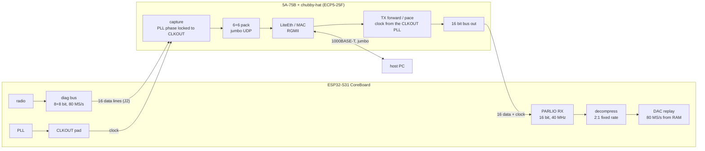

# S31 to host at 80 MS/s through a Colorlight 5A-75B

<!-- nav-start -->
Previous: [S31 PHY-less Ethernet links](s31-link.md) · Up: [Reference](index.md) · Next: [Transmit stream library (lib/esp_sdr/src/txs)](txs.md)
<!-- nav-end -->

This page plans a bridge between an ESP32-S31 and a host PC through a Colorlight 5A-75B (Lattice
ECP5, two gigabit Ethernet ports) on the chubby-hat. The goal is 80 MS/s receive, which the S31
cannot capture itself, and a transmit path as fast as the S31 can take.

**Design only, nothing built or measured.** Numbers below are arithmetic or come from datasheets,
the upstream projects or earlier measurements on this tree, as marked.

## Decisions (2026-11-26)

- Receive: **80 MS/s as 6+6 bits** (the top 6 of the 8-bit I and Q), **one gigabit port, jumbo
  frames**. The host has one gigabit port, so 8+8 at 80 MS/s (1.28 Gbit/s) is out.
- Transmit: investigate **compression** to get past the S31's 640 Mbit/s input limit.
- Board revisions: support **both** the V7.0 (Broadcom B50612D PHYs) and the V8.x (Realtek
  RTL8211F PHYs) 5A-75B; both are on the bench.
- The 74HC245 output buffers on the channels wired to the S31 are replaced by the chubby-hat's
  `hc245t-bypass-esd` boards.
- Radio side: the S31 first (the C5 has no Ethernet MAC; its 80 MS/s diag bus is a later case).

## Why an FPGA

The S31 radio puts its raw I/Q on pads as a 16-bit diag bus (8 bits I, 8 bits Q), up to 80 MS/s
(rate field `DUMP_MODE_RATE`, 0x20109008 bits 24:21 in `lib/esp_sdr/src/esp_sdr_priv.h`: 0 is
80 MS/s, which `dump_regs()` in `esp_sdr_s31.c` sets for the diag bus). The S31 itself captures that
bus with PARLIO RX, whose IO clock is limited to 40 MHz (datasheet v0.5, 4.2.2.14): 40 MS/s is
the most the chip can take in, measured gapless on the CoreBoard. An FPGA on the same pads has no
such limit and needs neither the S31's CPU nor its DMA.

## Receive: 80 MS/s, 6+6 bits

| 80 MS/s complex | Bit rate | One port, MTU 1500 (~957 Mbit/s) | One port, jumbo (~993 Mbit/s) |
|---|---|---|---|
| 8+8 | 1280 Mbit/s | no | no |
| 6+6 (chosen) | 960 Mbit/s | no | yes, ~3 % headroom |
| 5+5 | 800 Mbit/s | yes | yes |
| 4+4 | 640 Mbit/s | yes | yes |

UDP payload per frame is the wire size minus 66 bytes (UDP, IP, MAC, FCS, preamble, IFG); an 8972
byte payload in a 9038 byte frame gives about 993 Mbit/s. With our header inside that payload,
the samples alone get about 991 Mbit/s, 3.2 % over the 960 needed. The FPGA cannot be held up by
the host (UDP has no back-pressure, and the radio does not stop), so a FIFO only has to cover
stalls on the FPGA side (MAC back-pressure, pause frames). EBR minus two jumbo buffers is about
100 KiB, roughly 0.85 ms at 120 MB/s; anything longer needs the board's SDRAM (8 MB on V8.x,
about 70 ms). Host-side losses show up as sequence gaps. 5+5 is the fallback if 6+6 drops frames.

Packing: two complex samples (24 bits) per 3 bytes; 8958 bytes of samples (2986 pairs, 5972
samples, 74.65 us at 80 MS/s) plus a 14 byte header (sequence, sample counter, flags) fill an 8972
byte payload. Cutting 8 to 6 bits drops 12 dB of dynamic range; the FPGA could round instead of
truncate and report clipping in the header.

Capture timing: the diag bus has no clock. The S31 drives a CLKOUT channel from the same PLL on a
spare pad (output index 184, 185 or 245); the ECP5 PLL locks to it and steps its sampling phase
(dynamic phase shift) until the Q lines read clean. `esp_sdr_diag16.c` has the check: on the edge,
large Q values appear at Q's zero crossings (85 % of them when wrong). Not yet known: whether the
S31 pads drive 80 MHz cleanly over a ribbon cable (our 80 MHz captures were the chip's own); note
that `pads_route()` in `esp_sdr_diag16.c` sets the weakest drive (`GPIO_DRIVE_CAP_0`) on the diag
pads, which a cable will need raised.

## Transmit: compression

Host to S31 ends in PARLIO RX: 16 lanes x 40 MHz = 640 Mbit/s, so 40 MS/s at 8+8 bits. The S31's
DAC replay engine plays 80 MS/s, but from RAM. Options to investigate:

1. **No compression, 40 MS/s 8+8**: works with the PARLIO limit; the CoreBoard's own gigabit port
   (`apps/txstream_eth`) is planned for the same rate, so the FPGA adds little here.
2. **Compressed over PARLIO, decompressed on the S31**: 80 MS/s 8+8 (1.28 Gbit/s) in 640 Mbit/s
   needs 2:1. The link has no slack and the DAC does not wait, so the scheme must be fixed-rate,
   which makes it lossy: lossless delta coding is variable-rate and does not reach 2:1 on
   noise-like wideband I/Q. Fixed 2:1 is 8 bits per complex sample including any exponent, the
   same budget as option 3; block-floating-point (a shared exponent per block, PIE SIMD to expand)
   beats plain 4+4 only when the level varies between blocks. The decompressor runs on the S31 at
   80 MS/s into the replay buffer, a few cycles per sample on two cores. Cost to measure first.
3. **Fewer bits on the wire**: 80 MS/s at 4+4 fits PARLIO exactly (640 Mbit/s); expand to the
   DAC's format on the S31. 24 dB less range than 8+8.
4. **Compression on Ethernet only** (host to FPGA): saves nothing, the PARLIO link is the limit.

The first experiment is the S31 decompressor's cost per sample (option 2) against option 3.

Clocking: the FPGA must make the 40 MHz TX bus clock from the PLL locked to the S31's CLKOUT, not
from the board's 25 MHz. A free-running clock drifts by the crystals' ppm against the S31's DAC,
and with no feedback the S31's buffer would over- or underflow.

## Hardware

**5A-75B revisions** (q3k/chubby75, litex-boards):

| | V7.0 | V8.0 | V8.2 |
|---|---|---|---|
| FPGA | LFE5U-25F-6BG256C | LFE5U-25F-6BG256C | LFE5U-25F-7BG256I |
| PHYs | 2x B50612D | 2x RTL8211FD | 2x RTL8211F (suffix unverified) |
| SDRAM | 2x 1Mx16 | M12L64322A 2Mx32 | same |
| 25 MHz | oscillator | from PHY1 (a PHY reset stops it) | same |
| Buffers | 12x 74HC245T (5 V, output only) | same | 12x DP245D |

ECP5-25F: 24K LUT, 56 EBR (126 KiB), 28 multipliers, 2 PLLs, 2 DLLs. The EBR holds jumbo frame
buffers and the receive FIFO; both PLLs are spoken for (RGMII 125 MHz and system clock, the S31
clock with its phase shift).

**chubby-hat 0.2.2** (`/home/marble/repos/chubby-hat`): 7 Pmod hosts (56 IOs, 3.3 V), RP2040 as
USB-JTAG, AMS1117-3.3. Pmod numbers here are the hat's silkscreen, 1 to 7 (the Amaranth board
file counts `pmod 0` to `pmod 6`). Pmod 1 is on the HUB75 signals shared by all 8 connectors:
control lines only. Proposed, valid on V7.0 only until the map is re-derived for V8.x (below):

| Bus | Pmods | Direction |
|---|---|---|
| diag bus D[15:0] | 2 and 3 | S31 J2 to FPGA |
| S31 CLKOUT | 4 IO1 | S31 to FPGA (clock-capable ball still to check) |
| TX D[15:0] | 5 and 6 | FPGA to S31 PARLIO RX |
| TX clock | 7 IO1 | FPGA to S31 |

The S31 side is CoreBoard J2: the diag16 default pads GPIO20-25, 36-40, 42-44, 47, 48. These overlap
the MII jumper setups on [S31 PHY-less Ethernet links](s31-link.md) and the C5 link plan: one use
at a time.

Cautions: the stock buffers drive 5 V, so every channel wired to the S31 needs its bypass board;
the bypass board's ESD clamps hang on the Colorlight's 5 V, which is fine for 3.3 V signals. The
hat's Pmod 3.3 V comes from its AMS1117: do not power the S31 from it.

## Gateware

- LiteX has the board (`colorlight_5a_75x`, revisions 6.0 to 8.2) and LiteEth an ECP5 RGMII PHY
  (`LiteEthPHYRGMII`, 25 ps delay taps, jumbo MTU 9022, `LiteEthUDPStreamer`). No published UDP
  throughput for this board; liteeth PR 151 found the full stack does not close 125 MHz on this
  part, a 32-bit datapath at about 50 MHz does (1.6 Gbit/s raw).
- Amaranth: the user's `amaranth-boards` fork has `colorlight_5a75b_r7_0`, `r8_0`,
  `chubbyhat_v0_1` and `v0_2`. To fix first: `chubbyhat_v0_2` uses R7.0 ball names on the R8.0
  base, so the whole hat map has to be re-derived per revision. On R8.0 those names land on PHY0
  (L2, K1, K2, K3, P1, R1: hat Pmods 1 to 4, including the proposed diag bus), the shared PHY
  reset R6 (which on V8.x also stops the 25 MHz the FPGA runs on), the LED T6, PHY1 (K15, K16,
  J14, J15, J16, L16) and SDRAM data (A13, A14, B14). Hat Pmod 7 (`pmod 6`) lists A14 twice and
  lacks A15; r8_0 still names the B50612D. This tree's own gateware (`gateware/esdr_fpga`) is
  Amaranth.
- PHY bring-up: the B50612D (V7.0) runs without MDIO setup in the LiteX target with tx_delay 0;
  the RTL8211F (V8.x) sets its delays by straps on its RX pins, values not documented: try the
  MAC-side delays with and without.
- Programming: JTAG pads on the Colorlight, the hat's RP2040 (SRAM load through apollo_fpga),
  openFPGALoader for flash.

## Open points

- The hat's ball map for V8.x (the proposed Pmods collide with PHY0 and its reset there).
- 80 MHz on the S31 diag pads over a cable, and which hat balls are clock-capable.
- Whether jumbo frames at 993 Mbit/s are sustained by LiteEth (or an Amaranth MAC) on the 25F, and
  by the host NIC and kernel without loss.
- RTL8211F strap values per revision.
- The S31's PARLIO: whether 16 data lanes and a gated clock work together (some Espressif chips
  use the top lane for the valid signal).
- TX: the decompression cost on the S31.

<!-- nav-start -->
Previous: [S31 PHY-less Ethernet links](s31-link.md) · Up: [Reference](index.md) · Next: [Transmit stream library (lib/esp_sdr/src/txs)](txs.md)
<!-- nav-end -->
