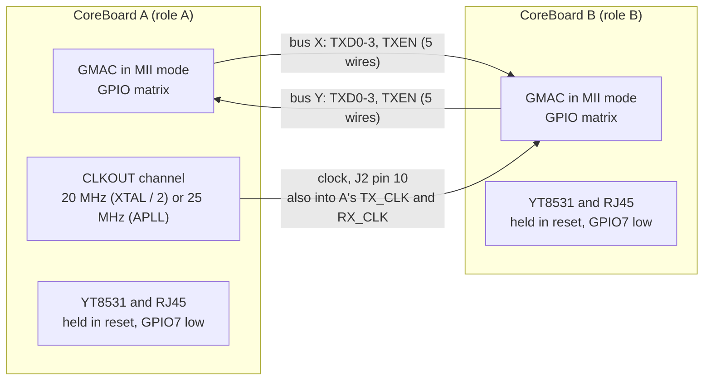
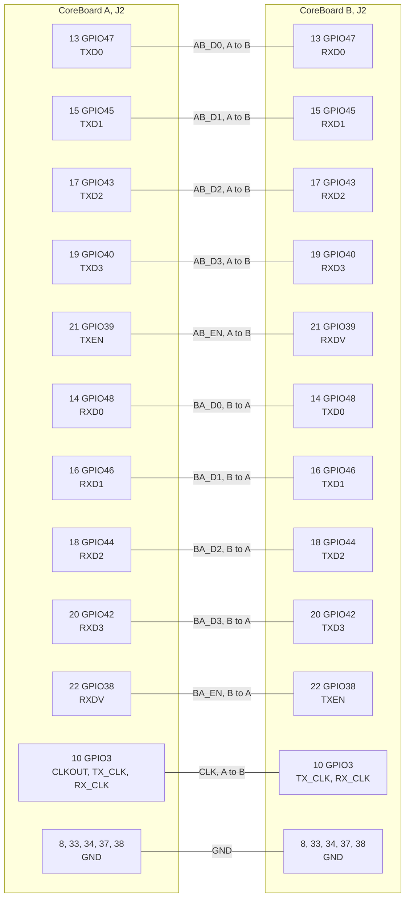
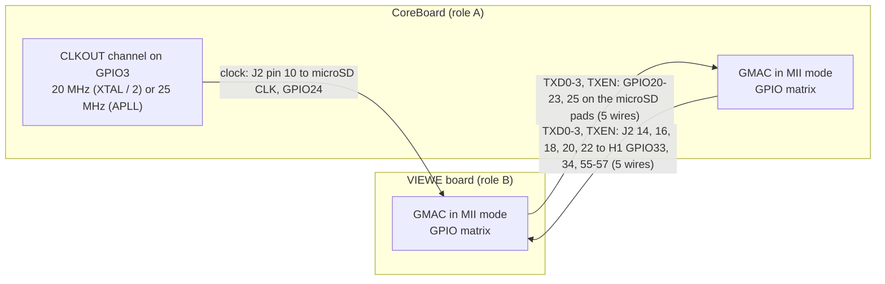
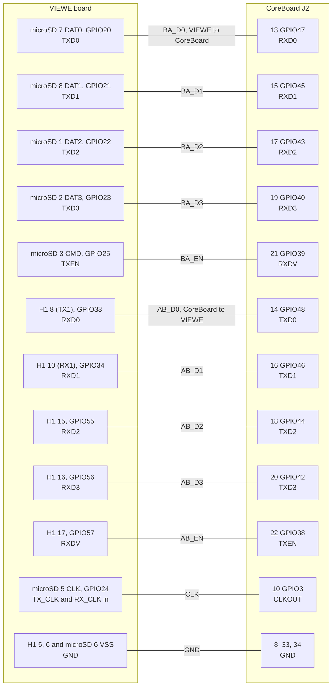
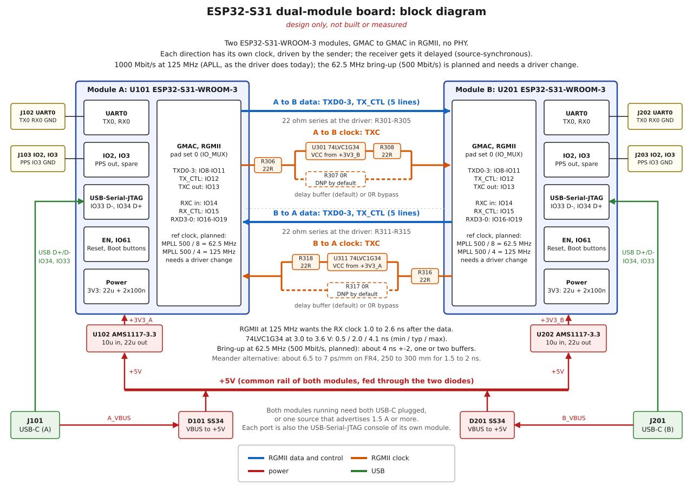
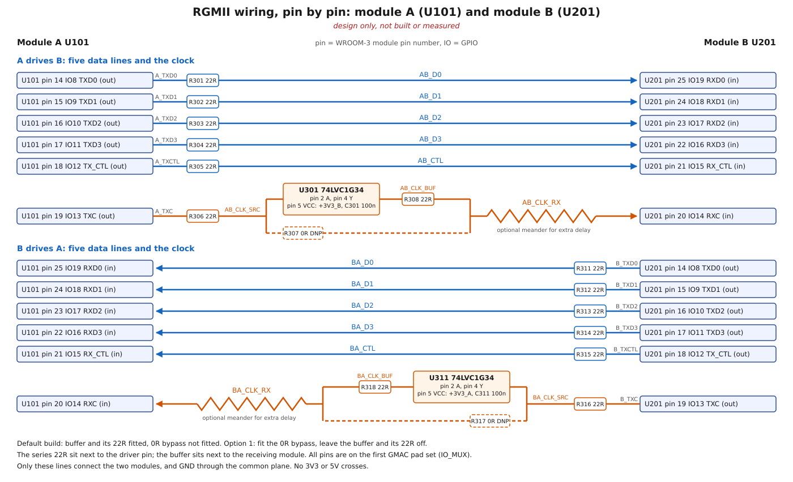
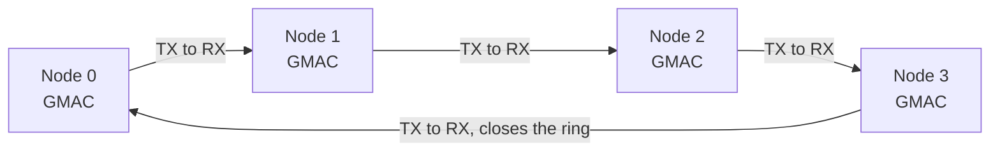
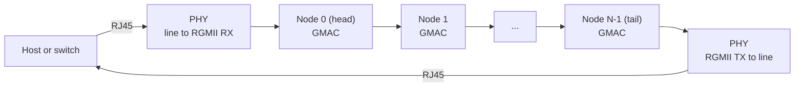

# S31 PHY-less Ethernet links

<!-- nav-start -->
Previous: [Ideas from elsewhere](ideas-from-elsewhere.md) · Up: [Reference](index.md) · Next: [S31 to host at 80 MS/s through a Colorlight 5A-75B](s31-fpga-bridge.md)
<!-- nav-end -->

This page designs Ethernet links between ESP32-S31 boards that need no PHY: the GMAC of one board
talks to the GMAC of the other over a few wires. Two jumper setups use boards that exist (two
CoreBoards, or a VIEWE board and a CoreBoard) with the GMAC in MII mode at 100 Mbit/s, and a
dual-module board with RGMII at up to 1000 Mbit/s is the third design.

**Design only, not built or measured.** No wire has been run and no Zephyr code written. The
wiring comes from the schematics, the ESP32-S31 datasheet and the GPIO matrix tables; the rates
come from the clock arithmetic, not from a test. Anything not checked against the hardware says
so.

## Answer

- **A link takes 11 wires and a ground.** Five data lines each way (TXD0 to TXD3 and TXEN, which
  the other end reads as RXD0 to RXD3 and RXDV) and one clock wire. GND is joined, 3V3 and 5V
  never.
- **Rate.** Fixed link, 100 Mbit/s full duplex. The MII clock is 20 MHz (XTAL 40 MHz / 2) or
  25 MHz (APLL) from a CLKOUT channel: about 80 to 100 Mbit/s each way.
- **Setup A** joins two CoreBoards over J2 with a straight 1:1 ribbon. **Setup B** joins the
  VIEWE board to a CoreBoard through the microSD slot and header H1.
- **The dual-module board** ([below](#the-dual-module-board)) puts two WROOM-3 modules on one PCB
  with RGMII between them.
- **A one-way ring** ([below](#one-way-ring)) joins N boards with the one GMAC each: TX to the
  next node, RX from the previous one, frames forwarded in software. With a PHY as one member,
  N boards share one RJ45 port ([below](#one-rj45-for-n-boards)).
- **Zephyr work is not done.** It is listed [below](#zephyr-work-needed-not-done).

## Common to both setups

### One MAC

The S31 has one GMAC. On a CoreBoard the RJ45 (a YT8531 PHY on RGMII, GPIO8 to GPIO19, MDC 5, MDIO
6, PHY reset GPIO7) and the MII link exclude each other at run time. Hold the PHY in reset (GPIO7
low) while MII runs. The wiring of the RJ45 stays as it is.

### Signals and matrix indexes

The MII pads go through the GPIO matrix. The signal indexes (`gpio_sig_map.h`):

| MAC signal | Direction at the MAC | Matrix index | Note |
| --- | --- | --- | --- |
| TXEN | out | 178 | |
| TXD0 to TXD3 | out | 179 to 182 | |
| RXDV | in | 178 | |
| RXD0 to RXD3 | in | 179 to 182 | |
| RX_CLK | in | 184 | |
| TX_CLK | in | 185 | |
| COL | in | 108 | tied low |
| CRS | in | 109 | tied low |
| RXER | in | 183 | tied low |

The CLKOUT channels drive the matrix outputs 184, 185 and 245. The output and input tables are
separate, so output 184 (a CLKOUT channel) and input 184 (RX_CLK) are different signals.

### Roles and clock

In MII both TX_CLK and RX_CLK are inputs of the MAC; a PHY would drive both. With no PHY one board
sources the clock for both:

- **Role A** puts a CLKOUT channel on its clock pad and feeds that same pad back into its own
  TX_CLK and RX_CLK.
- **Role B** takes the clock wire as input to TX_CLK and RX_CLK.

Both ends then run on one clock. A wire of 10 to 20 cm adds about 1 ns, small against the 40 to
50 ns clock period. The MAC is set to 100 Mbit/s full duplex without autonegotiation and no MDIO
traffic; CRS, COL and RXER are tied low through the matrix.

### Wiring rules

- Join **GND only**, never 3V3 or 5V between the boards.
- Short wires (10 to 20 cm), with a GND wire beside the clock.
- The S31 strapping pins 36, 37, 60 and 61 are not used for the link.

### Zephyr work needed (not done)

1. Relax the S31 RGMII-only build assert in `drivers/ethernet/dwc_mac/eth_esp32_dwc_ether_1000.c`.
2. Pinctrl for the MII pads.
3. The GMAC signal macros in `esp32s31-gpio-sigmap.h` (the header has the MDIO and MDC signals
   only).
4. The CLKOUT clock for role A (XTAL / 2 or the APLL).
5. A PHY node `ethernet-phy-fixed-link` with `default-speeds = "100BASE Full-Duplex"`.

## Setup A: CoreBoard to CoreBoard over J2

Two ESP32-S31-Function-CoreBoard-1 boards, J2 (2x20, 2.54 mm) joined by a straight 1:1 ribbon, pin
N to pin N. Check each wire by continuity before power. Board A is role A (it sources the clock).

### Wiring

### Netlist

| Net | Board, connector, pin | GPIO | Signal role |
| --- | --- | --- | --- |
| AB_D0 | A, J2-13 | 47 | TXD0 (out) |
| AB_D0 | B, J2-13 | 47 | RXD0 (in) |
| AB_D1 | A, J2-15 | 45 | TXD1 (out) |
| AB_D1 | B, J2-15 | 45 | RXD1 (in) |
| AB_D2 | A, J2-17 | 43 | TXD2 (out) |
| AB_D2 | B, J2-17 | 43 | RXD2 (in) |
| AB_D3 | A, J2-19 | 40 | TXD3 (out) |
| AB_D3 | B, J2-19 | 40 | RXD3 (in) |
| AB_EN | A, J2-21 | 39 | TXEN (out) |
| AB_EN | B, J2-21 | 39 | RXDV (in) |
| BA_D0 | A, J2-14 | 48 | RXD0 (in) |
| BA_D0 | B, J2-14 | 48 | TXD0 (out) |
| BA_D1 | A, J2-16 | 46 | RXD1 (in) |
| BA_D1 | B, J2-16 | 46 | TXD1 (out) |
| BA_D2 | A, J2-18 | 44 | RXD2 (in) |
| BA_D2 | B, J2-18 | 44 | TXD2 (out) |
| BA_D3 | A, J2-20 | 42 | RXD3 (in) |
| BA_D3 | B, J2-20 | 42 | TXD3 (out) |
| BA_EN | A, J2-22 | 38 | RXDV (in) |
| BA_EN | B, J2-22 | 38 | TXEN (out) |
| CLK | A, J2-10 | 3 | CLKOUT (out) and TX_CLK, RX_CLK (in) |
| CLK | B, J2-10 | 3 | TX_CLK, RX_CLK (in) |
| GND | A and B, J2-8, 33, 34, 37, 38 | | ground |

### Notes

- Leave J2 pins 9, 11 and 12 (GPIO0, 49 and 1) unconnected as guards.
- J2 pin 7 (GPIO2) is the PPS output of [apps/ptp_chain](../../apps/ptp_chain/README.rst); keep
  it free.
- Do not connect J2 3V3 (pins 35, 36) or 5V (pins 39, 40), the console pins 3 and 4, or the strap
  pins 5, 6, 23 and 24.
- **Conflict.** The default pads of `esp_sdr_diag16` and the planned C5 link use the same J2
  pins, so neither can run with this link on the same pair of boards.
  The diag16 pads include GPIO38, 39, 40, 42, 43, 44, 47 and 48; the C5 plan uses J2 pins 14 to 24. The diag16 notes also record that lines on GPIO45 and 46 came out mixed with others
  at 40 MS/s; whether that matters at the 20 to 25 MHz of MII is not known.

## Setup B: VIEWE to CoreBoard

The VIEWE board (PLCM-UES31S043H800V480C-U, see [Chip notes](chips.md#viewe-board)) has no RJ45.
It takes the link through header H1 (2x10) and the TF slot J1, with a microSD breakout adapter in
the slot. The microSD contacts are 1 DAT2, 2 DAT3, 3 CMD, 4 VDD, 5 CLK, 6 VSS, 7 DAT0 and
8 DAT1. Full duplex. **The VIEWE board is role B, the CoreBoard is role A** and sources the clock.

### Wiring

### Netlist

| Net | Board, connector, pin | GPIO | Signal role |
| --- | --- | --- | --- |
| BA_D0 | VIEWE, microSD 7 (DAT0) | 20 | TXD0 (out) |
| BA_D0 | CoreBoard, J2-13 | 47 | RXD0 (in) |
| BA_D1 | VIEWE, microSD 8 (DAT1) | 21 | TXD1 (out) |
| BA_D1 | CoreBoard, J2-15 | 45 | RXD1 (in) |
| BA_D2 | VIEWE, microSD 1 (DAT2) | 22 | TXD2 (out) |
| BA_D2 | CoreBoard, J2-17 | 43 | RXD2 (in) |
| BA_D3 | VIEWE, microSD 2 (DAT3) | 23 | TXD3 (out) |
| BA_D3 | CoreBoard, J2-19 | 40 | RXD3 (in) |
| BA_EN | VIEWE, microSD 3 (CMD) | 25 | TXEN (out) |
| BA_EN | CoreBoard, J2-21 | 39 | RXDV (in) |
| AB_D0 | VIEWE, H1-8 (TX1) | 33 | RXD0 (in) |
| AB_D0 | CoreBoard, J2-14 | 48 | TXD0 (out) |
| AB_D1 | VIEWE, H1-10 (RX1) | 34 | RXD1 (in) |
| AB_D1 | CoreBoard, J2-16 | 46 | TXD1 (out) |
| AB_D2 | VIEWE, H1-15 | 55 | RXD2 (in) |
| AB_D2 | CoreBoard, J2-18 | 44 | TXD2 (out) |
| AB_D3 | VIEWE, H1-16 | 56 | RXD3 (in) |
| AB_D3 | CoreBoard, J2-20 | 42 | TXD3 (out) |
| AB_EN | VIEWE, H1-17 | 57 | RXDV (in) |
| AB_EN | CoreBoard, J2-22 | 38 | TXEN (out) |
| CLK | VIEWE, microSD 5 (CLK) | 24 | TX_CLK and RX_CLK (in, one pad, two matrix inputs) |
| CLK | CoreBoard, J2-10 | 3 | CLKOUT (out) |
| GND | VIEWE, H1-5, H1-6, microSD 6 (VSS) | | ground |
| GND | CoreBoard, J2-8, 33, 34 | | ground |

### Cautions

- Keep SD_CTRL (GPIO60) high. That leaves SD_3V3 off, so its 51 kOhm pull-ups are dead.
- The pads GPIO20 to GPIO25 sit on the VDDPST_SD supply. Its I/O level is register-selectable
  (1.8 V or 3.3 V) and must be 3.3 V: set it and measure it before connecting.
- GPIO33 and GPIO34 are USB-Serial-JTAG pads. The VIEWE dtsi disables `usb_serial`; check the
  idle level of the pads before connecting.
- Never connect CN8's VCC_IN (up to 24 V).
- Avoid GPIO36 and 54 (driven by the RS-485 and CAN transceivers), GPIO59 (CH340 TXD) and
  GPIO61 (BOOT strap).
- The CoreBoard side keeps the notes of setup A: pins 9, 11, 12 open, no 3V3, 5V, console or strap
  pins, the diag16 conflict.

### Fallback without the breakout

Without the microSD adapter the VIEWE board can only send, from header H1 alone: the clock in on
GPIO33 (pin 8), TXEN on GPIO34 (pin 10), TXD0 to TXD2 on GPIO55 to GPIO57 (pins 15 to 17) and TXD3
on GPIO0 (pin 7), with the I2C and the touch controller off. The CoreBoard side is the same as
above: J2 pins 13, 15, 17, 19 and 21 for TXD0 to TXD3 and TXEN, pin 10 for the clock.

## The dual-module board

A third design leaves the jumpers behind: one PCB with two ESP32-S31-WROOM-3 modules, their GMACs
joined in RGMII at up to 1000 Mbit/s, with no PHY. The bring-up clock is planned at 62.5 MHz
(MPLL 500 MHz / 8, 500 Mbit/s); that needs a driver change, as the driver makes its RGMII
reference clock from the APLL today (`CONFIG_ETH_ESP32_DWC_RGMII_REF_MHZ`). Each direction carries its own clock, delayed at the receiver by a
74LVC1G34 buffer or a trace meander.

The design files are in [hw/s31-dual-rgmii](../../hw/s31-dual-rgmii/README.md): a netlist
generator (`gen_netlist.py`) that is the single source for the KiCad netlist, the CSV netlist and
the bill of materials, and the README with the layout rules, the bring-up steps and the open
risks. Design only, not built or measured.

## One-way ring

N boards in a ring: the TX bus of each node goes to the RX bus of the next, the last node closes
the ring to the first. A full-duplex MAC treats TX and RX as two independent buses, so nothing
needs both directions on one cable to reach the same neighbour, and the one GMAC per chip is
enough. Design only, like the rest of this page.

### Clocking

- **RGMII.** Each node drives its own TXC from its own crystal, and that wire is the RXC of the next
  node. The RX FIFO of the MAC crosses the clock domains as it does behind a PHY: there is no
  common clock. Every receiver needs its own RXC delay (a 74LVC1G34 or a meander, as on the
  [dual-module board](#the-dual-module-board)). At 125 MHz DDR this is a PCB with N modules, not
  jumper wires; the 62.5 MHz bring-up clock (500 Mbit/s) relaxes the timing.
- **MII.** Each node is role A of its outgoing link: its CLKOUT pad feeds its own TX_CLK and goes
  out as the RX_CLK of the next node. So every node needs two clock pads, CLKOUT out and RX_CLK in
  (setup A needs one clock pad per board); the second pad is not chosen. Whether a CLKOUT pad can
  also feed TX_CLK is not checked (see [open points](#open-points)), nor is the hold time between
  two MACs (below).
- **Wiring between CoreBoards.** With the same pin map on every node (TX on the odd J2 pins 13 to
  21, RX on the even pins 14 to 22, as board A of setup A), the odd pins of one board go to the
  even pins of the next. Each J2 then has two neighbours, so this is single jumper wires, not a
  1:1 ribbon.

### Forwarding

The DWC GMAC has no switch or cut-through; forwarding is software.

- Every node receives all ring frames (promiscuous, or one ring multicast address), keeps those
  for itself and sends the rest on. Without a copy: the RX buffer is handed to a TX descriptor and
  a fresh buffer goes back to the RX ring.
- A frame must leave the ring: the sender drops its own frame when it comes back, or a hop count in
  the frame ends it. Broadcasts circulate forever otherwise.
- Store and forward costs one frame time per hop (about 12 us for 1500 bytes at 1 Gbit/s, 120 us
  at 100 Mbit/s) plus the software time.
- Full rate through one node means 1 Gbit/s in and 1 Gbit/s out, about 250 MB/s of DMA in
  internal SRAM. Whether the S31 sustains that is not measured; the RJ45 baseline (below) comes
  first.
- Every node sends on its own crystal. A node whose upstream runs a few ppm fast cannot forward a
  full line rate forever: its TX queue grows. The slowest clock in the ring sets the limit, so
  sustained transit traffic stays a little under C (some 1e-5 of C for crystals of 10 ppm).

### Throughput

With link rate C:

- **Neighbour traffic** (a processing pipeline: node k sends to node k+1) gets C on every hop
  (just under C, see the crystals above).
  This is what the ring is good at.
- **Uniform traffic** (every node to every other) takes N/2 hops on average: the ring carries 2C
  in total, about 2C/N per node.
- The upstream neighbour is N-1 hops away.

### Limits

- **No reverse direction on the same MAC.** Splitting the lanes (TXD0-1 downstream, TXD2-3
  upstream, 2 lanes at 125 MHz DDR = 500 Mbit/s each way) does not work: the MAC sends one frame
  stream with every nibble across all four lanes, and the receiving MAC needs all four lanes of
  the same frame. A second ring the other way needs a second interface on every node: PARLIO
  (16 lanes at 40 MHz, framing and CRC in software). USB HS does not close a ring: each node would
  be host on one link and device on the other, and one OTG controller takes one role on one port at
  a time. It stays a point-to-point option (480 Mbit/s, NCM host class not written).
- **One dead node breaks the ring.** A bus switch per node (for example a 74CBTLV3257) that joins
  its upstream and downstream sides while the node is off keeps the ring closed; not designed.
- The RJ45 of a CoreBoard uses the same GMAC, so a node in the ring has no RJ45 Ethernet at the
  same time.

## One RJ45 for N boards

A PHY can take one place in the ring. It sits there like a node: its RGMII receive bus (RXC,
RX_CTL, RXD0-3) carries what comes in from the line, its transmit bus (TXC, TX_CTL, TXD0-3) goes
out to the line. The ring becomes a chain between two ends of one Ethernet port, and N boards
share one RJ45: one port for N radios (MIMO). Design only, like the rest of this page.

Frames from the network enter at node 0 (the head). A frame for node k passes nodes 0 to k-1, node
k takes it, and nothing of it reaches the PHY. A frame from node k to the network passes nodes k+1
to N-1 (the tail) and leaves on the wire. The PHY is the extra port that no S31 has: each has one
GMAC.

### What has to hold

- **Traffic between nodes runs downstream only.** A frame from node k to a node before it would
  leave through the tail, and a switch never sends a frame back out of the port it came in on.
  Discovery, command replies and anything else between nodes travel toward the tail; a broadcast of
  a node reaches the network as well. The rule of the plain ring that a sender drops its own frame
  when it comes back does not apply here: nothing comes back.
- **Both ends filter.** The tail passes on only frames that a chain node sent (source MAC is one of
  the chain's), so the network's broadcasts (ARP, DHCP) do not come back out of the same port, where
  a switch would learn the host's MAC address on the wrong port. The head drops frames from the wire
  whose source MAC is a chain MAC: they can only be the chain's own frames looped back by a second
  bridged path in the network.
- **The whole chain runs at the line speed.** A GMAC has one speed setting for RX and TX together
  (MACCR PS and FES, `eth_dwc_ether_1000_core.c`), so a 100 Mbit/s host link brings the head to
  100 both ways, node 1 with it, and so on: all links at 100 Mbit/s. Advertising 1000BASE-T only
  keeps the chain at 1 Gbit/s, but then 100 Mbit/s equipment gets no link at all. The 62.5 MHz
  bring-up clock (500 Mbit/s) cannot run on the two PHY links either: a PHY in 1000 mode drives RXC
  at 125 MHz and expects TXC at 125 MHz. Bring-up at 62.5 MHz is for a chain without the PHY.
- **All upstream traffic shares one link.** The tail forwards everything: about 1 Gbit/s in total
  toward the network for all N nodes. 4 channels of about 230 Mbit/s each fit, 4 channels of
  80 MS/s do not.
- **RX checksum checks off, or errored frames kept.** A partly filled aggregated frame (below) has
  an IP total length larger than its payload. With `CONFIG_ETH_DWC_ETHER_RX_HW_CHECKSUM_EN` the
  driver sets MACCR IPCO and leaves DMAOMR DT clear, and by the DWC databook the GMAC then drops
  frames with an IP payload error. Ring nodes need RX checksum offload off or DT set. Not checked
  on the S31.
- **One node drives MDC and MDIO** to set up the PHY and to read the link state. The internal RGMII
  delays of the PHY replace the delay buffer on its two links.
- **The PHY is a part of its own** on the board with N modules, with its magnetics and RJ45. The
  YT8531 of a CoreBoard cannot take this place: its RGMII traces go straight to the pads of that
  board's S31.

### Patterns from EtherCAT

EtherCAT has the same shape: the master sends from a normal network card, the frame passes every
slave and comes back to the same port. Its slaves forward in hardware while the frame passes (about
1 us per hop); an S31 stores the whole frame and forwards in software (about 12 us per hop at
1 Gbit/s). The protocol ideas carry over, the forwarding speed does not.

1. **One frame for all nodes.** EtherCAT puts the data of many slaves in one frame, and each slave
   reads or writes its own part as the frame passes. Here, for receive:
   - The head starts a UDP datagram with one slot per node, and each node fills its slot for the
     same sample interval. The host gets one packet per sample interval with all N channels,
     aligned for MIMO, and a packet rate N times lower.
   - A node adds its slot without a copy: the received buffer and its own sample buffer go out as
     the two buffers of one TX descriptor. The driver already does this: ring mode with buffer 2
     (TDES1 TBS2, des3) and `CONFIG_ETH_DWMAC_TX_FAST` frames of two buffers. RX strips the FCS
     (MACCR CSTF), so the received buffer has no CRC to splice past. Not tested on the S31.
   - The slot sizes are fixed, so the head writes the final IP total length and header checksum in
     advance. A node whose samples are not ready still appends a full slot (filler) and clears its
     bit; a shorter frame would not match the IP length and the host drops it.
   - On IPv4 the UDP checksum may be 0. IPv6 forbids that (RFC 8200): the tail's TX checksum
     offload fills it in, which covers both buffers because TX runs in store-and-forward mode
     (DMAOMR TSF).
   - Transmit is the reverse: the host sends one frame with N slots, each node takes its slot, and
     the tail drops the rest.
2. **A count of who took part.** An EtherCAT slave increments a working counter in the frame when
   it processes its data. Here each node sets its bit in a mask of valid slots, and the host sees
   at once which channel is missing.
3. **Address by position.** An EtherCAT slave increments an address field as the frame passes, so
   its address is its position. Here a discovery frame from the head gives each node its slot index
   without configuration, and the tail reports N to the host.
4. **Distributed clocks.** In EtherCAT the first slave is the reference, every slave timestamps the
   frame at its ports (which gives the delay of every hop) and corrects its local clock, to well
   under a microsecond. The S31 GMAC timestamps RX and TX in hardware, which
   [apps/ptp_chain](../../apps/ptp_chain/README.rst) already uses. Plain PTP with the host as master
   does not work here: the path from the host to node k has k software hops, the way back N-1-k, and
   PTP assumes both directions equal (the error is half the difference, tens of microseconds).
   Either every node acts as a PTP transparent clock and adds its residence time (RX to TX
   timestamp, two-step), or the chain syncs the EtherCAT way: one frame timestamped at every node,
   the hop delays added up. This aligns timestamps only: with one crystal per module the samples
   drift in phase, so coherent MIMO still needs a shared 40 MHz reference (bare chips, see
   [other options](#other-options-considered)) or resampling.
5. **Commands that come back confirmed.** An EtherCAT frame returns to the master with the
   counter filled in. Here the host sends a command (for example "start at time T"), each node
   increments the counter, and the tail sends it back to the host as a UDP reply: one frame for N
   nodes, with the confirmation.
6. **Plain IP beside the bus.** EtherCAT tunnels ordinary frames to its slaves (Ethernet over
   EtherCAT). Here the chain carries plain Ethernet frames anyway: only the aggregated stream
   frames are special, everything else (ARP, DHCP, SSH, MCUmgr) is normal traffic of each node.
7. **Routable transport.** EtherCAT also runs over UDP to cross routers. Here data and control are
   UDP/IP from the start, so the stream crosses switches and routers as it is.

### On a normal IP network

- **One MAC and one IP address per node** is the default. To the network the chain is N hosts
  behind one port, like a small switch. Every node runs its own stack and sees every frame from the
  network, and its MAC filter keeps only its own (and broadcasts). Fragments carry the destination
  IP, so each node reassembles its own.
- **One MAC and one IP for the whole chain** is possible, but only the head may run a full IP stack
  toward the network (ARP, ICMP, DHCP, TCP). Otherwise N stacks answer the same frame: N echo
  replies, ICMP port unreachable or a TCP RST from every node that does not own the port. The other
  nodes then take only their own UDP ports through a filter in front of their stack, and get the
  head's DHCP lease and the host's ARP entry from the head. Fragments from the host go to the head,
  which reassembles or drops them, because only the first fragment carries the UDP port.
- **No fragments from the chain.** Everything the chain sends has DF set and fits the MTU: nodes
  that share one source IP pick IP IDs on their own, and the host's reassembly could mix them.
- **Slot size.** MTU 1500 leaves 1472 bytes of UDP payload; the stream header, the slot mask and
  the counter come out of that first, the rest divided by N is the slot. One packet with N channel
  slots is not standard VITA 49 (one stream ID per packet): either each slot is a VRT packet of its
  own inside the datagram, or the payload is a format of its own. Jumbo frames where the network
  allows them; whether the S31 GMAC supports them is not checked.
- **Overhead.** Every frame on the wire costs 66 bytes besides its payload (preamble and SFD 8,
  Ethernet header 14, FCS 4, gap 12, IP 20, UDP 8), plus the stream header. One frame of N slots
  instead of N frames of one slot saves (N-1) x 66 bytes per sample interval: for N = 4 and full
  frames 1538 bytes on the wire instead of 1736, about 11 % less. The larger gains are the packet rate at the host and the alignment.
- **Untagged port.** An 802.1Q tag moves every offset by 4 bytes; the chain expects an untagged
  access port, or parses the tag.
- **A slot that is not ready in time** gets filler and a cleared bit, and the frame goes on. Waiting
  would stall every node behind it.

### What EtherCAT does better

- Hardware forwarding: here latency grows by about 12 us per hop.
- An EtherCAT port without link closes the loop by itself. Here a dead node breaks the chain
  unless the board has a bypass switch.

## Other options considered

Findings of the same investigation (2026-11-26), not designed further:

- **SMP across chips**: no. An IPI is only a doorbell; Zephyr's scheduler needs coherent shared
  memory and atomics on every context switch, which a 10 to 100 us link round trip turns into
  milliseconds. Boards cooperate by messages instead (AMP).
- **OpenAMP over a link**: RPMsg calls its transport through `struct rpmsg_device_ops`
  (`modules/lib/open-amp/open-amp/lib/include/openamp/rpmsg.h`), so an `rpmsg_device` that frames
  messages over the link (with CRC and retransmit) keeps endpoints and the name service; wrap it
  as a Zephyr `ipc_service` backend. remoteproc maps onto EN/BOOT and the ROM loader. Mirroring
  virtio vrings works too (one writer per field) but only pays for an unmodified virtio peer.
- **RJ45 between two CoreBoards**: a plain cable is already a direct gigabit link (the PTP work
  measured 0 lost in 3 M exchanges, about 22 us per round). Its sustained raw-L2 throughput is not
  measured yet and is the baseline for every design here.
- **USB HS**: the S31's PHY is on chip; one board as host with an NCM host class (not written)
  would give a 480 Mbit/s link with no extra IC.
- **Software 10BASE-T**: PARLIO TX plus the BitScrambler for Manchester, the analog comparator or a
  pad as line receiver, resistors and capacitors (or magnetics for a switch). Talks to real
  Ethernet gear at 10 Mbit/s; receiving at full rate is unproven on any ESP32.
- **GMII at a slow clock**: the matrix also has TXD4-7 and RXD4-7, so an 8-bit bus at 20 to 25 MHz
  (160 to 200 Mbit/s) between CoreBoards needs 19 pins; whether the TX clock may come from a pad in
  1000 mode (`EMAC_TX_CLK_SEL`, undocumented) is open.
- **Shared 40 MHz reference**: on bare chips (not modules, whose crystal is inside) one oscillator
  into every XTAL_P locks all PLLs, radios included (coherent receivers, as ESPARGOS does), and a
  Si5351 or MS5351M could make phase-tunable RGMII receive clocks, calibrated from CRC counters.
- **Other chips**: the C5, C6 and S3 have no Ethernet MAC; PARLIO to PARLIO (S31 16 lanes, C5 8
  lanes, 40 MHz) is the fast path for them. For 80 MS/s to a host see
  [S31 to host at 80 MS/s](s31-fpga-bridge.md).

## Open points

- Nothing is built: the MII timing at 20 MHz and the claimed 80 to 100 Mbit/s are arithmetic.
- Whether the S31 GMAC accepts a CLKOUT pad as TX_CLK and RX_CLK at once (one pad, two matrix
  inputs, plus the pad's own output) is not checked; the ring needs only TX_CLK from it.
- MII hold time between two MACs (setups A, B and the ring): the sender changes TXD 0 to 25 ns
  after the rising edge of TX_CLK, and the receiver samples on that same edge. Setup fits in a
  40 ns period, hold rests on the matrix and pad delays, which are not checked. Inverting RX_CLK at
  the receiver through the matrix input inversion would sample on the falling edge instead.
- Ring: the second MII clock pad per node is not chosen, the forwarding rate (250 MB/s of DMA at
  1 Gbit/s) is not measured, and the bypass switch for a dead node is not designed.
- One RJ45 for N boards: frames of two buffers forwarded on the S31 are not tested, RX checksum
  offload with partial frames (DT) and jumbo frames on the S31 GMAC are not checked, the PHY part
  is not chosen; the slot format, the discovery frame and the transparent clock are not
  specified.
- Setup B needs the VDDPST_SD level and the GPIO33 and GPIO34 idle level measured first.
- The dual-module board's RGMII clock window (1.0 to 2.6 ns at 125 MHz) is met by a typical
  buffer only; see its README.

<!-- nav-start -->
Previous: [Ideas from elsewhere](ideas-from-elsewhere.md) · Up: [Reference](index.md) · Next: [S31 to host at 80 MS/s through a Colorlight 5A-75B](s31-fpga-bridge.md)
<!-- nav-end -->
