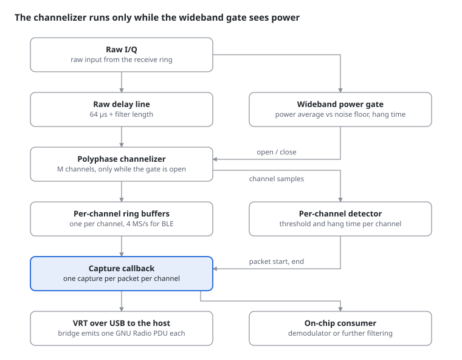

# Channelizer

A channelizer splits one wideband sample stream into a grid of narrow channels, so that a
receiver can watch many channels of a band at once.

This page is the first of [Modulation and coding](index.md): the Bluetooth LE captures in
[GFSK and Bluetooth LE](gfsk.md) and the survey in [Burst detection](bursts.md) start from its
channels.

Two implementations exist:

- **ESP32-S3:** a channelized burst capture, `esp_sdr_chancap.h` (`CONFIG_ESP_SDR_CHANCAP`),
  used by [chancap](../../apps/chancap/README.rst). It started as a design note dated 2026-10-15
  and was built on the ESP32-S3 on 2026-10-16. Its input is the raw mode of the ESP32-S3 ring in
  [Gapless receive](../samples/rings.md).
- **ESP32-P4:** a fixed-point polyphase filterbank (`esdr_pfbq.h`) over the ESP32-C6's gapless
  stream, used by [osmosdr_bridge](../../apps/osmosdr_bridge/README.rst) and by
  [pcap](../../apps/pcap/README.rst) (see [Polyphase filterbank on the ESP32-P4](#polyphase-filterbank-on-the-esp32-p4)).

Most of the page describes the ESP32-S3 capture: its goal, pipeline, API, the design-time
sizing, the implementation and its measurements. Sections that hold the design view of
2026-10-15 say so.

## Goal and scope

A reusable receive tool that watches a grid of equally spaced channels and hands over one I/Q
capture per packet per channel, with a timestamp and metadata. The consumer decides what happens
next: send it to the host as a GNU Radio PDU, or demodulate it on the chip.

- **In scope:** any uniform channel grid inside the captured bandwidth, given by first channel
  frequency, spacing and count. Examples are BLE (2 MHz spacing) and IEEE 802.15.4 (5 MHz
  spacing) in promiscuous mode.
- **Out of scope:** demodulation itself, mixed grids in one instance, and transmit.
- **Not a goal:** a continuous spectrum view. Frame-based FFTs already cover that better.

## Pipeline

Two power detectors gate the work. A cheap wideband detector decides when the channelizer runs,
and a per-channel detector decides which samples become a capture.



### Two detectors, one delay line

1. **Wideband gate.** A running average of the raw signal power is compared against a tracked
   noise floor. The gate opens on a rise and closes after the hang time.
2. **Delay line.** The channelizer reads the raw stream a fixed 64 µs (plus its filter length)
   behind the gate. When the gate opens, the channelizer starts on samples from before the burst,
   so nothing has to be caught up and the preamble is kept.
3. **Channelizer.** A polyphase filter bank splits the band into M channels at the per-channel
   rate.
4. **Per-channel detection.** Each channel has its own noise floor, threshold and hang time. A
   packet's capture runs from a bit before its trigger to the end of its hang time, taken from
   that channel's ring buffer.
5. **Callback.** One capture per packet goes to the consumer, which sends it to the host or
   processes it on the chip.

On the ESP32-S3 the ring runs at 16 MS/s without decimation on CPU 1 and hands the stream to
CPU 0 through SRAM bank 2. There the wideband gate runs, a polyphase filter bank (8 channels on
the vector unit) or a decimator per channel (other grids) splits the band, and the per-channel
detectors cut the packets out. Captures live in a PSRAM slab.

### Load

- Gating lowers the average load, not the peak: while the gate is open, the channelizer must
  keep up with the full input rate.
- At 2.4 GHz, Wi-Fi will hold the gate open much of the time.
- Either gate can be switched off at runtime, which turns the pipeline into a continuous
  channelizer, a continuous per-packet sniffer or anything between (next section).

## Runtime gating

Both gates switch on and off independently while running, through
`esp_sdr_chancap_set_gates()`. The shell commands that do it are in
[chancap](../../apps/chancap/README.rst).

### The four modes

| Wideband gate | Per-channel gate | What the consumer gets | Use |
|---|---|---|---|
| on | on | one capture per packet per channel; channelizer idle while the band is quiet | promiscuous sniffing at the lowest average load |
| off | on | one capture per packet per channel; channelizer always running | a band so busy the wideband gate would never close anyway |
| on | off | every channel in full for each span the band is busy, all with the same start and end | recording bursts for offline analysis, including signals below the per-channel threshold |
| off | off | every channel as a continuous stream, cut into back-to-back chunks of `max_capture_us` with contiguous indices | feeding continuous demodulators or recorders on the host |

### Switching rules

- **Takes effect at the next block boundary** of the ring, so a switch never splits a sample
  block.
- **Open captures are closed and delivered** when a switch would change how they end. No samples
  are lost or duplicated across a switch; `index` stays contiguous.
- **State keeps running while a gate is off.** The delay line keeps filling and every noise floor
  keeps tracking, so turning a gate on works at once, without a warm-up gap.
- **Thresholds** change at runtime through `esp_sdr_chancap_set_thresholds()`, on the same block
  boundary.

## Sizing and timing

The timing values come from the protocol specs. The buffer sizes are arithmetic at 16-bit I/Q
(4 bytes per complex sample) and become final once the detector window and filter are chosen.

| Item | Value | Basis |
|---|---|---|
| BLE 1M preamble + access address | 40 µs | BLE spec |
| 802.15.4 sync header (preamble + SFD) | 160 µs | 802.15.4 O-QPSK PHY |
| BLE inter-frame space | 150 µs | BLE spec |
| 802.15.4 ACK turnaround | 192 µs | 802.15.4 spec; see [The deadline](ieee802154.md#the-deadline) |
| Lookback (delay line) | 64 µs + filter length | detector delay estimate + margin |
| Hang time | 250 µs | covers a reply after the gap |
| Raw delay line at 40 MS/s | 2560 samples, about 10 KB | 64 µs × 40 MS/s |
| Per-channel rate, BLE grid | 4 MS/s | 2 MHz spacing × oversample 2 |
| Channels in 40 MHz | about 20 BLE, 8 of 16 802.15.4 | 2 MHz and 5 MHz spacing |
| One BLE capture, longest 1M packet (about 2.1 ms) + hang | about 9400 samples, about 37 KB | 2.37 ms × 4 MS/s |

### Slab and delay line

The last row sizes the capture slab: a few dozen BLE captures in flight need about 1 MB, which
points at PSRAM for the slab.

As of the design note (2026-10-15), no chip has a gapless 16-bit 40 MS/s input. The delay line on
the inputs that exist:

- the ESP32-C5's 40 MS/s diagnostic-bus stream carries one byte per sample (4-bit I and Q), so
  2560 bytes;
- the ESP32-S3 ring runs at 16 MS/s, so 1024 pairs.

## Where the channelizer runs

This section is the design view of 2026-10-15. The note's biggest open question was where the
channelizer runs, and it read the repository as saying that no chip could do it at 40 MS/s. The
ESP32-S3 implementation a day later answered the question for that chip
([Implementation on the ESP32-S3](#implementation-on-the-esp32-s3)).

### Compute budget per chip

The inputs per chip, as of 2026-10-15 (sources: [Gapless receive](../samples/rings.md),
[Chip notes](../dev/chips.md) and `include/esp_sdr/esp_sdr_ring.h`):

| Chip | Input | Cost against the budget |
|---|---|---|
| ESP32-S3, two-stage FIR | the ring at 16 MS/s, 15 cycles per pair | fits at decimation 64 and up (about 12.7 cycles), not at decimation 4 |
| ESP32-S3, boxcar of 4 | the same ring | about 9.5 cycles per pair |
| ESP32-S3, every 4th pair | the same ring | about 1 |
| ESP32-C5 | the diagnostic-bus ring: 40 MS/s of 4-bit I/Q gaplessly, 6.0 cycles per byte | box16 and a CIC3: 4.1 to 4.4 (5.7 with the USB service) |
| ESP32-C6 | no gapless raw stream; the CPU-paced receive reads the IQ estimator at a few MS/s at most ([Paced streams](../samples/paced.md)) | |

- The boxcar's 9.5 cycles split into 4.5 to unpack and mix and 5 for the sums, the lanes split
  by index mod 4 with PIE's unzip (19 summed lane by lane, measured on the XIAO). The ring's
  side of this trade-off is in [Decimation by four](../samples/rings.md#decimation-by-four).
- The ESP32-C6 row is out of date: its gapless 80 MS/s receive came later
  ([Gapless receive](../samples/rings.md#esp32-c6-gapless-80-mss)).

The note concluded: a polyphase channelizer costs more per input sample than any of these, so it
will not run on the chip at 40 MS/s; on the C5 it would have to follow a decimating stage.

### USB bandwidth

USB rules out a host-side channelizer. Against the rates in
[Host transports](../samples/transports.md) (about 1 MB/s on the S3, 500 kB/s on the C5 and C6),
raw 40 MS/s at 8 bit is 80 MB/s, 80 to 160 times more; 80 MS/s doubles that.

- Gated raw bursts to the host therefore only work below about 1 % duty cycle: occasional
  snapshots, not continuous sniffing.
- Continuous multi-channel capture needs the channelizer on the chip, at a rate and channel count
  the chip can carry. The API below stays the target for an on-chip version at lower rates or
  with fewer channels.
- Even the gate costs a few cycles per sample, so it needs measuring too.

## Configuration and API

### Structs and functions

One config struct describes the channel grid and the detector. Each finished packet reaches a
callback as one capture, which the consumer releases when done. The names follow the existing
`esp_sdr_ring` style (callbacks take `void *user` first, `_stop()` returns nothing).

This is the API as built (`include/esp_sdr/esp_sdr_chancap.h`). The per-channel rate is given
directly instead of an oversampling factor, since the decimator bank's rate is not a multiple of
the spacing.

#### Structs

```c
struct esp_sdr_chancap_cfg {
    uint32_t first_freq_hz;    /* centre of channel 0 */
    uint32_t spacing_hz;       /* 2 MHz BLE, 5 MHz 802.15.4 */
    uint16_t n_channels;
    uint32_t channel_rate_hz;  /* the spacing or twice it (filter bank), 16 MHz / n (decimators) */
    bool     wb_gate;          /* wideband gate on at start; see Runtime gating */
    bool     ch_gate;          /* per-channel gate on at start */
    int16_t  wb_threshold_db;  /* wideband gate, above the tracked noise floor */
    int16_t  ch_threshold_db;  /* per channel, above that channel's noise floor */
    uint32_t lookback_us;      /* delay line in front of the channelizer, e.g. 64 */
    uint32_t hang_us;          /* hold after power drops, e.g. 250 */
    uint32_t max_capture_us;   /* cap per capture; chunk length when ch_gate is off */
    esp_sdr_chancap_cb_t cb;
    void *user;
};

struct esp_sdr_chancap {
    uint16_t channel;          /* freq = first_freq_hz + channel * spacing_hz */
    uint64_t index;            /* raw input sample index of the first sample */
    uint32_t sample_rate;      /* per-channel rate */
    const int16_t *iq;         /* interleaved I/Q */
    size_t   n;                /* complex samples */
    int16_t  peak_db, noise_db;
    bool     truncated;        /* hit max_capture_us while the detector still saw power */
    bool     chunk;            /* fixed-length piece of a continuous stream (ch_gate off) */
};

typedef void (*esp_sdr_chancap_cb_t)(void *user, const struct esp_sdr_chancap *cap);
```

#### Functions

```c
int  esp_sdr_chancap_start(const struct esp_sdr_chancap_cfg *cfg);
int  esp_sdr_chancap_set_gates(bool wideband, bool per_channel);
int  esp_sdr_chancap_set_thresholds(int16_t wb_db, int16_t ch_db);
void esp_sdr_chancap_release(const struct esp_sdr_chancap *cap);
void esp_sdr_chancap_stop(void);
bool esp_sdr_chancap_active(void);
void esp_sdr_chancap_get_stats(struct esp_sdr_chancap_stats *stats);
void esp_sdr_chancap_get_plan(struct esp_sdr_chancap_plan *plan);   /* LO, engine, taps */
int  esp_sdr_chancap_bench(const struct esp_sdr_chancap_cfg *cfg, uint32_t pairs,
                           struct esp_sdr_chancap_bench_result *res);
```

### Contract

#### Buffer ownership

- The callback gets a capture it must give back with `esp_sdr_chancap_release()`. A USB sender
  can then transmit it without copying.
- Captures come from a fixed memory slab; when the slab is empty, new packets are dropped and
  counted.
- `apps/stream` already hands bursts between threads through a `K_MEM_SLAB` and a message queue.

#### Callback context

- The callback runs on a work queue thread, never in the DMA or ring loop.
- The ring's own sink runs with interrupts masked and must not block, so the capture path copies
  out of it and does everything else on the thread.
- The 802.15.4 driver (`lib/ieee802154/ieee154_esp_sdr.c`) works this way: its sink copies into
  an internal-RAM ring, a thread drains it.
- The sink must write to internal RAM; PSRAM stores cost it about 20 cycles per sample.

#### Timestamps

- `index` counts raw input samples.
- The ring sink's own `index` counts decimated output samples; output sample k is input pair
  k × decimation (`esp_sdr_ring_now()`).
- Captures from different channels can then be ordered and paired, for example a packet with its
  acknowledgement.

#### Validation and thresholds

- At start, the sample rate must be an integer multiple of the spacing, and every channel must
  lie inside the usable band. `esp_sdr_chancap_start()` picks the tuning frequency itself and
  returns `-EINVAL` for an impossible grid.
- Thresholds are relative to a slowly tracked noise floor per channel, not absolute. Gain and
  interference change, and a fixed level would drift into always-on or never-on.

## Implementation on the ESP32-S3

Built 2026-10-16: `lib/esp_sdr/src/esp_sdr_chancap.c`, the portable signal processing in
`esp_sdr_chancap_dsp.h`, the vector kernels in `esp_sdr_chancap_pie.S`.

### Input

The ring's raw mode (`ESP_SDR_RING_DECIM_RAW`) feeds the undecimated 16 MS/s stream to the sink,
and `spare_bank_app` leaves SRAM bank 2 to the capture: see
[Raw mode](../samples/rings.md#raw-mode) and
[Spare bank and bursts from a run](../samples/rings.md#spare-bank-and-bursts-from-a-run).

### The 8-channel bank on two CPUs

The work of the filter bank is split over the CPUs.

- **Ring's CPU.** The sink computes the branch sums of every frame of 8 input pairs straight from
  the ring's chunk (8 taps per lane, 40-bit accumulators). It writes them to a ring of 1024
  frames in bank 2 (32 KiB, 512 µs).
- **DFT.** The channelizer on the other CPU runs the DFT and the per-frame rotation over 8 frames
  at a time (`esp_sdr_chancap_post_n()`). The odd-stacking twiddle is merged into stage 1 as one
  Q14 complex multiply.
- **Vector stages.** Stages 2 and 3 run on I and Q together through `EE.VUNZIP.32` /
  `EE.VUNZIP.16`; the -j of stage 2 is done by 0/1 masks.
- **Gate.** The wideband gate's power comes from the sums (`EE.VMULAS.S16.ACCX`, one horizontal
  sum per sub-block).
- **Lookback.** The frames go to a frame ring of 512 in bank 2, which is the lookback of all
  channels at once. Captures read their lanes through one 8 x 8 transpose per run, only while one
  is open.
- **Detectors.** The per-channel detectors judge blocks of 32 output samples with one vector
  power call.

### Other grids and the engines

#### Hand-over ring

- The sink copies every chunk into a raw ring of 8192 pairs in bank 2 with the vector unit:
  planar int16, the first 320 pairs mirrored past the end so that a filter window never wraps.
- It sums the power of every 64-pair sub-block and publishes the write position.
- The channelizer thread runs two passes: the wideband gate on the sub-block powers, a lookback
  ahead of the channelizer; and the channelizer, which runs on a sub-block when the gate is or
  becomes open within that lookback.

So the delay line of the design is the hand-over ring itself, and the gate's decision reaches
the channelizer before the samples do.

#### Engines

- **Polyphase filter bank** for a spacing that divides 16 MHz: M = 16 MHz / spacing channels,
  8 taps per branch (Kaiser, 50 dB, cutoff 0.4 spacings), decimation M or M / 2, odd stacking so
  that the LO sits on a channel edge.
- **C reference.** It computes the same integer arithmetic as the kernels (saturating 16-bit
  adds, truncating Q14 products), and the bench checks both bit for bit on noise.
- **Decimator per channel** for other spacings: a Q14 mixer, a 32-tap low pass, decimation
  16 MHz / rate (4 MS/s for 802.15.4, three channels in 16 MHz).

#### Grid rules and LO placement

`esp_sdr_chancap_start()` plans the grid by these rules:

- The grid must fit the ring's 16 MHz.
- A spacing that divides 16 MHz runs the filter bank at the spacing or twice it; other spacings
  run a decimator per channel at 16 MHz divided by an integer.
- The decimators' offsets from the LO must be multiples of 125 kHz.
- The LO is placed between two channels (filter bank) or 1.5 MHz off the centre of the grid
  (decimator bank), so its leakage falls on a channel edge. Why the LO sits off a channel is in
  [Tuning](../radio/tuning.md#lo-placement).

### Detectors and captures

#### Detectors

- Both gates are the same detector: a noise floor that follows power below four times itself at
  1/64 per block and creeps up otherwise, a threshold in dB above it with 3 dB of hysteresis, and
  a hang count.
- The wideband one judges 4 µs sub-blocks, the per-channel ones blocks of 32 output samples.
- A capture opens from the lookback (the frame ring, or the per-channel rings of the other grids,
  up to 7168 pairs for all channels) and appends until the hang time ends or `max_capture_us` is
  reached.

#### Captures

- A PSRAM slab (`CONFIG_ESP_SDR_CHANCAP_SLAB_KB`, 512 KiB) is cut into buffers of
  `max_capture_us` samples at start.
- The channelizer thread fills them, a queue hands them to the callback thread, and
  `esp_sdr_chancap_release()` returns them.
- `index` is the ring pair index of the channel filter's window centre, so captures on different
  channels line up.

### Threads and CPU 0

#### Placement and priorities

- The ring runs on CPU 1 (cooperative); the channelizer and the callback thread run on CPU 0
  (preemptive, `CONFIG_ESP_SDR_CHANCAP_DSP_PRIORITY` and one below).
- Their stacks sit in the internal RAM above the capture bank.
- The channelizer runs at the highest preemptive priority and sleeps a tick whenever it has
  caught up, so the shell and the USB stack get CPU 0 in between.

#### Tick rate

- The chancap images run 20000 ticks a second, since a tick's sleep lasts up to two ticks and
  that wait comes out of the hand-over ring's slack.
- A wake-up from the sink would be better, but a `k_sem_give()` from the ring loop cost the ring
  thousands of abandoned units a second.
- The two software interrupts the ring's CPU could raise belong to the flash stall.

#### Interrupts and cooperative threads

- The channelizer holds the Wi-Fi MAC interrupt off on its CPU for the run, as the ring does on
  its own (the handler took 400 µs per decoded packet).
- Nothing cooperative may run on CPU 0 during a run. The USB device stack's thread, the DWC2
  driver's thread and the CDC-ACM class's work queue all are by default, and held the CPU for
  160 to 800 µs per transfer burst (measured by sampling CPU 0's current thread from the ring's
  CPU).
- So the chancap images run them preemptible: `CONFIG_USBD_THREAD_PREEMPTIBLE` and
  `CONFIG_UDC_DWC2_THREAD_PREEMPTIBLE` (two local Zephyr options), and
  `CONFIG_SYSTEM_WORKQUEUE_PRIORITY=11`.

#### Overruns and copies

- When the channelizer falls more than 6656 pairs (416 µs) behind, it restarts from the newest
  data and counts an overrun; a ring gap starts a new epoch the same way.
- The hot paths use the vector unit or inline word copies, not the S3's ROM `memcpy()` and
  `memmove()` ([Chip notes](../dev/chips.md)).

### To the host

[chancap](../../apps/chancap/README.rst) sends the captures to the host as VITA 49.2 in 4 KiB
blocks on a vendor bulk IN endpoint, and its host bridge turns them into GNU Radio PDUs; its
README describes the format. The tests of the capture (`tests/unit/chancap_dsp`,
`tests/integration/esp_sdr_chancap_api`) are in [Testing](../dev/testing.md).

## Measurements on the ESP32-S3

Measured with the test's bench, in cycles per input pair; 15 are available per CPU at 16 MS/s:

| Path | Ring CPU | Channelizer CPU |
|---|---|---|
| 8 x 2 MHz at 2 MS/s (BLE, both CPUs) | 11.5 (unpack 3.0, branch sums 7.1, history 1.1) | 11.6 (kernels 5.7, channels 3.5, gate) |
| 3 x 5 MHz at 4 MS/s (802.15.4, decimators) | 6.5 (copy, power) | 56 (13.7 per channel: mixer and 32-tap FIR on the vector unit) |

- **BLE grid.** It runs in real time on average. On the air with the gates on, a few percent of
  the bursts still end in an overrun: the channelizer falls up to 620 µs behind the sink, against
  416 µs of hand-over ring, from a single long event on CPU 0 that is still being hunted.
- **Continuous mode.** With both gates off and all eight channels streaming into PSRAM it needs
  about 25 to 33 cycles per pair, so continuous mode is a debugging mode.
- **Decimator bank.** Three 802.15.4 channels at 4 MS/s cost 3.8 times its budget: it needs part
  of its work on the ring's CPU, or fewer taps.

## Polyphase filterbank on the ESP32-P4

The WHY2025 badge's ESP32-P4 channelizes the gapless stream of its ESP32-C6 radio in
[osmosdr_bridge](../../apps/osmosdr_bridge/README.rst). The same bank feeds the survey of
[Burst detection](bursts.md).

### Requests and channel blocks

- With the C6 in gapless mode ([Gapless receive](../samples/rings.md#esp32-c6-gapless-80-mss))
  and a channelizer set (`ESDR_REQ_SET_CHANNELIZER`), the segment blocks go through a polyphase
  filterbank, 2x oversampled, and a burst detector per channel
  (`apps/common/include/esdr_pfbq.h`).
- The open channels' samples go out as `ESDR_BLK_CHAN` blocks.
- The request's fields, the block format and the host command are in
  [osmosdr_bridge](../../apps/osmosdr_bridge/README.rst).

### Fixed point on PIE

- The filterbank runs in fixed point four frames at a time on the P4's PIE SIMD
  (`apps/common/src/esdr_pfbq_pie.S`), assembled by Espressif's assembler. What a build without
  that assembler does is in the README's build section.
- The rules for PIE code on the P4 are in [Chip notes](../dev/chips.md).
- **Accuracy.** Against the float bank of the tests (`tests/common/src/esdr_pfb_ref.c`, the
  definition of `esdr_pfb.h` evaluated directly) the error stays within 0.4 sqrt(M) output units
  rms.
- `tests/unit/esdr_pfbq` checks that, and checks PIE against C bit for bit on the badge.

### Measured on the WHY2025 badge

- At 360 MHz the bridge takes 77 to 83 cycles a pair with 40 channels on busy 2.4 GHz air
  (filterbank 39, detector 15, channel blocks 10 to 15).
- The C6's whole link, 3.9 M pairs/s kept at a fixed low threshold, went through with 12 to 27 %
  of the CPU to spare and nothing dropped.
- The float bank had managed some 1 M pairs/s.

## Open points

### Design questions of 2026-10-15

These are the design note's open questions and plan. The compute and USB questions are in
[Where the channelizer runs](#where-the-channelizer-runs).

- **Hardware help.** Check whether the PHY's own energy detection or AGC state can serve as the
  wideband gate without touching samples. The decomp notes are the place to look.
- **Capture boundaries in VRT.** Mark where one capture ends.
  - The options: a trailer bit, a capture sequence number in a context field, or the host
    inferring it from timestamp gaps.
  - `vrt_rx.c` already sets the trailer's sample-loss bit on each burst's first packet.
  - `bursts()` in `apps/stream/tools/esp_sdr_lab.py` merges packets into bursts by timestamp.
  - Answered since: [chancap](../../apps/chancap/README.rst) marks first, last, truncated and
    chunk with trailer bits.
- **Mixed grids.** BLE and 802.15.4 together need two instances or a finer common grid (1 MHz).
  Decide once the single-grid version works.
- **Existing pieces.** No channelizer or energy gate existed in the repo yet. The closest were
  the CSMA noise-floor calibration in `apps/link/src/mac.c` (one-shot, dB above a median floor)
  and the 802.15.4 driver's sink-to-thread hand-over.
- **Next steps.** Benchmark a gate and an M = 32 channelizer on the C5 and the S3, prototype the
  host side in GNU Radio, then decide the split.

What was done instead: the S3 carries an 8-channel bank at 16 MS/s, so the split question
answered itself for that chip; the C5 stays open.

### Open after the implementation

- the remaining overrun source and the decimator bank's budget
  ([Measurements on the ESP32-S3](#measurements-on-the-esp32-s3));
- capture rates on the air;
- the C5: its diagnostic-bus ring at 40 MS/s and 4 bits would need the bank behind a decimating
  stage;
- mixed grids;
- the PHY's own energy detection as a cheaper wideband gate.
