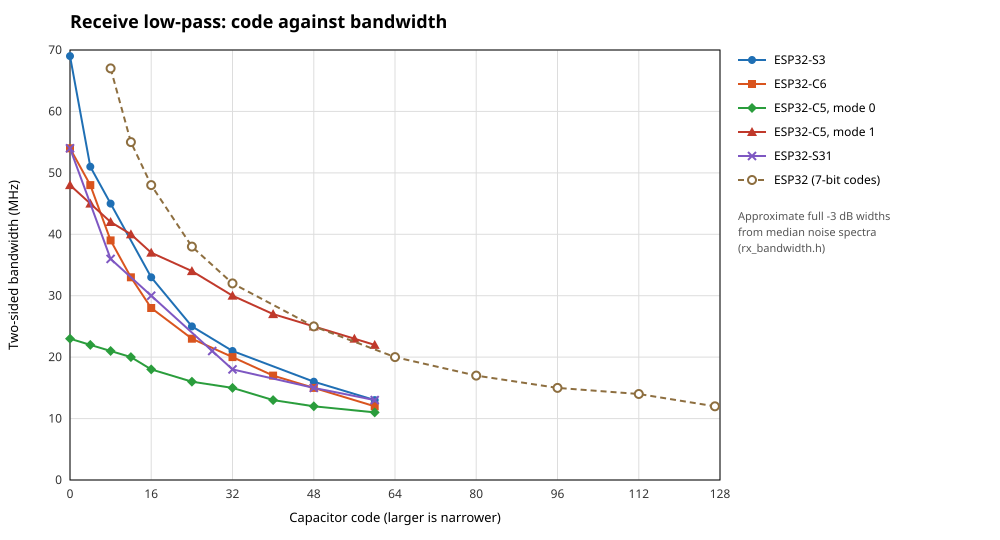
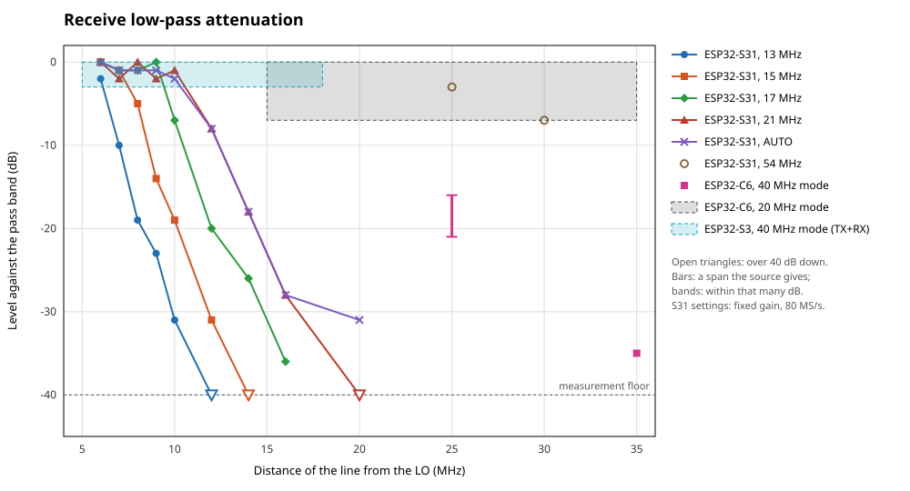

# Filters

This page covers the analog low-pass filters on both paths and the one digital decimation filter
before the samples reach memory. The receive filter decides how wide a band a capture sees and what
folds into it at a lower sample rate. It builds on the low-pass blocks of
[Transceiver](transceiver.md), which list the registers.

## Receive low-pass filter

### Codes

The filter has one capacitor code per branch, I and Q, in the analog block BBTOP.

- A larger code is narrower. 0 is the widest setting, not a bypass.
- `esp_sdr_rx_set_lpf()` takes a raw code from 0 (widest) to `ESP_SDR_RX_LPF_MAX` (63; 127 on the
  ESP32, whose codes have seven bits), or `ESP_SDR_RX_LPF_AUTO` (-1), which restores the PHY's
  calibrated setting.
- `esp_sdr_rx_set_bandwidth()` picks a code for a two-sided bandwidth in MHz; 0 selects the widest
  setting, and a bandwidth outside the characterized range returns `-EINVAL`.
- `probe lpf <rx> [txa [txb]]` in [rfprobe](../../apps/rfprobe/README.rst) sets the codes on the
  bench: -1 the PHY's, 0 the widest.
- An access to the analog block costs tens of microseconds, so the library writes the codes at
  front-end setup and on a change, not around every capture
  ([Transceiver](transceiver.md#cost)).
- The vendor's scaling from a bandwidth to a code is on the register page
  ([BBTOP_R4, BBTOP_R5](../dev/registers-esp32s3.md#register-bbtop_r4-bbtop_r5-0x674-0x675)).

The [capture](../../apps/capture/README.rst) app's sample output shows the receiver's noise shaped
by the filter, at code 0 against code 60.

### Code against bandwidth

The two-sided bandwidth each code gives, every chip in one plot. These are the curves
`esp_sdr_rx_set_bandwidth()` interpolates in (upstream's
`modules/lib/esp-sdr/main/common/rx_bandwidth.h`): approximate full -3 dB widths from median
noise spectra.

- ESP32-S3: the PHY's default is about 22 MHz
  ([ESP32-S3 registers](../dev/registers-esp32s3.md#register-bbtop_r4-bbtop_r5-0x674-0x675)).
- ESP32-C6 and ESP32-C5: the survey of [capture](../../apps/capture/README.rst) clamps to their
  range ([ESP32-C6 registers](../dev/registers-esp32c6.md#register-bbtop_r4-bbtop_r5-0x674-0x675)).
- ESP32: seven-bit codes; code 0 is wider than the measured span, so the widest point is code 8.
- On the C5 the range spans two PHY channel modes: mode 0, and mode 1, the PHY's wide path. Above
  23 MHz, or for the widest setting, `esp_sdr_rx_set_bandwidth()` selects mode 1 with a full channel
  setup, as upstream does (`lib/esp_sdr/src/esp_sdr_rx.c`).

### Attenuation

How far a line drops below its level in the pass band, by its distance from the LO: every chip
and setting the sources measured, in one plot.

- ESP32-S31, one curve per low-pass setting: a line at a fixed gain and 80 MS/s. AUTO, the PHY's
  own setting, therefore cuts the outer parts of a 40 or 80 MS/s burst.
- ESP32-S31, the widest setting (54 MHz): a line within some 3 dB out to 25 MHz and some 7 dB down
  at 30 (one burst each, with a few dB of scatter).
- ESP32-C6 and ESP32-S3: the channel bandwidth modes, [below](#channel-bandwidth-mode).

`doc/radio/filters.py` holds the data and draws both plots; finer measurements go into its tables.
With `--check` it exits 1 when a committed SVG differs from what it would write.

### RC calibration

The filter codes follow process spread. The vendor's `get_rc_dout()` measures an on-chip RC time
constant in the bias block (0x6a), and `rc_cal()` turns the result into the receive filter's base
code; the library does not use it. The steps and the formula are on
[ESP32-S3 registers](../dev/registers-esp32s3.md#register-bias_r5-0x6a5) (block 0x6a).

## Channel bandwidth mode

The PHY's channel bandwidth mode (`esp_sdr_set_channel_bw()`, the second argument of the blob's
`set_chanfreq()`) selects the analog filters too.

- The library passes it to the PHY's channel setup. 0, the default, is the 20 MHz configuration the
  receiver was characterized with.
- Above 2 the call returns `-EINVAL`.
- `probe cbw <0..2>` in [rfprobe](../../apps/rfprobe/README.rst) applies it by retuning.

### ESP32-S3

- cbw 0, the 20 MHz mode, cuts a 36 MHz OFDM frame off.
- cbw 2, the 40 MHz mode, passes +-18 MHz within +-3 dB, TX and RX end to end
  ([Attenuation](#attenuation)): a 36 MHz OFDM frame decodes error free.
- There is no 80 MHz mode ([Transceiver](transceiver.md#tuning-calls)).
- `apps/link` defaults to `CONFIG_APP_CBW=2`.
- The spectrum edge of a single-carrier signal is a misleading measure of this, since it mixes the
  TX filter, the RX filter and the pulse shaping. Measure the channel per subcarrier instead
  (`ofdm rx -v`, [QAM and OFDM](../modem/qam-ofdm.md)).

### ESP32-C6

On the C6 the 20 MHz mode with the widest low-pass passes the whole band; the 40 MHz mode does not.
Measured in the WHY2025 badge's survey (`apps/pcap`), plotted under [Attenuation](#attenuation):

- 20 MHz mode, widest low-pass: an 802.15.4 sender read within 7 dB of its level at +-15 MHz out
  to +-35 MHz (2026-10-27).
- 40 MHz mode: 16 to 21 dB down at +-25 MHz and some 35 dB at +-35 MHz; it ignores the low-pass
  setting.

The run used the 40 MHz mode before: the survey's edges, the advertising channels 37 and 39 among
them, reached the P4 30 to 50 dB down. The gapless run of
[osmosdr_serial](../../apps/osmosdr_serial/README.rst) keeps the 20 MHz mode and the widest
low-pass too, unless the host set a bandwidth.

## Decimation filter at 40 MS/s

On the S3, `ESP_SDR_RATE_40MSPS` captures go through the radio's digital decimation filter
(DUMP_CTRL_REG bit 15, [Transceiver](transceiver.md#digital-edge)):

- The MER is the same as at 80 MS/s, with half the samples to process.
- The filter spreads each symbol by about +-8 samples. The OFDM receiver's fine timing handles
  that ([QAM and OFDM](../modem/qam-ofdm.md)).

## Transmit low-pass filter

The S3's transmit path has two code pairs the vendor PHY calibrates, A (`0x67:12`, `0x67:13`) and
B (`0x67:14`, `0x67:15`). As on the receive side, larger is narrower (inferred from the vendor's
transmit setup).

- `esp_sdr_tx_set_lpf(code_a, code_b)` (experimental) takes 0 to `ESP_SDR_RX_LPF_MAX` or
  `ESP_SDR_RX_LPF_AUTO` for the PHY's code per pair. It writes them at once and keeps them across
  retunes.
- `probe lpf <rx> [txa [txb]]` sets them on the bench.
- What pair A's codes measured to is on
  [ESP32-S3 registers](../dev/registers-esp32s3.md#register-bbtop_r12-bbtop_r13-0x6712-0x6713).
- On the C6 the same registers are probably the transmit pairs, but `esp_sdr_tx_set_lpf()` returns
  `-ENOTSUP` there.

## Aliasing

A complex stream shows a band as wide as its rate ([The radio](index.md)). What lies further out
arrives too, at the rate's distance, unless a filter stops it first. Where no digital filter sits
before the lower rate, the analog low-pass is the only one.

- **Subsampled rings:** the C5's diagnostic-bus ring and the S31's rings take every n-th sample
  with no filter before the sampling. Narrow the low-pass for them
  ([Gapless receive](../samples/rings.md)).
- **S31 bursts:** what a display shows comes from bursts, and the analog filter is all that stands
  before their rate. So the band's image at the input rate's distance arrives at full level.

### ESP32-S31 display bursts

At 8 MS/s with the LO 2 MHz off, the line at 2400 MHz showed at 2408 and at 2392 as strong as at
2400 (-45 dBFS, floor -83). LO - 6 MHz is inside the filter's narrowest setting. So the
MicroPython app's bursts run at 20 MS/s, the LO 5 MHz below the centre, the filter at 13 MHz:

- The filter is what keeps out the band's image, 20 MHz off: a bandwidth set wider lets it in.
- The app's own decimator (`stream_decimate()` in `cmod/esdr_local.c`) leaves the noise floor flat
  within 2 dB over the band's middle 3/4 and 3 to 5 dB down at its edges.
- A signal exactly at the centre goes with the burst's mean.

The app's settings are in [micropython](../../apps/micropython/README.rst).
