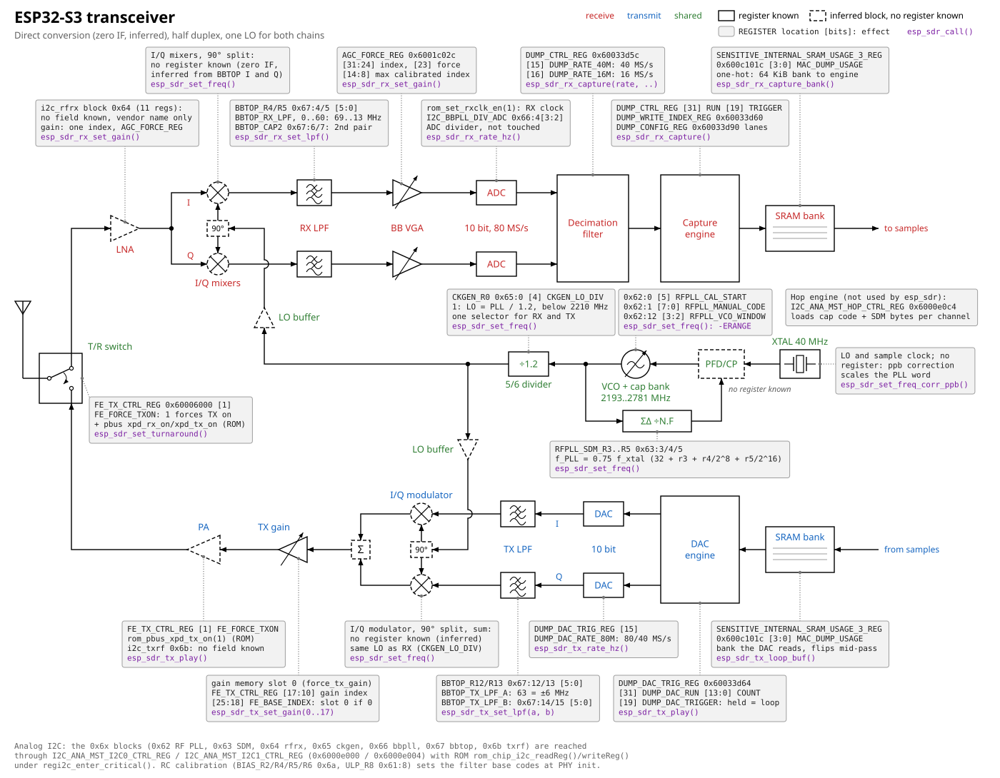
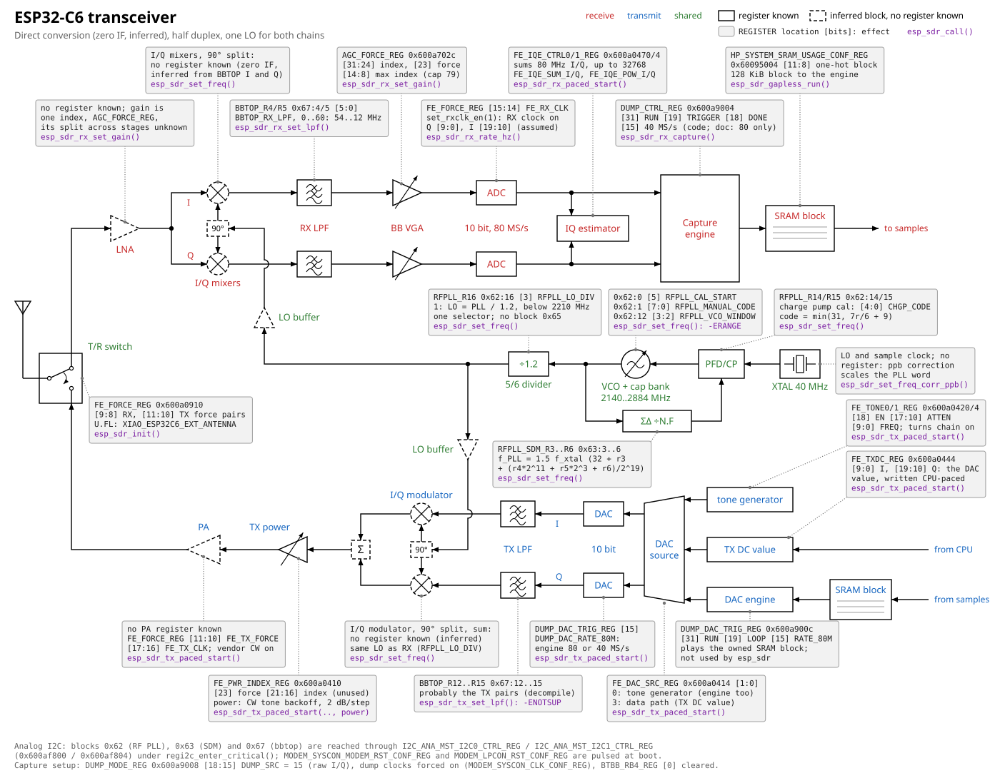
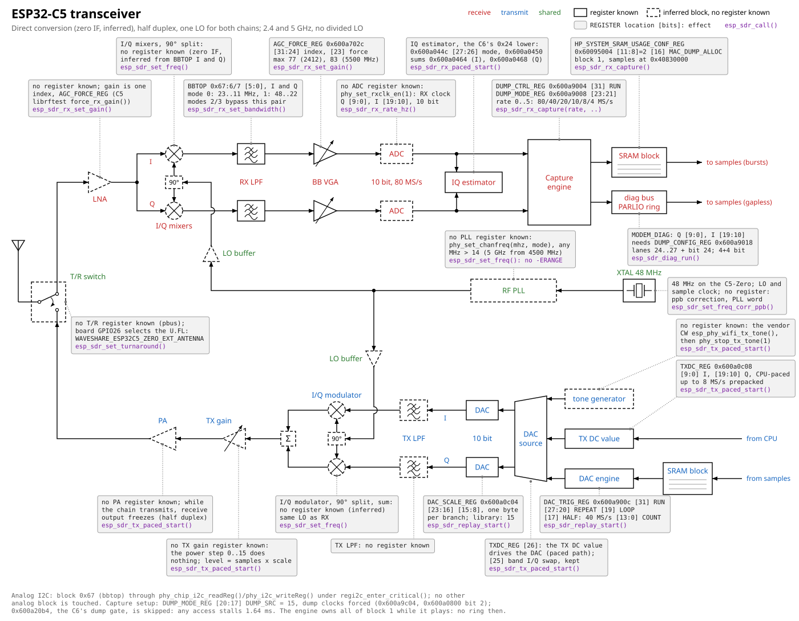
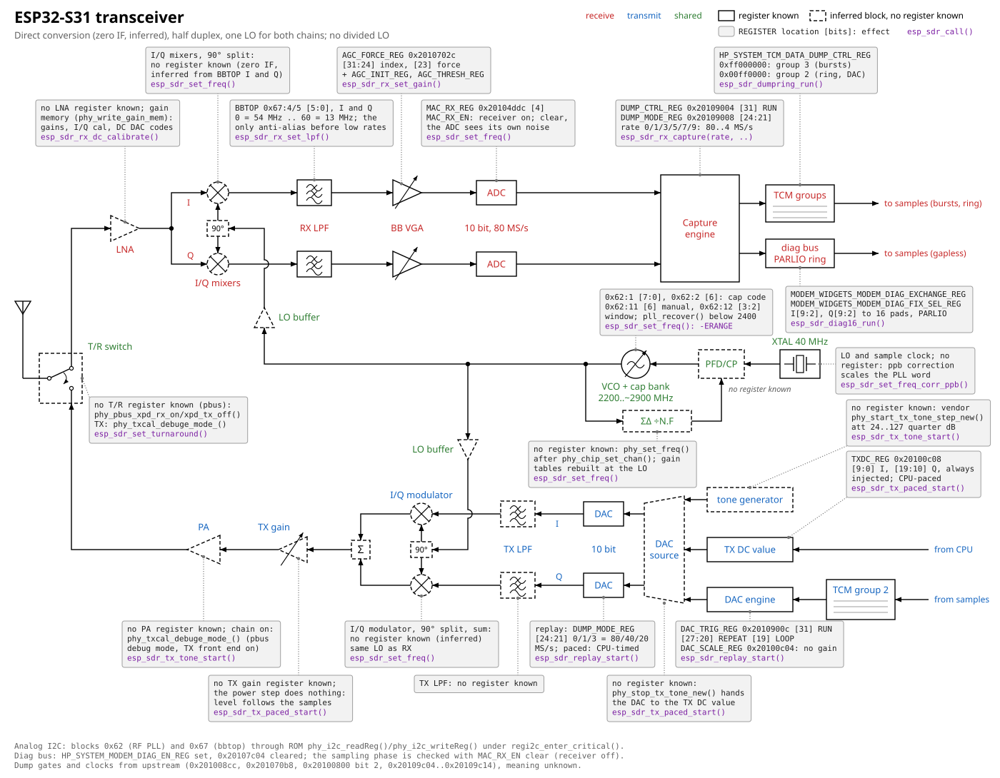
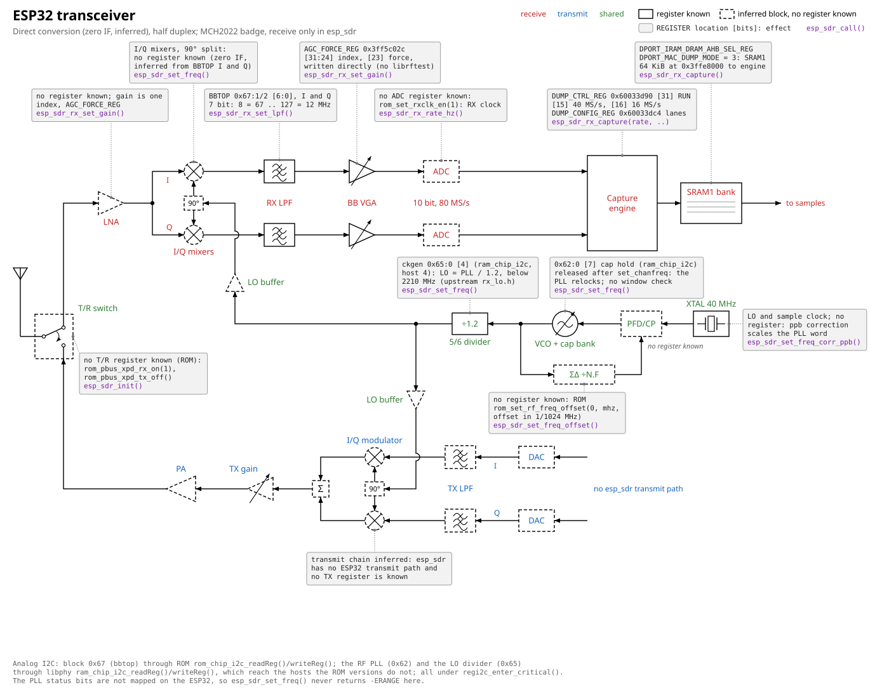

# Transceiver

This page walks the radio's analog chain block by block, in the order the signal passes: the
receive path from the antenna to the ADC, the local oscillator (LO) both paths share, and the
transmit path from the DAC back to the antenna.

For each block it names the registers the library touches and the call that drives them. It builds
on the concepts of [The radio](index.md); the following pages go deeper into [Tuning](tuning.md),
[Gain](gain.md) and [Filters](filters.md).

## Block diagram

One diagram per chip, in tabs. The ESP32-S3 and ESP32-C6 have register pages behind them; the
other three draw on the library's code and [Chip notes](../dev/chips.md), so more of their blocks
are dashed.

::::{tab-set}

:::{tab-item} ESP32-S3

:::

:::{tab-item} ESP32-C6

:::

:::{tab-item} ESP32-C5

:::

:::{tab-item} ESP32-S31

:::

:::{tab-item} ESP32

:::

::::

### Reading the diagram

- Red labels are the receive path, blue the transmit path, green the shared parts (T/R switch, LO).
- A solid block has a known register; a dashed block is inferred, with no register known.
- A grey box lists the registers that influence its block: name, location (peripheral address or
  analog I2C `block:reg`), bits and effect.
- Purple text names the `esp_sdr` call that drives the block.
- The register names, the `block:reg` notation and the confidence words (*measured*, *working*,
  *upstream*, *decompile*, *speculative*) follow the register pages; their "How to read this page"
  explains them ([ESP32-S3 registers](../dev/registers-esp32s3.md),
  [ESP32-C6 registers](../dev/registers-esp32c6.md)).

### The diagrams

`doc/radio/transceiver.py` generates one SVG per chip (ESP32-S3, ESP32-C6, ESP32-C5, ESP32-S31,
ESP32) from its tables of blocks, wires and register boxes. Edit the tables and run
`python3 doc/radio/transceiver.py`, which writes the SVGs next to it. With `--check` it exits 1
when a committed SVG differs from what it would write.

## Receive path

### Antenna and T/R switch

One antenna pin serves both directions. No discrete T/R switch register is known on any chip: the
radio switches by forcing the receive or the transmit chain on.

| Chip | Register or call | Bits | Effect |
|---|---|---|---|
| ESP32-S3 | [FE_TX_CTRL_REG](../dev/registers-esp32s3.md#register-fe_tx_ctrl_reg-0x60006000) 0x60006000 | [1] FE_FORCE_TXON | 1 forces TX on: without a frame in flight the MAC never enables TX; `force_txon_mode(0, 0, 0)` clears it at receive setup, `force_txon_mode(1, 0, 0)` sets it for transmit |
| ESP32-S3, ESP32-C6 | pbus calls in ROM and libphy | | turn the receive or transmit chain on with the MAC idle ([Vendor PHY functions](#vendor-phy-functions)) |
| ESP32-C6 | [FE_FORCE_REG](../dev/registers-esp32c6.md#register-fe_force_reg-0x600a0910) 0x600a0910 | [9:8] RX, [11:10] TX, [15:14] RX clock, [17:16] TX clock | force pairs written by the vendor's chain and clock calls, such as `force_txon()` and `set_rxclk_en()` (*decompile*) |

API: `esp_sdr_init()`, and `esp_sdr_set_turnaround()` for the switch between the directions
([Transmit](../samples/transmit.md)).

#### Board antenna selection

The library does not drive a board's antenna switch; the board files do.

- The C5-Zero's RF switch hangs on GPIO26, with a 200 kOhm pull-down: the chip antenna while the
  pin floats.
- `CONFIG_WAVESHARE_ESP32C5_ZERO_EXT_ANTENNA` drives the pin high at boot (`board.c`), which
  selects the U.FL, as `CONFIG_XIAO_ESP32C6_EXT_ANTENNA` does on the XIAO C6.
- `capture` and `rfprobe` set it for the coax bench.

Ambient Wi-Fi on the C5-Zero at gain 60 over 2412 to 2472 MHz:

| GPIO26 | Antenna | Ambient Wi-Fi |
|---|---|---|
| low | chip antenna | up to -1 dBFS (clipping) |
| high | U.FL on coax | at most -16 dBFS |
| high | U.FL open | at most -30 dBFS |

### LNA

The first gain stage. No register is known for it on any chip. The S3 vendor debug dump names
analog block 0x64 `i2c_rfrx` (11 registers); reading it as the receive RF block comes from the
name alone, and `esp_sdr` never touches it.

The receive gain is one index into a calibrated PHY gain table (AGC_FORCE_REG, below). How that
index splits across the LNA, the mixer and the baseband stages is not known. API:
`esp_sdr_rx_set_gain()`.

### I/Q mixers

The mixers bring the RF signal down to I and Q with the LO. No register is known for the mixers or
for the 90 degree split. The split is inferred at the RF mixer, because the first baseband block
already has separate I and Q codes:

| Chip | BBTOP register for I | for Q |
|---|---|---|
| ESP32-S3, ESP32-C6, ESP32-S31 | 0x67:4 | 0x67:5 |
| ESP32-C5 | 0x67:6 | 0x67:7 |
| ESP32 | 0x67:1 | 0x67:2 |

Both mixers take the LO through one divider selector, shared with the transmit path
([Local oscillator](#local-oscillator)). API: `esp_sdr_set_freq()`.

### Receive low-pass filter

The analog filter on I and Q before the ADC. It sets how wide a band reaches the ADC; where no
digital filter follows, it is the only filter before a lower sample rate ([Filters](filters.md)).

| Chip | Register | Bits | Effect |
|---|---|---|---|
| ESP32-S3, ESP32-C6, ESP32-S31 | BBTOP_R4, BBTOP_R5 (0x67:4, 0x67:5) | [5:0] BBTOP_RX_LPF | I and Q capacitor code, larger is narrower |
| ESP32-S3 | BBTOP_R6, BBTOP_R7 (0x67:6, 0x67:7) | [5:0] BBTOP_CAP2 | second capacitor pair, probably a second receive stage; the library leaves it alone |
| ESP32-C5 | 0x67:6, 0x67:7 | [5:0] | I and Q low-pass codes (`lib/esp_sdr/src/esp_sdr_priv.h`) |
| ESP32 | 0x67:1, 0x67:2 | [6:0] | I and Q low-pass codes, seven bits |

Fields: [ESP32-S3 registers](../dev/registers-esp32s3.md#register-bbtop_r4-bbtop_r5-0x674-0x675),
[ESP32-C6 registers](../dev/registers-esp32c6.md#register-bbtop_r4-bbtop_r5-0x674-0x675). API:
`esp_sdr_rx_set_lpf()`, `esp_sdr_rx_set_bandwidth()`, `esp_sdr_set_channel_bw()`.

### Baseband amplifier and AGC

The variable gain before the ADC, set by one gain index: forced by the library, or left to the
hardware AGC ([Gain](gain.md)).

| Chip | AGC_FORCE_REG | How the library forces it |
|---|---|---|
| ESP32-S3 | [AGC_FORCE_REG](../dev/registers-esp32s3.md#register-agc_force_reg-0x6001c02c) 0x6001c02c | librftest `force_rx_gain()` |
| ESP32-C6 | [AGC_FORCE_REG](../dev/registers-esp32c6.md#register-agc_force_reg-0x600a702c) 0x600a702c | librftest `force_rx_gain()`, which writes only this register |
| ESP32-C5 | 0x600a702c | librftest `force_rx_gain()` |
| ESP32-S31 | 0x2010702c | the PHY's `phy_force_rx_gain()` |
| ESP32 | 0x3ff5c02c | written directly, without librftest |

The layout is the same on every chip: [31:24] the index, [23] the force (1 holds the index, 0 hands
the gain to the AGC), [14:8] the largest calibrated index. The S31 adds AGC_INIT_REG (0x20107094
bits 8:2, the AGC's start index) and AGC_THRESH_REG (0x2010713c bits 24:18, its threshold index;
see [Gain](gain.md), "AGC idles high").

API: `esp_sdr_rx_set_gain()` with an index or `ESP_SDR_RX_GAIN_AUTO`, `esp_sdr_rx_get_gain()`,
`esp_sdr_rx_gain_max()`.

### ADC

Two 10-bit converters, I and Q, at a native 80 MS/s. No register is known for the converters
themselves; the library only turns their clock on.

| Chip | Register or call | Effect |
|---|---|---|
| ESP32-S3 | `rom_set_rxclk_en(1)` | receive clock on, so the engine sees live ADC data |
| ESP32-S3 | I2C_BBPLL_DIV_ADC 0x66:4[3:2] | the ADC clock divider (documented by the HAL); upstream probed it for other ADC rates without a result; `esp_sdr` does not touch it |
| ESP32-C6 | `set_rxclk_en(1)`; FE_FORCE_REG [15:14] FE_RX_CLK | receive clock on |

API: `esp_sdr_rx_rate_hz()`. The layout of the sample words is in
[Samples in and out](../samples/index.md).

### Digital edge

Behind the ADC the samples leave the analog radio and enter the engines of Part 2,
[Samples in and out](../samples/index.md).

| Chip | Block | Register | Effect |
|---|---|---|---|
| ESP32-S3 | decimation filter | [DUMP_CTRL_REG](../dev/registers-esp32s3.md#register-dump_ctrl_reg-0x60033d5c) 0x60033d5c [15] DUMP_RATE_40M, [16] DUMP_RATE_16M | 40 MS/s through the radio's decimation filter ([Filters](filters.md)); 16 MS/s a separate path |
| ESP32-S3 | capture engine | DUMP_CTRL_REG [31] RUN, [19] TRIGGER; DUMP_WRITE_INDEX_REG 0x60033d60; DUMP_CONFIG_REG 0x60033d90 | one-shot or circular capture; the lane selectors |
| ESP32-S3 | SRAM bank | SENSITIVE_INTERNAL_SRAM_USAGE_3_REG 0x600c101c [3:0] SENSITIVE_INTERNAL_SRAM_MAC_DUMP_USAGE | one-hot: hands a 64 KiB bank to the engine |
| ESP32-C6 | IQ estimator | FE_IQE_CTRL0_REG, FE_IQE_CTRL1_REG 0x600a0470, 0x600a0474 | sums the 80 MHz I/Q in hardware (paced receive) |
| ESP32-C6 | capture engine | [DUMP_CTRL_REG](../dev/registers-esp32c6.md#register-dump_ctrl_reg-0x600a9004) 0x600a9004 [31] RUN, [19] TRIGGER, [18] DONE | captures into the owned block |
| ESP32-C6 | SRAM block | HP_SYSTEM_SRAM_USAGE_CONF_REG 0x60095004 [11:8] | one-hot: hands a 128 KiB block to the engine |

API: `esp_sdr_rx_capture()` and its rate argument, `esp_sdr_rx_capture_bank()`,
`esp_sdr_rx_paced_start()`, `esp_sdr_gapless_run()`.

#### Source differences

ESP32-C6 receive rate:

- The C6 register page says DUMP_CTRL_REG has no rate field, unlike the S3's: receive runs at
  80 MS/s only. The rate list in `include/esp_sdr/esp_sdr.h` says the same.
- The comment on `DUMP_CTRL_40MSPS` in `lib/esp_sdr/src/esp_sdr_priv.h` says the S3's rate bit 15
  works on the C6 too: the ring index advanced 2003 samples in 8000 CPU cycles against 4005
  without it (bench 2026-10-27), and bit 16 gave 1335 (26.7 MS/s).
- The gapless ring's half rate uses bit 15 (`lib/esp_sdr/src/esp_sdr_gapless.c`). The C6 diagram
  marks the bit "(code; doc: 80 only)".

ESP32-S3 bank field: the diagram abbreviates the field as `MAC_DUMP_USAGE`; the register page
names it SENSITIVE_INTERNAL_SRAM_MAC_DUMP_USAGE.

## Local oscillator

One LO feeds both mixers. A crystal clocks a fractional-N RF PLL: a VCO with a capacitor bank,
calibrated by the vendor's tuning call, and a sigma-delta divider in the feedback. Below 2210 MHz a
5/6 divider follows the PLL. [Tuning](tuning.md) explains the frequency plan.

| Chip | Register | Bits | Effect | Written by |
|---|---|---|---|---|
| ESP32-S3, ESP32-C6 | RFPLL_R0 0x62:0 | [5] RFPLL_CAL_START | starts the VCO calibration | vendor tuning call |
| ESP32-S3, ESP32-C6 | RFPLL_R1 0x62:1 | [7:0] RFPLL_MANUAL_CODE | manual capacitor code | vendor tuning call |
| ESP32-S3, ESP32-C6, ESP32-S31 | RFPLL_R12 0x62:12 | [3:2] RFPLL_VCO_WINDOW | VCO inside or outside its window | read by the library after every tune: `-ERANGE` |
| ESP32-S3 | RFPLL_SDM_R3 to R5 0x63:3 to 5 | | the fractional-N word | vendor tuning call |
| ESP32-C6 | RFPLL_SDM_R3 to R6 0x63:3 to 6 | | the fractional-N word | vendor tuning call |
| ESP32-C6 | RFPLL_R14, RFPLL_R15 0x62:14, 0x62:15 | [4:0] | charge pump calibration (*decompile*) | vendor tuning call |
| ESP32-S3 | [CKGEN_R0](../dev/registers-esp32s3.md#register-ckgen_r0-0x650) 0x65:0 | [4] CKGEN_LO_DIV | 1: LO = PLL / 1.2 | library |
| ESP32-C6 | [RFPLL_R16](../dev/registers-esp32c6.md#register-rfpll_r16-0x6216) 0x62:16 | [3] RFPLL_LO_DIV | the same; the C6 has no block 0x65 | library |
| ESP32-S3 | I2C_ANA_MST_HOP_CTRL_REG 0x6000e0c4 | | the hop engine's table loader ([Tuning](tuning.md), "Hop engine") | vendor, not used by `esp_sdr` |

The crystal has no register: the library's ppb correction scales the requested PLL frequency in kHz
(`esp_sdr_pll_khz()`; [Crystal calibration](crystal-calibration.md)). API: `esp_sdr_set_freq()`,
`esp_sdr_set_freq_offset()`, `esp_sdr_set_freq_corr_ppb()`.

## Transmit path

### DAC engine

The transmit samples come back from Part 2 ([Transmit](../samples/transmit.md),
[Paced streams](../samples/paced.md)) through one of three sources: a DAC engine that plays an SRAM
bank, a TX DC value register the CPU writes sample by sample, or the vendor's tone generator.

| Chip | Register | Bits | Effect |
|---|---|---|---|
| ESP32-S3 | [DUMP_DAC_TRIG_REG](../dev/registers-esp32s3.md#register-dump_dac_trig_reg-0x60033d64) 0x60033d64 | [31] DUMP_DAC_RUN, [19] DUMP_DAC_TRIGGER, [13:0] COUNT | plays COUNT words of the bank; the trigger held loops |
| ESP32-S3 | SENSITIVE_INTERNAL_SRAM_USAGE_3_REG 0x600c101c | [3:0] | the bank the DAC reads; a switch takes effect mid-pass |
| ESP32-C6 | FE_TONE0_REG, FE_TONE1_REG 0x600a0420, 0x600a0424 | [18] EN, [17:10] ATTEN, [9:0] FREQ | the vendor CW tone, which turns the chain on |
| ESP32-C6 | [FE_DAC_SRC_REG](../dev/registers-esp32c6.md#register-fe_dac_src_reg-0x600a0414) 0x600a0414 | [1:0] | DAC source: 0 the tone generator (the DAC engine plays with 0 too), 3 the data path |
| ESP32-C6 | [FE_TXDC_REG](../dev/registers-esp32c6.md#register-fe_txdc_reg-0x600a0444) 0x600a0444 | [9:0] I, [19:10] Q | the TX DC value: the DAC's input, written CPU-paced |
| ESP32-C6 | DUMP_DAC_TRIG_REG 0x600a900c | [31] RUN, [19] LOOP, [15] RATE_80M | plays the owned SRAM block; not used by `esp_sdr` |
| ESP32-C5 | 0x600a900c; 0x600a0c08 | | DAC engine; TX DC value |
| ESP32-S31 | 0x2010900c; 0x20100c08 | | DAC reader; TX DC value |

API: `esp_sdr_tx_play()` and `esp_sdr_tx_loop_buf()` on the S3; `esp_sdr_tx_paced_start()` on the
C6, C5 and S31; `esp_sdr_replay_*()` on the C5 and S31.

The sources differ on FE_TXDC_REG: the C6 register page calls it untested on the C6 and says the
library has no C6 transmit path, while `lib/esp_sdr/src/esp_sdr_paced.c` drives the C6's paced
transmit through it (`TXDC_REG` in `lib/esp_sdr/src/esp_sdr_priv.h`).

### DAC

Two 10-bit converters, I and Q.

- On the S3 the DAC has its own clock: DUMP_DAC_TRIG_REG [15] DUMP_DAC_RATE_80M selects 80 MS/s (1)
  or 40 MS/s (0). There is no 16 MS/s DAC rate.
- The C5 and S31 scale the samples by a DAC scale register before the DAC ([Gain](gain.md),
  "Level per chip").

API: `esp_sdr_tx_rate_hz()`. The transmit word layout is in [Samples in and out](../samples/index.md).

### Transmit low-pass filter

The analog low-pass filter of the transmit path, after the DAC.

| Chip | Register | Bits | Effect |
|---|---|---|---|
| ESP32-S3 | [BBTOP_R12, BBTOP_R13](../dev/registers-esp32s3.md#register-bbtop_r12-bbtop_r13-0x6712-0x6713) (0x67:12, 0x67:13) | [5:0] BBTOP_TX_LPF_A | transmit low-pass, pair A |
| ESP32-S3 | BBTOP_R14, BBTOP_R15 (0x67:14, 0x67:15) | [5:0] BBTOP_TX_LPF_B | transmit low-pass, pair B |
| ESP32-C6 | BBTOP_R12 to R15 (0x67:12 to 15) | | probably the transmit pairs, as on the S3 (*decompile*) |

API: `esp_sdr_tx_set_lpf(a, b)`, which returns `-ENOTSUP` on the C6. Codes and widths are in
[Filters](filters.md).

### I/Q modulator

The modulator mixes I and Q with the LO and sums them. No register is known for it, and no source
names a TX I/Q correction register on the S3. It takes the same LO as the receive mixers, through
the same divider selector ([Tuning](tuning.md), "The 5/6 divider"). API: `esp_sdr_set_freq()`.

### Transmit gain

What sets the transmit level before the PA: a gain memory step on the S3, a backoff, a DAC scale or
an attenuation on the others.

| Chip | Register or call | Bits | Effect |
|---|---|---|---|
| ESP32-S3 | TX gain memory slot 0, through librftest `force_tx_gain()` | | gain index and baseband gain code of one ladder step ([Gain](gain.md), "TX gain ladder") |
| ESP32-S3 | FE_TX_CTRL_REG 0x60006000 | [17:10] FE_TX_GAIN_INDEX, [25:18] FE_BASE_INDEX | the gain memory index in use; slot 0 applies only while FE_BASE_INDEX reads 0 |
| ESP32-C6 | [FE_PWR_INDEX_REG](../dev/registers-esp32c6.md#register-fe_pwr_index_reg-0x600a0410) 0x600a0410 | [23] force, [21:16] index | written by the vendor's `force_txon_mode()`, not by the library |
| ESP32-C6 | vendor CW backoff, through `esp_phy_wifi_tx_tone()` | | the `power` argument of `esp_sdr_tx_paced_start()`, 0 to 15: a backoff of 8 quarter dB (2 dB) a step below 15 (`lib/esp_sdr/src/esp_sdr_paced.c`) |
| ESP32-C5 | DAC scale 0x600a0c04 | [23:8] | the level follows samples times scale ([Gain](gain.md)) |
| ESP32-S31 | tone attenuation | | quarter dB, the carrier's level ([Gain](gain.md)) |

API:

- `esp_sdr_tx_set_gain()` with steps 0 to 17 on the S3.
- The `power` argument of `esp_sdr_tx_paced_start()` on the C6. On the C5 the
  [osmosdr_serial](../../apps/osmosdr_serial/README.rst) README gives the same 2 dB steps, while on
  the C5-Zero bench steps 0 to 15 gave the same level ([Gain](gain.md#level-per-chip)).
- The attenuation of `esp_sdr_tx_tone_start()` on the S31.

### PA

The output stage before the T/R switch.

| Chip | Register or call | Bits | Effect |
|---|---|---|---|
| ESP32-S3 | FE_TX_CTRL_REG 0x60006000 | [1] FE_FORCE_TXON | see [Antenna and T/R switch](#antenna-and-tr-switch) |
| ESP32-S3 | `rom_pbus_xpd_tx_on(1)` (ROM) | | powers the transmit analog chain |
| ESP32-S3 | analog block 0x6b `i2c_txrf` | | 12 registers, vendor name only, not touched |
| ESP32-C6 | FE_FORCE_REG 0x600a0910 | [11:10] FE_TX_FORCE, [17:16] FE_TX_CLK | no PA register known; the vendor CW turns the chain on |

API: `esp_sdr_tx_play()` on the S3, `esp_sdr_tx_paced_start()` on the C6.

## Analog I2C access

The analog blocks of the diagram (PLL, divider, filters) sit behind an internal I2C bus, not in the
memory map. The library reaches them through two ROM functions on 8-bit registers:
`rom_chip_i2c_readReg(block, host, reg)` and `rom_chip_i2c_writeReg(block, host, reg, value)`.

### ROM functions and masters

The Zephyr link maps the two functions into the ROM:

| Chip | ROM addresses | Through the stubs at |
|---|---|---|
| ESP32-S3 | 0x40035548 and 0x40035818 | 0x40005cd0 and 0x40005cdc |
| ESP32-C6 | 0x40003dc0 and 0x400040b4 | |

The I2C masters themselves are memory-mapped: I2C_ANA_MST_I2C0_CTRL_REG and
I2C_ANA_MST_I2C1_CTRL_REG
([ESP32-S3 registers](../dev/registers-esp32s3.md#analog-i2c-master),
[ESP32-C6 registers](../dev/registers-esp32c6.md#analog-i2c-master)).

#### Master routing

- The `host` argument is ignored.
- 0x62, 0x63, 0x64, 0x67 and 0x6b go to master 1, every other block to master 0 (bit mask 0x227
  over `block - 0x62`).
- On the S3 the ROM's own `get_i2c_hostid()` (0x400354bc) sends only 0x62 to 0x64 to master 1.
  libphy replaces it at PHY init (`g_phyFuns + 0x15c`, `ram_get_i2c_hostid()`), which adds 0x67
  and 0x6b (*decompile*: S3 `phy_init.o`).
- Evidence, ESP32-S3: *decompile*: S3 ROM `rom_chip_i2c_writeReg` overwrites the host register
  with the block, `rom_chip_i2c_readReg` never reads it; S3 `phy_i2c.o`.
- Evidence, ESP32-C6: *decompile*: C6 ROM `rom_chip_i2c_readReg` and `rom_get_i2c_hostid`
  (0x40003d4a, `andi 551`); *measured*: host 0 and 1 read identically in every register of blocks
  0x60 to 0x6f (bench 2026-10-09).

#### Host values in code

The host values in code are therefore cosmetic, and inconsistent across the chips:

- ESP32-S3: the library passes 0 for BBTOP and 1 for the RF PLL and the LO selector.
- ESP32-C6: the library passes 1 for BBTOP, the RF PLL and the LO selector.
- Upstream's docs say host 1 for BBTOP on every chip, while its S3 code passes 0.
- The HAL headers give hosts that do not match the routing (`I2C_BBPLL_HOSTID 1` for a master 0
  block).
- Evidence, ESP32-S3: `BBTOP_HOST` in `lib/esp_sdr/src/esp_sdr_priv.h`;
  `modules/lib/esp-sdr/main/targets/esp32s3/receiver.c:76`;
  `modules/hal/espressif/components/soc/esp32s3/include/soc/regi2c_bbpll.h:18-19`.
- Evidence, ESP32-C6: `BBTOP_HOST` in `lib/esp_sdr/src/esp_sdr_priv.h`.
- Evidence, upstream's docs: `modules/lib/esp-sdr/docs/rx-controls.md:43`.

### Locking

- The ROM functions take no lock: on the S3, `rom_enter_critical_phy` and `rom_exit_critical_phy`
  (0x40055bb8 and 0x40055bc0) are empty (*decompile*: S3 `phy_i2c.o`).
- The vendor PHY serializes its own analog I2C traffic: libphy's `ram_chip_i2c_*` call
  `phy_i2c_enter_critical()`, which the HAL maps to `regi2c_enter_critical()`
  (`modules/hal/espressif/components/esp_phy/src/phy_override.c:50-58`).
- The Wi-Fi PHY code may run a sequence at any time, on two cores even at the same time as the
  library. So every `rom_chip_i2c_*` sequence in the library takes `regi2c_enter_critical()` too
  (*working*: its declaration in `lib/esp_sdr/src/esp_sdr_priv.h`).

### Cost

An access costs tens of microseconds, so the library writes the filter codes at front-end setup,
not around every capture (*measured*: the comment above `lpf_apply()` in
`lib/esp_sdr/src/esp_sdr_rx.c`).

### Block map

Register counts are the loop bounds of the vendor's debug dump `phy_i2c_check()`. The S3 names are
the dump's strings, the C6 names the HAL's comment.

| Block | Diagram block | ESP32-S3 name, registers | Used by `esp_sdr` | ESP32-C6 name, registers | Used by `esp_sdr` |
|---|---|---|---|---|---|
| 0x61 | | `i2c_ulp`, 9 | no | ULP, 11 | no (a symptom of stale modem state) |
| 0x62 | VCO and its calibration | `i2c_rfpll`, 13 (0 to 12) | VCO status | PLL, 19 (0 to 18) | VCO status, LO divider |
| 0x63 | sigma-delta divider | `i2c_rfpll_sdm`, 6 | no (read on the bench) | SDM, 7 | no (read on the bench) |
| 0x64 | LNA side (by name) | `i2c_rfrx`, 11 | no | absent | |
| 0x65 | 5/6 divider | `i2c_ckgen`, 9 | LO divider | absent | |
| 0x66 | ADC clock | `i2c_bbpll`, 11 | no | BBPLL, 11 | no |
| 0x67 | low-pass filters | `i2c_bbtop`, 57 | RX and TX filter codes | BB, 57 | RX filter codes |
| 0x69 | | `i2c_sar`, 8 | no | SAR, 9 | no |
| 0x6a | RC calibration | `i2c_bias`, 8 | no | BIAS, 4 | no |
| 0x6b | PA side (by name) | `i2c_txrf`, 12 | no | TXRF, 1 to 15 | no |
| 0x6d | | `i2c_dig_reg`, 15 | no | PMU, 15 | no |

- The HAL defines fields only for 0x61, 0x66, 0x69 and 0x6d on the S3, and for 0x61, 0x66, 0x69,
  0x6a and 0x6d on the C6.
- On the C6, blocks 0x60, 0x64, 0x65, 0x68, 0x6c, 0x6e and 0x6f read 0xff in every register
  (*measured*, bench 2026-10-09).
- Evidence: *decompile* S3 `phy_debug.o` and C6 `libphy.a` `phy_debug.o` (`phy_i2c_check`);
  `modules/hal/espressif/components/esp_hal_regi2c/esp32c6/regi2c_impl.c:9-19`.

## Vendor PHY functions

The library drives the analog chain through the vendor's PHY blobs (libphy, librftest, the ROM) and
the Wi-Fi driver. The function tables used to read their decompile (`g_phyFuns` slots) stay on the
register pages.

### Tuning calls

| Function | Chip | Library | Called as | Evidence |
|---|---|---|---|---|
| `set_chanfreq(mhz, cbw)` | ESP32-S3 | libphy | `(channel ? mhz : 2412, cbw)`, cbw 0 or 2 | *working* `esp_sdr_tune()` in `lib/esp_sdr/src/esp_sdr.c`; *decompile* S3 `phy_rfpll.o` |
| `chip_v7_set_chan(mhz, mode)` | ESP32-C6 | libphy | `(channel ? mhz : 2412, cbw)` | *working* `esp_sdr_tune()` in `lib/esp_sdr/src/esp_sdr.c`; *upstream* `modules/lib/esp-sdr/main/targets/esp32c6/chip.h:12-19` |
| `set_rf_freq_offset(xtal, mhz, khz)` | ESP32-S3 | libphy | `(0, PLL MHz, kHz + offset)` | *working* `esp_sdr_tune()` in `lib/esp_sdr/src/esp_sdr.c`, its declaration in `lib/esp_sdr/src/esp_sdr_priv.h`; *decompile* S3 `phy_rfpll.o`; *measured*: the bench SDM values fit 40 MHz |
| `phy_set_freq(mhz, khz)` | ESP32-C6 | libphy | `(PLL MHz, kHz + offset)` | *decompile* C6 `libphy.a` `phy_rfpll.o` |

- `set_chanfreq()` converts MHz to a channel (`rom_mhz2ieee`), then calls
  `chip_v7_set_chan(chan, cbw)`. That tunes the PLL (hop table or full calibration) and passes cbw
  to `rom_bb_bss_cbw40`, which selects the analog filters. There is no 80 MHz mode; mode 2 widens
  the filters ([Filters](filters.md), "Channel bandwidth mode").
- `chip_v7_set_chan()` on the C6 sets the channel up. It converts MHz through mhz2ieee and loses
  off-grid requests, hence the calibration channel plus `phy_set_freq()`.
- `set_rf_freq_offset()` takes the crystal selector first (1: 26, 2: 32, other: 40 MHz); 0 selects
  40 MHz, right for the XIAO. It clears `0x62:11[6]`, writes block 0x63, restarts and waits for the
  calibration, then runs `rfpll_cap_init_cal()`.
- `phy_set_freq()` stores khz at `phy_param + 0x20` and calls
  `set_rf_freq_offset(phy_param[81], mhz, khz)`, the crystal selector coming from the PHY.

### Chain on and off

| Functions | Chip | Library | Called as | Evidence |
|---|---|---|---|---|
| `stop_tx_tone`, `rom_pbus_workmode`, `rom_pbus_xpd_tx_off`, `rom_pbus_xpd_rx_on`, `rom_set_rxclk_en`, `rom_pbus_xpd_tx_on` | ESP32-S3 | libphy, ROM | receive: `stop_tx_tone(1)`, `workmode()`, `xpd_tx_off()`, `xpd_rx_on(1)`, `set_rxclk_en(1)`; transmit: `workmode()`, `xpd_rx_on(0)`, `xpd_tx_on(1)` | *working* `rx_front_end()` in `lib/esp_sdr/src/esp_sdr_rx.c`, `esp_sdr_tx_front_end()` in `lib/esp_sdr/src/esp_sdr_tx.c`; *upstream* `modules/lib/esp-sdr/main/targets/esp32s3/receiver.c:92-106` |
| `ram_stop_tx_tone`, `pbus_workmode`, `rom_pbus_xpd_tx_off`, `ram_pbus_xpd_rx_on`, `set_rxclk_en` | ESP32-C6 | libphy, ROM | receive: `stop_tx_tone(1)`, `workmode()`, `xpd_tx_off()`, `xpd_rx_on(1)`, `set_rxclk_en(1)` | *working* `rx_front_end()` in `lib/esp_sdr/src/esp_sdr_rx.c`; *upstream* `modules/lib/esp-sdr/main/targets/esp32s3/receiver.c:92-106` |

The sequence (from upstream's `prepare_rx()`) forces the analog chain and the receive clock on with
the MAC idle, so the engine sees live ADC data. The chain then needs to settle: after a retune see
[Tuning](tuning.md) ("Retune time", *measured*), without one see [Transmit](../samples/transmit.md)
("Turnaround").

### Gain calls

| Function | Chip | Library | Called as | What it does | Evidence |
|---|---|---|---|---|---|
| `force_rx_gain(force, index, bt)` | ESP32-S3, ESP32-C6 | librftest | `(manual, index, 0)`; index 40 while the AGC is in charge | forces AGC_FORCE_REG (above) | `gain_apply()` in `lib/esp_sdr/src/esp_sdr_rx.c` |
| `force_tx_gain(gain, bb, dig)` | ESP32-S3 | librftest | the ladder step, dig 0 | turns TX power tracking off, writes TX gain memory slot 0 (`rom_set_tx_gain_mem(0, 1, ...)`) and the digital gain; the ladder is in [Gain](gain.md) | *working* `tx_ladder` and `tx_gain_apply()` in `lib/esp_sdr/src/esp_sdr_tx.c`; *decompile* S3 `wifi.o` |
| `force_txon_mode(en, mode, ofs)` | ESP32-S3 | librftest | `(1, 0, 0)` for transmit, `(0, 0, 0)` for receive | writes FE_TX_CTRL_REG and FE_R110_REG; ends with `rom_force_txon` | *working* `esp_sdr_tx_front_end()` in `lib/esp_sdr/src/esp_sdr_tx.c`; *decompile* S3 `phy_test.o` |

### Dump engine reference

`adctrig()` and `dactrig()` in the S3's librftest are not called. They are the reference for the
dump engine's registers (*decompile*: S3 `mac_common.o`).

### Wi-Fi driver calls

| Functions | Chip | Called as | Evidence |
|---|---|---|---|
| `esp_wifi_set_ps()`, `esp_wifi_set_promiscuous()`, `esp_wifi_set_channel()` | ESP32-S3, ESP32-C6 | `WIFI_PS_NONE`; `true`; `(1, WIFI_SECOND_CHAN_NONE)` | *working* `radio_up()` in `lib/esp_sdr/src/esp_sdr.c` |

- The register pages state that the engine and the PHY calls need the Wi-Fi driver up.
- `CONFIG_ESP_SDR_PHY_ONLY` brings the PHY up without the driver on the S3, C6 and S31
  ([Samples in and out](../samples/index.md)).
- NULL mode accepts a channel only in promiscuous mode.

## Per chip

The table sums up where the five diagrams differ:

| Chip | LO divider | VCO window check | Receive low-pass codes | Notes |
|---|---|---|---|---|
| ESP32-S3 | CKGEN_R0 0x65:0[4] | RFPLL_R12 0x62:12[3:2] | 0x67:4, 0x67:5 | [ESP32-S3 registers](../dev/registers-esp32s3.md) |
| ESP32-C6 | RFPLL_R16 0x62:16[3] | RFPLL_R12 0x62:12[3:2] | 0x67:4, 0x67:5 | [ESP32-C6 registers](../dev/registers-esp32c6.md) |
| ESP32-C5 | none | none known: never `-ERANGE` | 0x67:6, 0x67:7 | tunes 2.4 and 5 GHz ([Tuning](tuning.md)); a board antenna switch (above); its *decompile* entries are on the C6 register page; [Chip notes](../dev/chips.md) |
| ESP32-S31 | none | 0x62:12[3:2]; lock window recovery below 2400 MHz ([Tuning](tuning.md#esp32-s31)) | 0x67:4, 0x67:5 | the receiver enable (below); a tone generator for transmit; [Chip notes](../dev/chips.md) |
| ESP32 | 0x65:0[4] | none: the PLL status is not mapped | 0x67:1, 0x67:2, seven bits | the ROM's `rom_set_rf_freq_offset()` takes the offset in 1/1024 MHz; capacitor hold 0x62:0[7], released after `set_chanfreq()` so the PLL relocks at the offset frequency; no transmit |

### ESP32-S31 receiver enable

`0x20104ddc` bit 4 (`MAC_RX_EN` in `lib/esp_sdr/src/esp_sdr_s31.c`) turns the receiver on.

- Without it the ADC gives only its own noise, rms 1 to 2 counts at any gain.
- Nothing else looks wrong: the PHY calibrates, the AGC register reads back the forced index,
  bursts have the right length.
- Upstream never writes it, because its Wi-Fi driver's start does. Without the driver it must be
  set.
- librftest's `mac_init()` sets it, among much that the receive path does not need. The last thing
  it writes, `0x20104c5c`, takes the signal away again.
- Do not call `rftest_init()`: it stops the system timer under Zephyr.
