# Samples in and out

Part 2 takes the samples from the ADC and the DAC of [The radio](../radio/index.md) to the host
and back. It covers the sample words, the hardware that moves them, the memory that hardware takes
and the paths each chip offers. [Modulation and coding](../modem/index.md) starts from the complex
baseband samples this part delivers.

## The digital chain

The flowchart follows `apps/stream`: receive from the ADC to a host sample, transmit from a host
sample to the DAC. Its labels name that app's path (`vrt_rx.c`, `transport_udp.c`, USB CDC-NCM);
the packet types and sample formats are in [stream](../../apps/stream/README.rst). The analog
blocks before the ADC and after the DAC are in [Transceiver](../radio/transceiver.md).

```mermaid
flowchart LR
    subgraph RX["RX: radio to host sample"]
        direction TB
        R1["`**Analog receive path**
The radio, Part 1`"]
        R2["`**ADC**
10-bit I/Q`"]
        R3["`**Capture engine**
HW fills a DRAM bank`"]
        R4["`**esp_sdr_rx**
raw / CIC decimate / fold`"]
        R5["`**iq_pack**
8/12/16-bit packing`"]
        R6["`**vrt_rx.c**
VITA 49.2 packet`"]
        R7["`**transport_udp.c**
UDP/IPv6 send`"]
        R8["`**USB CDC-NCM**
cdc_ncm_eth0 + UDC dwc2`"]
        R9["`**Host NIC**
esdr0`"]
        R10["`**esp_sdr_lab.py / vrt_rx.py**
decode to IQ samples`"]
        R1 --> R2 --> R3 --> R4 --> R5 --> R6 --> R7 --> R8 --> R9 --> R10
    end

    subgraph TX["TX: host sample to radio"]
        direction TB
        T1["`**esp_sdr_lab.py txstream / vrt_tx.py**
encode VITA packets`"]
        T2["`**Host NIC**
esdr0`"]
        T3["`**USB CDC-NCM**
UDC dwc2 + cdc_ncm_eth0`"]
        T4["`**vrt_tx.c**
UDP recv, decode, timestamp`"]
        T5["`**PSRAM ring buffer**
sample queue`"]
        T6["`**Bank fill**
leader filler, PIE/C interp
into the idle bank`"]
        T7["`**2 DAC banks**
loop mode, bank flip`"]
        T8["`**DAC**
10-bit I/Q`"]
        T9["`**Analog transmit path**
The radio, Part 1`"]
        T1 --> T2 --> T3 --> T4 --> T5 --> T6 --> T7 --> T8 --> T9
    end
```

Mermaid source

### Receive chain

The capture engine writes raw I/Q words straight into the selected DRAM bank, and the CPU touches
no sample until the burst is complete ([Burst capture](bursts.md)). `esp_sdr_rx` then reads the
words raw, CIC-decimated or folded, and `iq_pack` packs them into 8, 12 or 16-bit items.

`vrt_rx.c` puts the items into VITA 49.2 packets, and `transport_udp.c` sends them over UDP/IPv6
through USB CDC-NCM (`cdc_ncm_eth0` on the dwc2 device controller). On the host they arrive at the
network interface `esdr0`, where `esp_sdr_lab.py` or `vrt_rx.py` decode them to I/Q samples.
[Host transports](transports.md) describes the link.

### Transmit chain

On the host, `esp_sdr_lab.py txstream` or `vrt_tx.py` encode VITA packets and send them through
`esdr0` and USB CDC-NCM. `vrt_tx.c` receives them over UDP, decodes them, places them by their
timestamps and queues the samples in a ring buffer in PSRAM.

The bank fill (the leader's filler, interpolating with PIE or in C) writes the idle one of two DAC
banks, and the DAC plays the banks in loop mode, flipping between them. The mechanism is in
[Gapless streaming](transmit.md#gapless-streaming).

## Sample word formats

The capture engine writes, and the DAC engine plays, 32-bit words with two 10-bit fields:

| Word | Bits 9:0 | Bits 19:10 | Bits 31:20 | ESP32-S3 evidence | ESP32-C6 evidence |
|---|---|---|---|---|---|
| Receive, in the dump bank | Q (assumed on the C6) | I (assumed on the C6) | S3: unused here; upstream reads 27:20 as gain metadata (unverified). C6: not stated | *measured* `include/esp_sdr/esp_sdr_rx.h:209-225`, bench 2026-10-05; *upstream* `modules/lib/esp-sdr/main/common/ring_capture.c:290, 857` | the same helpers as on the S3 (`include/esp_sdr/esp_sdr_rx.h:209-225`); not checked against a tone |
| Transmit, played by the DAC (engine) | I | Q | 0 | *measured* `include/esp_sdr/esp_sdr_tx.h:83-87` | *measured* bench 2026-10-11 (tone side and image) |

- Each field is 10-bit two's complement, -512 to 511.
- Packed form: IQ8 is bits 19:12 then 9:2 (I then Q; `include/esp_sdr/esp_sdr_rx.h:231-238`).

### Receive orientation

- The orientation was found on the S3 by detuning only the receive LO against a known carrier:
  with I taken from the low field, a tone below the LO showed up above it.
- Upstream's code comments call the low field I
  (`modules/lib/esp-sdr/main/targets/esp32s3/s3_unpack.S:7`, carried into
  `lib/esp_sdr/src/esp_sdr_ring_fir.S:12`).
- Upstream's docs say the raw ring comes out spectrally inverted, so hosts conjugate
  (`modules/lib/esp-sdr/docs/iq-stream.md:32-35`): the same finding from the other side.
- The ring keeps upstream's kernels, filters `j conj(z)` and swaps the outputs
  (`lib/esp_sdr/src/esp_sdr_ring.c:214-216`).

## Hardware that moves samples

Four pieces of hardware move samples between the radio and memory or the CPU. Each gets one
paragraph here; the pages of this part have the details.

### Dump engine

The capture and the DAC playback use the Wi-Fi MAC's undocumented dump engine (layout from
upstream esp-sdr, see `lib/esp_sdr/src/esp_sdr_priv.h`). In one-shot mode it fills a bank with a
burst and stops ([Burst capture](bursts.md)). In circular mode it writes a ring without a stop
while the CPU follows its write index ([Gapless receive](rings.md)).

On the DAC side it plays words out of memory once, in a loop, or (C5 and S31) a number of times
([Transmit](transmit.md)). The register fields are on
[ESP32-S3 registers](../dev/registers-esp32s3.md) and
[ESP32-C6 registers](../dev/registers-esp32c6.md).

### IQ estimator

The modem's IQ estimator sums the 80 MHz baseband samples in hardware, and the CPU reads the running
sums and takes their differences. Three paths use it:

- paced receive, for its samples ([Paced streams](paced.md));
- the C6 trigger, for its power windows ([Triggered snapshots](bursts.md#triggered-snapshots));
- the C6 gapless ring, to choose what it keeps ([Gapless receive](rings.md)).

### TX DC value register

The TX DC value register drives the DAC once the vendor tone path has turned the transmit chain on.
The CPU writes it at each sample instant ([Paced streams](paced.md)). Its word is the transmit
layout above (I in bits 9:0, Q in 19:10), which the S31's replay engine also plays
([Transmit](transmit.md)).

### Modem diagnostic bus

The modem's diagnostic bus (`MODEM_DIAG`) carries the I and Q fields of the dump word. Looped
through pads into the PARLIO receiver and collected by a GDMA ring, it gives a gapless stream: 4+4
bits at 40 MS/s on the C5, 8+8 bits on the S31 ([Gapless receive](rings.md)).

## SRAM bank ownership

- The engine writes or reads one SRAM bank (64 KiB on the S3), selected one-hot in
  `MAC_DUMP_USAGE`.
- While it does, the CPUs cannot reach any of that bank, so nothing else may live there.
- Linker snippets reserve the banks. A link error "DRAM image overlaps the ... bank(s)" means the
  image grew into one.

### ESP32-S3

The engine's 64 KiB banks and the `ESP_SDR_HIGH_RAM` region sit at the top of internal DRAM, laid
out by the linker snippets `lib/esp_sdr/esp_sdr_bank*.ld` (picked in
`lib/esp_sdr/CMakeLists.txt`).

| Bank | Address | Use | Reserved by |
|---|---|---|---|
| 0 | 0x3fcb0000 | the ring (banks 0 to 2) | `ESP_SDR_RING` |
| 1 | 0x3fcc0000 | second DAC and capture bank; the ring | `CONFIG_ESP_SDR_BANK1`, which `ESP_SDR_TX` and `ESP_SDR_RING` select |
| 2 | 0x3fcd0000 | always the capture bank; the ring | always |
| `ESP_SDR_HIGH_RAM` | the capture bank's end up to `DRAM_USER_END` (0x3fce9704) | buffers placed there | `ESP_SDR_HIGH_RAM` |

- Each snippet lowers `_heap_sentry` to its lowest bank, so the libc heap stays below it.
- Each snippet fails the link if the DRAM image grows into a bank.
- The bank-by-bit table is on [ESP32-S3 registers](../dev/registers-esp32s3.md); the limits of
  the rest of internal RAM are in [Code placement](../dev/code-placement.md).

### ESP32-C6

- The C6 engine takes a whole 128 KiB block.
- The gapless rotation needs two (blocks 1 and 2), and an image with the Wi-Fi driver fills blocks
  0 and 1. So the gapless ring needs the radio without the Wi-Fi driver (below), whose image fits
  block 0.
- The ownership register `HP_SYSTEM_SRAM_USAGE` is on
  [ESP32-C6 registers](../dev/registers-esp32c6.md).

### ESP32-C5

- `SRAM_USAGE` (`0x60095004` bits 11:8) = 2 with `MAC_DUMP_ALLOC` (bit 16) puts the samples at
  0x40830000, 64 KiB into block 1.
- The CPU loses all of block 1, 128 KiB (0x40820000 to 0x4083ffff): reads return the last word it
  read there, writes are dropped, nothing faults.
- Blocks 0 and 2 stay with the CPU. Block 2 holds the ROM's data, so block 1 is the only capture
  bank.
- The replay engine owns all of block 1 while it plays: no diagnostic-bus ring meanwhile.
- How the image is split around the bank is in [Code placement](../dev/code-placement.md).

### ESP32-S31

The S31's engine works in the TCM's 128 KiB groups. Group 2 is the one at 0x2F040000
(`lib/esp_sdr/Kconfig`, `ESP_SDR_S31_GROUP2`); group 3, the upper group, holds the ROM's data
and the capture bank.

| Path | Group it takes | When | What it means for the CPU |
|---|---|---|---|
| Bursts ([Burst capture](bursts.md)) | the whole upper group, ROM data at the top included | while the engine writes | interrupts off, code and stack below the group, no ROM or PHY calls |
| Dump-engine ring ([Gapless receive](rings.md)) | group 2 for its units; group 3 only while it copies a unit out of group 2 | group 2 for the whole run but for the turns; group 3 during a turn, up to 21 us | in group 2 CPU reads give the engine's words and CPU writes are lost; the other core waits in its stall interrupt during a turn |
| Replay ([Transmit](transmit.md)) | the group at 0x2F040000 (`0x00ff0000` in `HP_SYSTEM_TCM_DATA_DUMP_CTRL_REG`) | while it plays | the image must end below 0x2F040000 (`esp_sdr_bank_s31.ld` checks); a capture or the ring returns -EBUSY |
| diag16 ring ([Gapless receive](rings.md)) | shares the replay's group | while it runs | as for replay |
| Ring stage of the Pcap engine ([Gapless receive](rings.md)) | the capture bank (group 3), past the dump ring's words | during a dump-ring run | written from IRAM |

- The upper group with the ROM data stays the CPU's for replay: the engine never plays it.
- A capture or the ring would write the ownership register, hence the -EBUSY while replay plays.

## Radio without the Wi-Fi driver

`CONFIG_ESP_SDR_PHY_ONLY` brings the PHY up without the Wi-Fi driver. The C6 needs it for the
gapless ring, the S3 gains RAM from it, and the S31 always runs this way.

### ESP32-S3

The option brings the PHY up as on the C6 below, with the S3's Wi-Fi clock enable for the modem
clock and `CONFIG_ESP_PHY_ENABLE_USB`: the USB controller runs from the PLL the PHY calibrates.
Unlike on the C6, the level does not drop. Against the same builds with the driver on an S3 devkit:

| Measure | With the Wi-Fi driver | Without it |
|---|---|---|
| Noise floor on the AGC (`wpan measure`) | about -33 dBFS | the same within 0.7 dB |
| Noise floor at a forced gain | about -55 dBFS | the same within 0.7 dB |
| `apps/osmosdr` at 250 kS/s | no overflows | no overflows; filter cycles and 1.25 M samples transmitted the same |
| `apps/wpan` | frames and ACKs both ways | the same |
| DRAM image end below bank 0, before shrinking the heap | `osmosdr` 1.7 KB, `wpan` 56 B | `osmosdr` 31.8 KB, `wpan` 23 KB (about 30 KB lower) |
| Signed image | | about 300 KB smaller |
| Kernel heap peak in `osmosdr` | about 12 KB | 2184 bytes |

- `apps/multiapp` and `apps/ubertooth` select it on the S3; Ubertooth followed connections with the
  same stream loss either way.
- The other standalone S3 apps keep the driver.

### ESP32-C6

- `CONFIG_ESP_SDR_PHY_ONLY` brings the PHY up through the HAL (`esp_timer_init()`, the Wi-Fi power
  domain and modem clock, `esp_phy_enable()`, `phy_wifi_enable_set()`) in about 70 ms.
- The image fits block 0.
- Without the driver nothing sets a receive gain: the level stays some 20 dB low until one is
  forced.
- The driver's periodic receive glitch is gone.

### ESP32-S31

Without the Wi-Fi driver's start, the S31's receiver enable bit must be set by hand
([Transceiver](../radio/transceiver.md#esp32-s31-receiver-enable)).

## Sample paths per chip

Each chip offers a different set of paths. The first table names them, the second gives their
rates and tuning ranges chip by chip.

### Paths, headers and Kconfig

| Path | Header | Kconfig | Chips | Page |
|---|---|---|---|---|
| Bursts | `esp_sdr_rx.h` | `CONFIG_ESP_SDR`; decimated and folded with `CONFIG_ESP_SDR_RX_DECIM` | S3, C6, C5, S31, ESP32 | [Burst capture](bursts.md) |
| Triggered snapshots | `esp_sdr_trig.h` | `CONFIG_ESP_SDR_TRIG` | C6 | [Burst capture](bursts.md) |
| Ring of three banks | `esp_sdr_ring.h` | `CONFIG_ESP_SDR_RING`, `CONFIG_ESP_SDR_RING_BOX4`, `CONFIG_ESP_SDR_RING_RAW` | S3 | [Gapless receive](rings.md) |
| Channelized bursts | `esp_sdr_chancap.h` | `CONFIG_ESP_SDR_CHANCAP` | S3 | [Channelizer](../modem/channelizer.md) |
| Gapless 80 MS/s ring | `esp_sdr_gapless.h` | `CONFIG_ESP_SDR_GAPLESS` (with `CONFIG_ESP_SDR_PHY_ONLY`) | C6 | [Gapless receive](rings.md) |
| Diagnostic-bus ring, 4+4 bit | `esp_sdr_diag.h` | `CONFIG_ESP_SDR_DIAG` | C5 | [Gapless receive](rings.md) |
| Diagnostic-bus ring, 8+8 bit | `esp_sdr_diag16.h` | `CONFIG_ESP_SDR_DIAG16` | S31 | [Gapless receive](rings.md) |
| Dump-engine ring | `esp_sdr_dumpring.h` | `CONFIG_ESP_SDR_DUMPRING` | S31 | [Gapless receive](rings.md) |
| Playback and loop | `esp_sdr_tx.h` | `CONFIG_ESP_SDR`; two-bank loops with `CONFIG_ESP_SDR_BANK1` | S3 | [Transmit](transmit.md) |
| Gapless transmit stream | `esp_sdr_tx.h` | `CONFIG_ESP_SDR_TX` (needs PSRAM and `librftest.a`) | S3 | [Transmit](transmit.md) |
| Replay | `esp_sdr_replay.h` | `CONFIG_ESP_SDR_REPLAY` | C5, S31 | [Transmit](transmit.md) |
| Carrier | `esp_sdr_tx.h` (`esp_sdr_tx_tone_start()`) | | S31 | [Transmit](transmit.md) |
| Paced receive | `esp_sdr_paced.h` | `CONFIG_ESP_SDR_PACED` | C6, C5 | [Paced streams](paced.md) |
| Paced transmit | `esp_sdr_paced.h` | `CONFIG_ESP_SDR_PACED` | C6, C5, S31 | [Paced streams](paced.md) |

### Rates per chip

Each cell line reads **path: instantaneous / average**. The instantaneous rate is the rate at which
a path moves samples while it runs; the average rate counts the samples delivered over a whole run,
gaps included, per second. Tuning shows where the PLL locks and the LO reaches, not the 100 to
6000 MHz the API accepts.

Instantaneous rates are the rates a path is set to. Averages and run results were measured unless
marked *(derived)*, arithmetic on other figures, or *(stated)*, a limit given by the code or a page
rather than a run. "nm" means not measured.

| Chip | Tuning range | Capture, burst | Capture, continuous | Replay, burst | Replay, continuous |
|---|---|---|---|---|---|
| ESP32-S3 | Direct: PLL locks on air 2180 to 2793 MHz; VCO window (no -ERANGE) 2193 to 2781 MHz 5/6 divider below 2210 MHz: LO 1817 MHz on air, 1828 MHz without -ERANGE; about 1865 MHz per the crystal calibration Whole LO: 1817 to 2793 MHz on air, 1828 to 2781 MHz without -ERANGE; Scan grid 1840 to 2780 MHz -ERANGE checked; one LO for RX and TX, TX also through the divider | `esp_sdr_rx_capture()`: 80, 40 or 16 MS/s, 256 to 16380 samples / burst cycle nm Scan app (8192 samples at 80 MS/s and a retune a hop): 80 MS/s / 0.97 MS/s, 0.81 MS/s with the display *(derived)* `apps/stream` raw bursts of 1404 samples: 16 MS/s / 0.204 MS/s at the host over CDC-NCM; 0.24, 0.32, 0.48 MS/s at 16, 12, 8 bit *(stated)* `esp_sdr_rx_capture_decimated()`: 16/m MS/s / about 30 % coverage at 200 kS/s, so 60 kS/s *(derived)* | `esp_sdr_ring` (banks 0 to 2): 16 MS/s into the ring, FIR output 500 to 15.625 kS/s / gapless; osmosdr over USB full speed 250 kS/s 16-bit for 60 s without a gap, 500 kS/s 8 or 4-bit gapless in 5 s runs `CONFIG_ESP_SDR_RING_BOX4`: 4 MS/s / gapless for minutes; ring stage at 2 MS/s: no input lost `CONFIG_ESP_SDR_RING_RAW` (chancap): 16 MS/s to the sink / about 250 kS/s of 16-bit captures at the host over USB full speed *(stated)* | `esp_sdr_tx_play()`: 80 or 40 MS/s, up to 16380 words / nm `esp_sdr_tx_play_for()`: 80 or 40 MS/s / 79.5 or 39.87 MS/s *(derived)* `esp_sdr_tx_sweep()`: 80 or 40 MS/s / pauses between segments, nm Burst from a ring run: one bank at 40 MS/s / nm | `esp_sdr_tx_loop_*()`: 80 or 40 MS/s / the same, gapless (periodic content) `esp_sdr_tx_*()` stream: DAC at 40 MS/s, input 40/n MS/s with n at least 2 / 100 % at 8-bit 400 kS/s over CDC-NCM; osmosdr 250 kS/s for 66 s without an underrun; 500 kS/s gapless generated on chip `esp_sdr_tx_dac_play_gen()`: 40 MS/s / gapless; one block late in about 400 frames |
| ESP32-C6 | Direct: PLL locks on air 2128 to at least 2856 MHz; VCO window 2140 to 2884 MHz Divider below 2210 MHz (`RFPLL_LO_DIV`, 0x62:16): LO 1774 MHz on air, 1784 MHz without -ERANGE; about 1775 MHz per the crystal calibration Whole LO: 1774 to at least 2856 MHz on air, 1784 to 2884 MHz without -ERANGE; WHY2025 Scan 1800 to 2890 MHz -ERANGE checked; one divider selector feeds RX and TX; paced TX 2400 to 2500 MHz | `esp_sdr_rx_capture()`, `ESDR_REQ_CAPTURE_BURST`: 80 MS/s only, up to 16380 samples / nm `esp_sdr_trig`: 80 MS/s, 16320 samples a snapshot / 52 a second over SDIO to the P4, so 0.85 MS/s *(derived)*; ceiling about 3.9 MS/s from the 4 ms dead time *(derived)*; 5.6 a second through the bridge, limited by the source, so 91 kS/s *(derived)* | `esp_sdr_rx_paced`: boxcar of 80 MHz inputs, about 4.7 MS/s *(stated)* / USB-Serial-JTAG or UART 250 kS/s 8-bit, 16-bit up to 125 kS/s; SDIO 2 MS/s (2.5 MS/s leaves 3 % late); 4.0 MB/s gapless at 2 MS/s through the P4 over high-speed USB `esp_sdr_gapless` (no Wi-Fi driver): 80 MS/s, 40 with `ESDR_GAPLESS_F_HALF` / gapless at the radio for 120 s (9.6 G samples); kept 1.07 to 1.87 MS/s at 80 and 2.10 to 2.31 MS/s at 40 *(derived)*; 3.9 M pairs/s through the P4 bridge; SDIO budget 11 MB/s *(stated)* | No DAC-engine replay in the library; a transmission that drains (`ESDR_MODE_F_DRAIN`) takes the paced path | `esp_sdr_tx_paced`: DAC up to 250 kS/s (125 kS/s x 2) / over USB-Serial-JTAG about 10 % arrives late at 250 kS/s, so 125 kS/s is reliable; SDIO 250 kS/s |
| ESP32-C5 | No divider, no PLL lock flag: never -ERANGE The PHY tunes any MHz above 14; below about 1100 MHz nothing; 5 GHz path from 4500 MHz; LO at 2433, 2444, 5190 and 5200 MHz checked on Wi-Fi bursts Edges nm; paced TX 2400 to 5900 MHz | `esp_sdr_rx_capture()`: 80, 40, 20, 10, 8 or 4 MS/s, up to 16380 samples, which took 208 to 4098 us / nm | `esp_sdr_diag`: 40 MS/s, 4+4 bit / 40 MB/s for 40 s, none skipped; after box16 and a CIC 2.5 MS/s divided by the decimation, at most 312.5 kS/s *(derived)*; 250 kS/s over USB-Serial-JTAG for 60 s without an index jump `esp_sdr_rx_paced`: as on the C6 / 250 kS/s over USB-Serial-JTAG | `esp_sdr_replay`, one pass: 80 or 40 MS/s, up to 16383 words / a restart from the CPU leaves 35 to 37 samples out, so 79.8 MS/s *(derived)* MicroPython `tx_start()` buffer: paced, see the next column | `esp_sdr_replay` with LOOP or REPEAT: 80 or 40 MS/s / about 80 MS/s (12240047 against 12240000 cycles) `esp_sdr_tx_paced`: library poll up to 1.35 MS/s, tight loop 8 MS/s; DAC 500 kS/s in osmosdr_serial (125 kS/s x 4) / USB OUT delivers about 239 kS/s; 250 kS/s keeps up or starves (see below) |
| ESP32-S31 | No divider: 2200 to some 2900 MHz; -ERANGE below 2200 MHz VIEWE Scan 2205 to 2870 MHz, about 1 LO in 100 refused at random TX chain 2200 to 2900 MHz *(stated)* | `esp_sdr_rx_capture()` (no Wi-Fi driver, `librftest.a` always): 80, 40, 20, 10, 8 or 4 MS/s, up to 16380 samples plus 256 settling / VIEWE display stream of 0.8 ms bursts at 20 MS/s: 42 to 49 % coverage, so 8.4 to 9.8 MS/s *(derived)*; near PSRAM-clock lines one burst a frame (58.5 Hz) | `esp_sdr_diag16` (16 pads, not with the panel): 40 down to 0.64 MS/s, 8+8 bit / 60 s at each of 40, 20, 10, 5 MS/s without a gap; osmosdr_hs over high-speed USB 20 MS/s for 300 s at 40.157 MB/s `esp_sdr_dumpring`: 20, 10, 8 or 4 MS/s, 10+10 bit / 99.995 % of the words in 1 s at 20 MS/s; decimated on chip up to 250 kS/s gapless; 2 MS/s from a 10 MS/s ring gapless for 10 s | `esp_sdr_replay`, one pass: 80, 40 or 20 MS/s, up to 32768 words / nm MicroPython paced buffer: DAC up to 1 MHz / 187 kS/s *(derived)* | `esp_sdr_replay` with LOOP: 80, 40 or 20 MS/s / about 80 MS/s (89 cycles more over 255 passes) `esp_sdr_tx_paced`: rate times interpolation up to 1 MHz / 250 kS/s x 4 exact for 1 s; tight loop 2 MS/s exact, 5 MS/s with a few late writes |
| ESP32 (MCH2022 badge) | Divider below 2210 MHz in the code; no -ERANGE (PLL status not mapped) Range nm | `esp_sdr_rx_capture()` (Wi-Fi driver on, no `librftest.a`): 80, 40 or 16 MS/s / nm | No gapless path. `esp_sdr_rx_capture_decimated()` bursts of 16380 samples at 16 MS/s (about 1 ms), CIC to 2 MS/s down to 125 kS/s / 676, 419, 238 and 65 kS/s at 2 MS/s, 1 MS/s, 500 kS/s and 125 kS/s *(derived)*, 5.41 MS/s raw at 2 MS/s *(derived)*; through the FPGA and the RP2040 over USB full speed 449.6, 415.8, 236.0, 126.1 and 64.8 kS/s at 2 MS/s, 1 MS/s, 500, 250 and 125 kS/s; framed UART at 5 Mbaud 178.9 kS/s and plain UART at 2 Mbaud 89.1 kS/s, both at 2 MS/s | None (no transmit) | None |
| ESP32-P4 (WHY2025 badge, transport only) | No radio; it uses the C6's | C6 snapshots pass through at 5.6 a second | Over high-speed USB: C6 paced 2 MS/s at 4.0 MB/s gapless; C6 gapless 3.9 M pairs/s; the P4 channelizer dropped nothing at 8 MB/s kept; SDIO 11.6 MB/s raw, about 13 MB/s within a transfer | Forwards to the C6 | Forwards the C6's 250 kS/s *(stated)* |

The S31 also transmits a carrier from the PHY's tone generator ([Carrier](transmit.md#carrier)).

### Rate sources

Each number in the table lives on the pages below, with its date and setup; code paths name the
header or source file that states a limit.

| Chip | Tuning | Capture | Replay |
|---|---|---|---|
| ESP32-S3 | [Tuning](../radio/tuning.md) (VCO window and lock limits, bench 2026-10-09); [Crystal calibration](../radio/crystal-calibration.md) (about 1865 MHz); Scan in [micropython](../../apps/micropython/README.rst) (2026-11-10); `lo_tuning` in [Testing](../dev/testing.md); `include/esp_sdr/esp_sdr.h`, `lib/esp_sdr/src/esp_sdr.c` | [Burst capture](bursts.md); [Gapless receive](rings.md); [capture](../../apps/capture/README.rst); [stream](../../apps/stream/README.rst); [osmosdr](../../apps/osmosdr/README.rst); [chancap](../../apps/chancap/README.rst); [pcap internals](../apps/pcap-internals.md); `include/esp_sdr/esp_sdr_ring.h` | [Transmit](transmit.md); [stream](../../apps/stream/README.rst); [osmosdr](../../apps/osmosdr/README.rst); [IEEE 802.15.4](../modem/ieee802154.md); [Testing](../dev/testing.md); `include/esp_sdr/esp_sdr_tx.h`, `include/esp_sdr/esp_sdr_ring.h` |
| ESP32-C6 | [Tuning](../radio/tuning.md) (bench 2026-10-09); [Crystal calibration](../radio/crystal-calibration.md); Scan in [micropython](../../apps/micropython/README.rst); [Paced streams](paced.md) | [Burst capture](bursts.md); [Paced streams](paced.md); [Gapless receive](rings.md); [Host transports](transports.md); [osmosdr_serial](../../apps/osmosdr_serial/README.rst); [osmosdr_bridge](../../apps/osmosdr_bridge/README.rst); [Testing](../dev/testing.md); `include/esp_sdr/esp_sdr_paced.h`, `include/esp_sdr/esp_sdr_trig.h` | [Paced streams](paced.md); [Host transports](transports.md); `include/esp_sdr/esp_sdr_tx.h` |
| ESP32-C5 | [Tuning](../radio/tuning.md); [Paced streams](paced.md) | [Burst capture](bursts.md); [Gapless receive](rings.md); [Testing](../dev/testing.md); `include/esp_sdr/esp_sdr_diag.h` | [Transmit](transmit.md); [Paced streams](paced.md); [Host transports](transports.md); [Testing](../dev/testing.md); [micropython](../../apps/micropython/README.rst) |
| ESP32-S31 | [Tuning](../radio/tuning.md); Scan in [micropython](../../apps/micropython/README.rst); [osmosdr_hs](../../apps/osmosdr_hs/README.rst); `lib/esp_sdr/src/esp_sdr_s31.c` | [Burst capture](bursts.md); [Gapless receive](rings.md); [Impairments](../radio/impairments.md) (one burst a frame near PSRAM-clock lines); [osmosdr_hs](../../apps/osmosdr_hs/README.rst); [micropython](../../apps/micropython/README.rst); `include/esp_sdr/esp_sdr_diag16.h`, `include/esp_sdr/esp_sdr_dumpring.h` | [Transmit](transmit.md); [Paced streams](paced.md); [Testing](../dev/testing.md); `include/esp_sdr/esp_sdr_replay.h`, `include/esp_sdr/esp_sdr_paced.h` |
| ESP32 | `lib/esp_sdr/src/esp_sdr.c` | [MCH2022 badge](../apps/mch2022.md) (burst times, stream rates); [osmosdr_serial](../../apps/osmosdr_serial/README.rst); [micropython](../../apps/micropython/README.rst); `lib/esp_sdr/Kconfig` | [osmosdr_serial](../../apps/osmosdr_serial/README.rst); [micropython](../../apps/micropython/README.rst) |
| ESP32-P4 | [osmosdr_bridge](../../apps/osmosdr_bridge/README.rst) | [Host transports](transports.md); [osmosdr_bridge](../../apps/osmosdr_bridge/README.rst); [pcap internals](../apps/pcap-internals.md); [micropython](../../apps/micropython/README.rst) | [osmosdr_bridge](../../apps/osmosdr_bridge/README.rst) |

### Derived values

- S3 Scan: 64 hops of 8192 samples in 0.54 s a sweep give 0.97 MS/s; in 0.65 s with the display,
  0.81 MS/s.
- S3 decimated bursts: 200 kS/s times 30 % coverage gives 60 kS/s.
- S3 `esp_sdr_tx_play_for()`: a 1.35 us hole is 108 samples at 80 MS/s, so 16380 / 16488 x 80 =
  79.5 MS/s; at 40 MS/s it is 54 samples, 39.87 MS/s.
- C6 snapshots: 52 x 16320 = 0.85 MS/s; ceiling 16320 / (4 ms + 0.205 ms), about 3.9 MS/s;
  through the bridge 5.6 x 16320 = 91 kS/s.
- C6 gapless: the samples kept in a 20 s survey (21.3 M and 37.4 M at 80 MS/s, 42.0 M and
  46.1 M at 40 MS/s) divided by 20 s. Reading the figures per survey matches the 2.2 M a second at
  40 MS/s the P4 measured; the source does not confirm it.
- C5 diagnostic-bus ring: 40 MS/s / 16 (box16) / 8 (CIC) = 312.5 kS/s.
- C5 replay restarted from the CPU: 16383 / (16383 + 37) x 80 = 79.8 MS/s.
- S31 display stream: 0.42 x 20 = 8.4 MS/s and 0.49 x 20 = 9.8 MS/s.
- S31 paced buffer: 26628 pairs / (0.1065 s + 0.036 s) = 187 kS/s.
- ESP32: a burst cycle (capture, CIC, packing) takes 3025, 2436, 2138 and 1905 us at 2 MS/s,
  1 MS/s, 500 kS/s and 125 kS/s; its outputs, 16380 / m - 3, are 2044, 1020, 508 and 124 samples
  (`include/esp_sdr/esp_sdr_rx.h`). Raw: 16380 / 3.025 ms = 5.41 MS/s.

### Conflicting figures

- **S3 ring decimation:** `esp_sdr_ring.h` and [osmosdr](../../apps/osmosdr/README.rst) (32 times,
  500 kS/s) give a minimum of 32; `lib/esp_sdr/Kconfig` and [Channelizer](../modem/channelizer.md)
  say 64 to 1024.
- **C6 paced receive ceiling:** the library summary of
  [ESP-SDR on Zephyr](../../README.rst) gave "up to 250 kS/s"; osmosdr_serial measures 2 MS/s over
  SDIO ([Paced streams](paced.md)); `esp_sdr_paced.h` states gapless up to about 4.7 MS/s "with
  nothing else in the loop", in its paragraph on the C6.
- **C5 transmit at 250 kS/s:** "keeps up on the C5" against "starves on the C5 too", both in
  [Host transports](transports.md#host-fed-transmit).
- **ESP32 rates:** "at 2 MS/s the library makes some 2 MB/s of samples" does not match "the ESP32
  could give 670 kS/s" or the 676 kS/s derived here. "The 520 bursts a second the library could
  make" matches the 125 kS/s cycle (1 / 1.905 ms = 525), not 2 MS/s; the source does not say which
  rate. All in [MCH2022 badge](../apps/mch2022.md).
- **S3 low LO edge:** 1817 and 1828 MHz (`esp_sdr.h`, [Tuning](../radio/tuning.md)), about
  1865 MHz ([Crystal calibration](../radio/crystal-calibration.md)), 1840 MHz (Scan grid).
- **S3 high LO edge:** the S3 locks up to 2793 MHz, yet the C6 measurement had the S3 transmitter
  reach at least 2856 MHz ([Tuning](../radio/tuning.md)). These may be different boards; the
  sources do not say.
- **S31 high edge:** "some 2900" MHz stated, 2870 MHz reached by the VIEWE Scan.
- **S31 burst rates in the API:** the rate list in `include/esp_sdr/esp_sdr.h` names the S3,
  ESP32, C5 and C6 rates but not the S31's, which `esp_sdr_rx_rate_hz()` in
  `lib/esp_sdr/src/esp_sdr_rx.c` returns (80 to 4 MS/s).

### Not measured

- The classic ESP32's LO range, and the C5's edges (no sweep, no lock flag). The C5's 1900 MHz
  direct step ([capture](../../apps/capture/README.rst)) is not shown to receive.
- The average of a pure burst cycle on every chip, of S3 `esp_sdr_tx_play()` and
  `esp_sdr_tx_sweep()`, and of a single S31 replay pass. The restart hole was measured on the C5
  only.
- The C6 snapshot ceiling (3.9 MS/s is derived); the 52 a second were limited by the traffic on air.

## Pages in this part

The pages run from the engine's paths (bursts, rings, playback and replay) to the CPU-paced paths
and then to the links that carry samples to a host.

- [Burst capture](bursts.md): one-shot captures, their lengths, rates and modes, and the C6's
  triggered snapshots.
- [Gapless receive](rings.md): the rings that stream without a gap on each chip.
- [Transmit](transmit.md): playback, gapless streaming, replay, the carrier and the turnaround.
- [Paced streams](paced.md): receive and transmit paced by the CPU through two registers.
- [Host transports](transports.md): the links to a host and what each carries.
