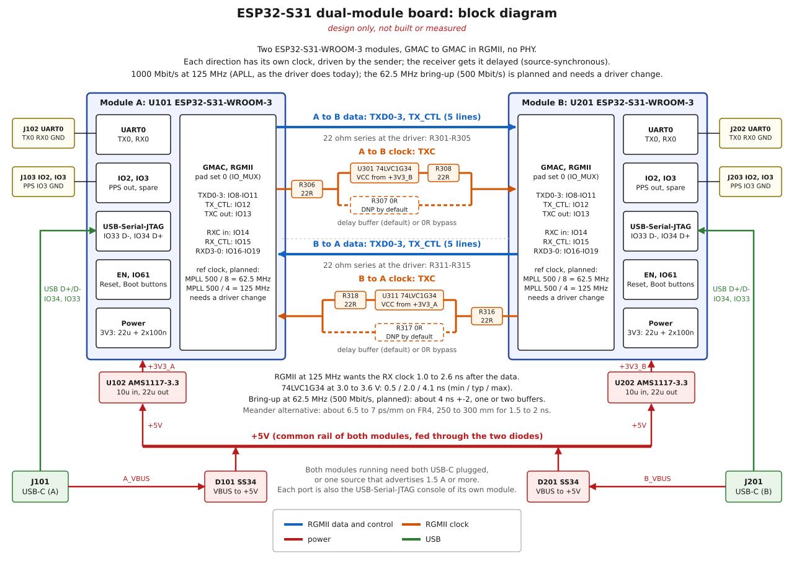
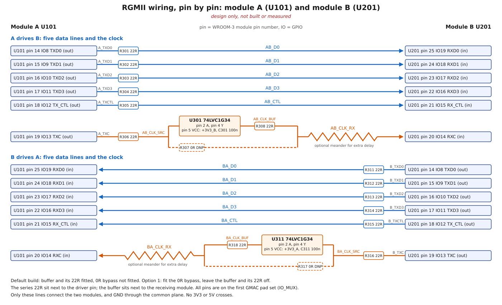

# Two ESP32-S31 modules, RGMII MAC to MAC

**Status: design only, not built or measured.** Nothing here has been fabricated, powered or
imported into KiCad. The numbers are from the ESP32-S31-WROOM-3 datasheet (v0.7, PRELIMINARY) and
from the 74LVC1G34 datasheet; the timing is a plan, not a result.

## Purpose

A small board with two ESP32-S31-WROOM-3 modules (A and B) whose GMACs are wired to each other in
RGMII, with no PHY between them. It gives a gigabit-class Ethernet link between two S31 chips for
tests that need no cable, no switch and no PHY: the Zephyr MAC driver, the PTP chain
(`apps/ptp_chain`) and frame-rate limits. The goal is a 125 MHz RGMII clock (1000 Mbit/s); the
driver makes it from the APLL today. Planned for bring-up: a 62.5 MHz clock (MPLL 500 MHz / 8,
500 Mbit/s), and the MPLL (500 MHz / 4) as the 125 MHz source. Both need a driver change, which is
not done.

The two-board jumper setups (MII at 100 Mbit/s, existing CoreBoards) are in
[S31 PHY-less Ethernet links](../../doc/dev/s31-link.md). This board is the dual-module design
that page points to.

## Files

| File | What it is |
| --- | --- |
| `gen_netlist.py` | The single source of truth: components and connections as data. Python 3 standard library only. |
| `s31-dual-rgmii.net` | KiCad netlist (s-expression, format E), written by the script. |
| `netlist.csv` | The same nets as `net,ref,pin,pinfunction` rows. |
| `bom.csv` | `refs,qty,value,footprint,lcsc,note`, grouped by value and footprint. |
| `block-diagram.svg`, `wiring-diagram.svg` | The two diagrams below: plain SVG, edited by hand, not generated by the script. |

The SVGs sit here, next to the generator, and the doc page embeds them by the relative path
`../../hw/s31-dual-rgmii/`. A Sphinx build of `doc/` copies them into `_images/` and reports no
warning for the page.

## Regenerate and check

```sh
python3 hw/s31-dual-rgmii/gen_netlist.py             # write the .net, netlist.csv and bom.csv
python3 hw/s31-dual-rgmii/gen_netlist.py --check     # regenerate in memory, compare, run the checks
python3 hw/s31-dual-rgmii/gen_netlist.py --selftest  # list the self-test mutations and what catches them
```

The output has no dates and the tstamps are `uuid5` of the reference, so a second run changes
nothing. `--check` exits 1 if a file differs from what the script writes, and also checks:

- no pin is in two nets, and no net (but the `unconnected-` ones) has fewer than two nodes;
- every pin of every component is connected or listed as no-connect, and the module pins are the
  99 pins of the datasheet;
- each data line (TXD0 to TXD3, TX_CTL: 5 per direction) leads from the driver's pad over one
  series resistor to the matching pad of the other module (TXD0 to RXD0 and so on). Together with
  TXC that is 6 RGMII lines per direction, 12 in all;
- the clock path of each direction is exact: TXC, 22 Ohm, `*_CLK_SRC`; then either the buffer
  (pin 2 A on `*_CLK_SRC`, pin 4 Y on `*_CLK_BUF`, VCC on the 3V3 of the receiving side, GND, its
  capacitor) and its 22 Ohm, or the 0 Ohm bypass between `*_CLK_SRC` and `*_CLK_RX`; `*_CLK_RX`
  holds nothing else but RXC of the receiver. By default the buffer path is fitted and the bypass
  is DNP;
- each side: the diode has its anode on VBUS and its cathode on `+5V`; the regulator runs from
  `+5V` into its own side's 3V3, which feeds the module's 3V3 pins; and no two-pin part joins two
  of `+5V`, `+3V3_A`, `+3V3_B`;
- the written `.net` parses back (a small s-expression parser) to the same components (value,
  footprint, LCSC, note, DNP) and nets;
- both SVGs exist, are well-formed XML and show every link net and link part by name (they do not
  compare pin numbers with the netlist);
- self-test: 17 mutations of the circuit (a swapped RX line, a reversed buffer, buffer VCC on the
  wrong side, a bypass in the wrong place, a reversed diode, a bridge between the 3V3 rails and so
  on) and 3 of the written `.net` text must each be reported. `--check` runs them; `--selftest`
  lists them.

`--check --footprints DIR` also compares every pin with the pads of the stock KiCad footprints in `DIR`
(the `footprints` directory of the KiCad library). The custom module footprint is not covered.

## Diagrams





## Circuit

Refs: side A in the 100s, side B in the 200s, the link parts in the 300s (A to B: 301 to 308,
B to A: 311 to 318).

**Per side** (X is 1 for A, 2 for B):

- `UX01` ESP32-S31-WROOM-3, footprint `esp-sdr:ESP32-S31-WROOM-3`. It is a custom footprint and
  must be drawn from the datasheet land pattern. The module has its own 40 MHz crystal, flash and
  PSRAM. The `USB_DP`/`USB_DM` pins (HS OTG, 40 and 41) stay open.
- `JX01` USB-C receptacle (GCT USB4105, 16 pins) for power and the USB-Serial-JTAG console: D+ to
  IO34 (pin 43), D- to IO33 (pin 42), CC1 and CC2 each 5.1 kOhm to GND, SBU1 and SBU2 open.
- `DX01` SS34 Schottky (3 A, SMA) from VBUS to the common `+5V` rail. Both modules share that
  rail, and no module is back-powered through the RGMII pads. Power: both modules running need
  both USB-C plugged (the load then splits by diode and cable drop, not evenly) or one source that
  advertises at least 1.5 A on CC. A single default source gives 500 mA or 900 mA, and the two
  modules ask for 2 x 0.6 A at least.
- `UX02` AMS1117-3.3 from `+5V` to `+3V3_A` or `+3V3_B`; 10 uF in, 22 uF and 2x 0.1 uF at the
  module (the datasheet's support circuit; it asks for a supply that delivers at least 0.6 A).
- EN: 10 kOhm to 3V3 and 1 uF to GND (the datasheet RC), `SWX01` to GND as reset. Boot: `SWX02`
  from IO61 (pin 71) to GND with a 10 kOhm pull-up; IO61 low at reset starts the download mode.
- `JX02` UART0 (TX0 pin 68, RX0 pin 69, GND) and `JX03` (IO2 pin 6, the PPS output of
  `apps/ptp_chain`; IO3 pin 7; GND), both 1x3 headers.

**RGMII, first pad set** (IO_MUX, fixed; the second set on GPIO36 to 47 is unusable because its
RXD0 is GPIO41, which the module does not bond out):

| Signal | GPIO | Module pin | Signal | GPIO | Module pin |
| --- | --- | --- | --- | --- | --- |
| TXD0 | 8 | 14 | RXC (in) | 14 | 20 |
| TXD1 | 9 | 15 | RX_CTL | 15 | 21 |
| TXD2 | 10 | 16 | RXD3 | 16 | 22 |
| TXD3 | 11 | 17 | RXD2 | 17 | 23 |
| TX_CTL | 12 | 18 | RXD1 | 18 | 24 |
| TXC (out) | 13 | 19 | RXD0 | 19 | 25 |

**Link, A to B** (B to A is the mirror, nets `BA_*`): each of TXD0 to TXD3 and TX_CTL of A goes
through a 22 Ohm 0402 resistor at the driver (`R301` to `R305`) to the same-named RX pad of B
(`AB_D0` to `AB_D3`, `AB_CTL`). TXC of A (pin 19) goes through `R306` (22 Ohm) to `AB_CLK_SRC`.
From there:

- **Option 2, delay buffer (default):** `U301` 74LVC1G34 (SOT-353: pin 2 A, pin 4 Y, pin 5 VCC
  from the receiving side's 3V3, 0.1 uF `C301`, pin 1 not connected), then `R308` (22 Ohm) to
  `AB_CLK_RX`.
- **Option 1, bypass:** `R307` (0 Ohm, not fitted by default) from `AB_CLK_SRC` straight to
  `AB_CLK_RX`.

`AB_CLK_RX` goes to RXC of B (pin 20). Route `AB_CLK_RX` (or the buffer output) with an optional
meander for extra delay.

The LCSC column of the BOM holds only the one number that was given: the 74LVC1G34GW clone from
MDD, C52140426. It is a clone with no timing data: prefer a Nexperia or TI original.

## Assembly options

| Option | Default | Other |
| --- | --- | --- |
| RX clock delay | buffer `U301`/`U311` and `R308`/`R318` fitted, `R307`/`R317` not fitted | fit `R307`/`R317` (0 Ohm), leave the buffer, its 22 Ohm and its capacitor off, and add the delay as trace length |
| RGMII clock | 62.5 MHz for bring-up (500 Mbit/s) | 125 MHz (1000 Mbit/s) |
| Power | both USB-C sockets, both Schottkys | one USB-C only if its source advertises 1.5 A or more (with 5.1 kOhm on CC the source decides the current) |
| Series resistors | 22 Ohm | tune at bring-up: 0 to 47 Ohm |

The delay budget (Nexperia 74LVC1G34, 3.0 to 3.6 V: 0.5 ns minimum, 2.0 typical, 4.1 maximum):

- At 125 MHz RGMII wants the RX clock 1.0 to 2.6 ns after the data. A buffer meets that for a
  typical part only; the spread covers more than the window.
- At 62.5 MHz the clock wants about 4 ns, plus or minus 2: one or two buffers are fine.
- A meander is the alternative: about 6.5 to 7 ps/mm on FR4, so 1.5 to 2 ns is about 250 to
  300 mm of trace.

## Layout rules

- Modules a few cm apart, the antenna ends over the board edge or clear of copper (datasheet
  keep-out).
- Each RGMII group (TXD0 to TXD3, TX_CTL, TXC) length-matched within about 5 mm.
- 50 Ohm single-ended on a solid GND plane, no stubs, no plane splits under the lines.
- The series resistor right next to the driver pin; the delay buffer near the receiver.
- The `AB_CLK_RX` and `BA_CLK_RX` routes are the ones that may carry a meander: leave room.
- `UX02` needs copper area: at 0.6 A from 5 V it burns about 1 W.

## Bring-up

1. Before power: continuity from GND to the pads and between the rails, check that `R307` and
   `R317` are not fitted.
2. Power from both USB-C sockets (or one source that advertises 1.5 A or more), measure `+5V`,
   `+3V3_A`, `+3V3_B` and the voltage drop across the diodes under load.
3. Flash each module over its own USB-C (USB-Serial-JTAG) or the UART0 header.
4. Run the MAC at a 62.5 MHz clock and 500 Mbit/s (planned, needs the driver change), count
   frames and the CRC and alignment errors of the driver (they point at RGMII timing). Look at TXC and a data line at the receiving
   module with a scope: the clock edge belongs in the middle of the data eye.
5. Move to 125 MHz. If the window is missed, fit the bypass and meander, or change the series
   resistors.
6. Run `apps/ptp_chain` between the two modules; the PPS output is IO2 on the `JX03` headers.

## Zephyr side

- The two modules are two builds of the same image; each sees an `ethernet-phy-fixed-link` PHY
  (`phy_fixed_link.c`) with `default-speeds = "1000BASE Full-Duplex"` and
  `phy-connection-type = "rgmii"`. There is no MDIO.
- The pads are the ones the CoreBoard's YT8531 uses (GPIO8 to GPIO19), so the existing RGMII path
  of `drivers/ethernet/dwc_mac/eth_esp32_dwc_ether_1000.c` and the pinctrl of the CoreBoard apply.
- The driver takes the RGMII reference clock from the APLL today
  (`CONFIG_ETH_ESP32_DWC_RGMII_REF_MHZ`, multiples of 25 MHz up to 125). 125 MHz needs no change.
  This design plans the MPLL as the source (500 MHz, divider 4 for 125 MHz, 8 for 62.5 MHz);
  that and the 62.5 MHz bring-up clock are planned and need a driver change. Not done.

## Open risks

- **Timing.** The buffer delay has a 0.5 to 4.1 ns spread against a 1.6 ns window at 125 MHz.
  Whether the S31 GMAC adds its own clock delay in RGMII mode was not checked. 62.5 MHz is the
  fallback.
- **Pad voltage.** The module pads run at 3.3 V; RGMII is specified at 2.5 V and 1.8 V. The
  CoreBoard's YT8531 link runs this way, a MAC-to-MAC link at 125 MHz has not been tried.
- **DNP.** The netlist writes DNP as a user field (`DNP` = `yes`, and the BOM note), not as
  KiCad's own DNP flag, whose version E syntax could not be confirmed. After importing the netlist
  into KiCad, set `R307` and `R317` to DNP by hand.
- **KiCad parts.** The netlist was not imported into KiCad. The USB-C pad names match the stock
  GCT footprint in the library on the author's machine (`--footprints`). The module footprint is
  still to be drawn, and the symbols named in the `libsource` fields are placeholders.
- **AMS1117 headroom.** Its dropout is 1.1 to 1.3 V near 1 A. From a USB 5 V that may sag to
  4.75 V, minus about 0.5 V across the diode, minus the dropout leaves 2.95 to 3.15 V, under 3.3 V
  (arithmetic, not measured): a module drawing 0.6 A or more can pull the 3V3 rail out of
  regulation, and the regulator burns about 1 W. A low-dropout regulator or a buck converter is
  the alternative. The AMS1117 also needs an output capacitor with some ESR: `C102`/`C202` are
  tantalum or polymer, since a ceramic-only output can oscillate.
- **USB power.** Two modules at 0.6 A each exceed what a default USB source offers (500 mA, or
  900 mA on USB 3). See the Power line in the circuit and assembly sections.
- **USB.** No ESD protection on the data lines. Two USB-C ports into two hosts tie those hosts'
  grounds together.
- **Strapping.** IO36 (pin 45) is pulled up inside the module; the board leaves IO36, IO37 and
  IO60 open and uses IO61 for the boot button only.

## Not in this design

A variant with two bare ESP32-S31 chips instead of modules would remove the clock problem: one
shared 40 MHz oscillator into both chips (the datasheet allows an active oscillator on XTAL_P with
XTAL_N floating), and a Si5351A or MS5351M that makes phase-tunable 125 MHz RX clocks, programmed
by chip A after boot. Chip A could then calibrate the delay itself by counting CRC errors while
it sweeps the phase. Two chips on one oscillator are also frequency-locked, which helps two
radios that must share a clock. The modules cannot do this, because their crystal is inside.
